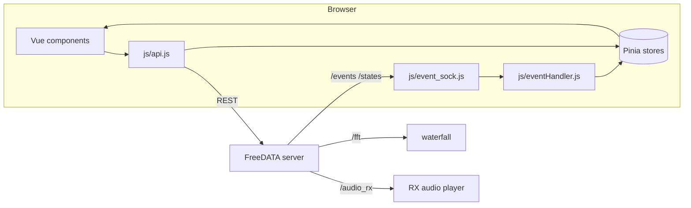

# FreeDATA GUI — Developer Documentation

`freedata_gui` is the browser front end of FreeDATA: a Vue 3 single-page app (Pinia stores,
Bootstrap 5, gridstack dashboard, Chart.js, d3) built with Vue CLI. The production build in `dist/`
is served by the FreeDATA server at `/gui`. The GUI talks to the server over REST and four
WebSocket streams.

These documents describe the code as it currently is, based on reading the source, including the
bug fixes made after the first version of these docs (REST no longer gated on the WebSocket state,
API error toasts, config load/save fixes, preset validation, scheduled RX audio playback, UTF-8
broadcasts with a size limit, and more). Each one ends with the known issues that are still open. For the server side, see
[freedata_server/docs](../../freedata_server/docs/README.md).

## Contents

| Document | Covers |
|---|---|
| [architecture.md](architecture.md) | Tech stack and build, app startup, how the GUI finds the server, WebSocket connections and event routing, Pinia stores, `api.js` reference, cross-check of every API call against the server |
| [screens-and-settings.md](screens-and-settings.md) | Screen navigation, startup check, modals, every settings page mapped to its config key, footer and navbar indicators |
| [dashboard-grid.md](dashboard-grid.md) | Gridstack dashboard and widget registry, layout persistence and presets, waterfall, RX audio playback, charts and meters, station map, control widgets |
| [chat-and-broadcasts.md](chat-and-broadcasts.md) | Chat conversations and messages, attachments, Markdown rendering and sanitisation, broadcasts and METAR, payload cross-check against the server |

## Big picture



- **REST** ([api.js](../src/js/api.js)): commands and data (config, messages, broadcasts, radio,
  modem control). The server address is always the page's own host; see
  [architecture.md](architecture.md#3-finding-the-server).
- **WebSockets** ([event_sock.js](../src/js/event_sock.js)): `/states` and `/events` feed the stores
  through [eventHandler.js](../src/js/eventHandler.js), `/fft` feeds the waterfall, and `/audio_rx`
  carries RX audio.
- **Settings**: `settings.remote` mirrors the server config and is posted to `/config` when a
  setting changes (never before it has been loaded from the server). `settings.local` (dashboard
  layout, theme, language) stays in the browser's `localStorage`.

## Development

```bash
npm install
npm run serve     # dev server
npm run build     # production build into dist/
npm run lint      # eslint
```

When the dev server runs on port 8080, the GUI connects to the FreeDATA server on port 5000 on the
same host. `npm run build` runs `npm i` first. `npm run lint` runs `npx eslint .` (no `--fix`).
See [architecture.md](architecture.md#1-tech-stack-and-build) for details.

## Reading order for new contributors

1. [architecture.md](architecture.md): how data gets from the server into components.
2. [screens-and-settings.md](screens-and-settings.md): the app shell and configuration.
3. [dashboard-grid.md](dashboard-grid.md) or [chat-and-broadcasts.md](chat-and-broadcasts.md),
   depending on the feature you're working on.
