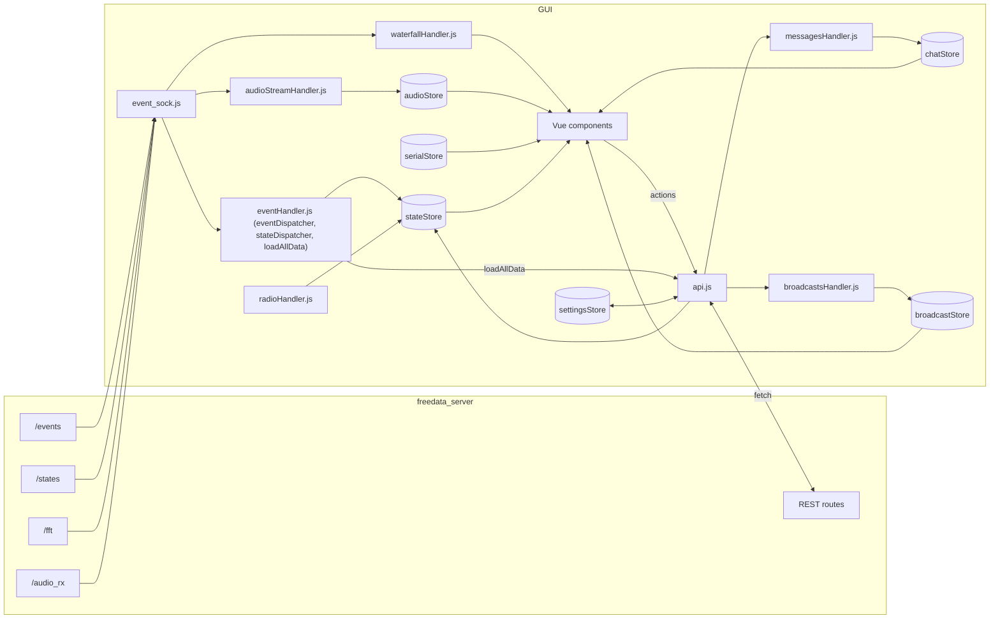

# FreeDATA GUI architecture

This page covers how the Vue 3 GUI is built, how it boots, how it finds and talks to the FreeDATA server (REST and WebSocket), the shared state stores, and where the GUI and the server disagree.

Server-side reference: [freedata_server/docs/api.md](../../freedata_server/docs/api.md). Component-level docs live next to this file (for example [dashboard-grid.md](dashboard-grid.md) and [screens-and-settings.md](screens-and-settings.md)).

---

## 1. Tech stack and build

### 1.1 Runtime dependencies

From [package.json](../package.json). "Used in" lists the files that import the package (found by grepping `src/`).

| Package | Used for | Used in |
|---|---|---|
| `vue` | UI framework (Vue 3, Composition API and `<script setup>`) | everywhere |
| `pinia` | State stores | [src/store/](../src/store/), most components |
| `i18next`, `i18next-vue` | Translations, `$t()` in templates | [i18n.js](../src/js/i18n.js), [main.js](../src/main.js) |
| `bootstrap` | CSS, plus JS `Tooltip`, `Popover`, `Toast`, `Modal` | [App.vue](../src/App.vue), [popupHandler.js](../src/js/popupHandler.js), components |
| `bootstrap-icons` | Icon font (`bi-*` classes) | [App.vue](../src/App.vue) |
| `@popperjs/core` | Not imported directly. Peer dependency of Bootstrap's tooltips/popovers | none |
| `chart.js`, `vue-chartjs` | Charts (speed, SNR, scatter, beacon history). `Filler` is registered globally in `main.js` | `chat_screen.vue`, `grid_active_stats.vue`, `grid_scatter.vue`, `grid_stats_chart.vue`, `main_modals.vue` |
| `chartjs-plugin-annotation` | Chart annotations | `chat_screen.vue` |
| `gridstack` | Draggable dashboard grid | `dynamic_components.vue` |
| `d3`, `topojson-client` | Station map rendering | `grid_stations_map.vue` |
| `qth-locator` | Maidenhead locator to lat/lon and distance | `grid_stations_map.vue`, `grid_active_heard_stations.vue` |
| `marked` | Markdown rendering of chat/broadcast text | chat and broadcast message components |
| `dompurify` | Sanitising user input / rendered HTML | chat and broadcast components |
| `js-image-compressor` | Shrinking image attachments before sending | `chat_new_message.vue` |
| `vuemoji-picker` | Emoji picker | `chat_new_message.vue`, `broadcast_new_message.vue` |
| `uuid` | Unique DOM ids for toasts (`v4()`), version `^14` | [popupHandler.js](../src/js/popupHandler.js) |

### 1.2 Dev dependencies and scripts

Dev dependencies: `@vue/cli-service` (webpack build and dev server), `eslint`, `eslint-plugin-vue`, `globals`.

| Script | Command | Notes |
|---|---|---|
| `npm run serve` | `vue-cli-service serve` | Dev server with hot reload. Vue CLI's default port is 8080, which the URL logic in 3 relies on |
| `npm run build` | `npm i && vue-cli-service build` | Runs `npm i` first, then writes the production bundle to `dist/` |
| `npm run lint` | `npx eslint .` | Uses [eslint.config.js](../eslint.config.js) |

After the current round of bug fixes (working tree), `npm run build` and `npx eslint .` both completed without errors. The development commands in [README.md](README.md#development) (`npm install`, `npm run serve`, `npm run build`, `npm run lint`) match the scripts above. The top-level [../README.md](../README.md) lists the same commands; its heading "Lints and fixes files" overstates `npm run lint`, which does not pass `--fix`.

### 1.3 Build configuration

- [vue.config.js](../vue.config.js): `publicPath: "/gui/"`, so every asset URL in the built `index.html` is prefixed with `/gui/`. `transpileDependencies` is empty.
- There is no Babel step: `@vue/cli-plugin-babel` is not installed (removed in commit `d4ccda12`, "adjusted linting packages"), and the leftover `babel.config.js`, `core-js` and the Babel packages have been removed. Code is bundled by webpack as written, so `browserslist` in `package.json` has no effect on JS transpilation.
- [jsconfig.json](../jsconfig.json) declares the `@/* -> src/*` alias for editors. The webpack alias itself comes from Vue CLI's defaults, and code uses it (`@/js/i18n`, `@/js/api`, `@/js/mobile_devices`).
- [public/index.html](../public/index.html): favicons, `manifest.json` link, iOS web-app meta tags, and an inline script that writes `window.visualViewport.height` (or `innerHeight`) into the CSS variable `--app-height` on resize, orientation change and `DOMContentLoaded`.
- [public/manifest.json](../public/manifest.json): PWA manifest (`display: standalone`, `start_url: "."`, 192/512 px icons). No service worker is registered.
- [src/styles.css](../src/styles.css): global styles. Disables body scrolling, applies safe-area insets, centres text in progress bars, sticky table headers, emoji-picker sizing and a `.force-gpu` helper.

### 1.4 Linting

[eslint.config.js](../eslint.config.js) uses only `eslint-plugin-vue`'s `flat/base` config (`flat/recommended` is commented out because of unresolved errors). Two rules are set: `vue/no-unused-vars: error`, `vue/multi-word-component-names: warn`. Browser globals are enabled. No JavaScript rule set (such as `@eslint/js`) is applied. The `ignores` list sits in the same object as `rules`, so in flat config it only limits that object; it is not a global ignore.

### 1.5 How the server serves the build

[server.py](../../freedata_server/server.py) mounts the first existing directory of this list at `/gui` with `StaticFiles(html=True)`:

1. `<freedata_server>/gui` (Nuitka standalone build)
2. `<freedata_server>/../freedata_gui/dist` (pip install / repo layout)
3. `../freedata_gui/dist`, `freedata_gui/dist`, `FreeDATA/freedata_gui/dist` (cwd-relative fallbacks)

If none exists, the server logs a warning and runs API-only. When a GUI directory exists and `GUI.auto_run_browser` is true, `main()` opens `http://<modemaddress>:<modemport>/gui` after 2 s. The GUI build's `publicPath: "/gui/"` matches this mount point.

---

## 2. App bootstrap

### 2.1 [main.js](../src/main.js)

1. `Chart.register(Filler)` (global Chart.js plugin).
2. `createApp(App)`, `app.use(I18NextVue, { i18next })`.
3. `app.use(pinia)` with the shared instance from [store/index.js](../src/store/index.js), then `app.mount("#app")`.
4. Local (browser) settings are applied straight away, without waiting for the server:
   - `i18next.changeLanguage(settings.local.language)`,
   - `applyColorMode(settings.local.colormode)` (sets `data-bs-theme` on `<html>`; `"auto"` follows `prefers-color-scheme`, `""` becomes `light`).
5. `getRemote().finally(() => initConnections())`: load the server config (GET only), then open the four WebSockets whether or not the load succeeded. `getModemState()` is no longer called here; opening the `/states` socket runs `loadAllData()`, which fetches it.

There is a single Pinia instance. [store/index.js](../src/store/index.js) creates it, `main.js` installs it into the app, and every JS module (`api.js`, `eventHandler.js`, `event_sock.js`, `stationHandler.js`, other handlers) and every component calls `setActivePinia(pinia)` / `useXStore(pinia)` with the same object.

### 2.2 [App.vue](../src/App.vue)

Imports `styles.css`, Bootstrap CSS and Bootstrap Icons. Renders `<Suspense>` with `main_screen.vue` (async component) as default and `main_loading_screen.vue` as fallback. On mount it:

- sets `<html lang>` to `i18next.language` and keeps it in sync through i18next's `languageChanged` event (the listener is removed on unmount);
- sets `data-bs-theme="light"` only if no theme is set yet (`applyColorMode()` in `main.js`, called right after mount, sets the stored colour mode);
- creates the delegated Bootstrap `Tooltip` on `document.body` and the delegated `Popover` on `document.documentElement` (`<html>`). Bootstrap allows one component instance per element, so the two delegates live on different elements. These two delegates are the only tooltip/popover set-up in the app; components no longer create their own.

### 2.3 i18n ([i18n.js](../src/js/i18n.js))

- `require.context("../locales", true, /[A-Za-z0-9-_,\s]+\.json$/i)` bundles every JSON file in [src/locales/](../src/locales/) at build time.
- Each key is matched with `/\.\/([^_]+)_([^.]+)\.json$/i`: the part before the first `_` is the language code, the rest is the display name. Files that do not match are skipped.
- Each file becomes `resources[iso] = { translation: <json> }` and is pushed to the exported `availableLanguages` array (`{iso, name}`), which the GUI settings use for the language picker.
- `i18next.init({ lng: "en", fallbackLng: "en", resources })`. `main.js` then switches to `settings.local.language`.

Current locale files:

| File | Code | Name |
|---|---|---|
| `cz_Čeština.json` | `cz` | Čeština |
| `de_Deutsch.json` | `de` | Deutsch |
| `en_English.json` | `en` | English |
| `it_Italiano.json` | `it` | Italiano |
| `nl_Nederlands.json` | `nl` | Nederlands |
| `no_Norsk.json` | `no` | Norsk |

To add a language, drop a `<code>_<Name>.json` file into `src/locales/` and rebuild. The code is used as-is (Czech uses `cz`, not the ISO 639-1 `cs`).

---

## 3. Finding the server

The GUI always talks to the host it was loaded from. There is no configurable server address: `settingsStore.local.host` and `settingsStore.local.port` exist in the defaults but nothing reads them.

REST ([api.js](../src/js/api.js), `buildURL`):

```js
const { protocol, hostname, port } = window.location;
const adjustedPort = port === "8080" ? "5000" : port;
return `${protocol}//${hostname}:${adjustedPort}${endpoint}`;
```

WebSocket ([event_sock.js](../src/js/event_sock.js), `connect`):

```js
const wsProtocol = protocol === "https:" ? "wss:" : "ws:";
const adjustedPort = port === "8080" ? "5000" : port;
new WebSocket(`${wsProtocol}//${hostname}:${adjustedPort}/${endpoint}`);
```

Consequences:

- In production the page is `http://host:5000/gui/`, so calls go to `http://host:5000/...`.
- In development (`npm run serve` on port 8080) calls are redirected to port 5000 on the same hostname. If Vue CLI falls back to another port (8081, ...), or the server runs on a port other than 5000, the dev GUI cannot reach it. There is no dev-server proxy in `vue.config.js`; CORS on the server (`allow_origins=["*"]`) makes the cross-port calls work.
- Behind a reverse proxy on a default port, `window.location.port` is `""` and the URL becomes `http://host:/...`, which browsers treat as the default port.

---

## 4. Data flow



---

## 5. WebSocket connections ([event_sock.js](../src/js/event_sock.js))

`initConnections()` opens four sockets, each with its own dispatcher:

| Endpoint | Dispatcher | Frame format | Notes |
|---|---|---|---|
| `/states` | `stateDispatcher` ([eventHandler.js](../src/js/eventHandler.js)) | JSON text | Modem and radio state snapshots |
| `/events` | `eventDispatcher` ([eventHandler.js](../src/js/eventHandler.js)) | JSON text | PTT, scatter, modem lifecycle, ARQ, frames, logging, DB changes |
| `/fft` | `addDataToWaterfall` ([waterfallHandler.js](../src/js/waterfallHandler.js)) | JSON array text | `JSON.parse`, ignored unless an array, then `addData()` on every registered `Spectrum` instance |
| `/audio_rx` | `addDataToAudio` ([audioStreamHandler.js](../src/js/audioStreamHandler.js)) | binary | `binaryType = "arraybuffer"` (set for any endpoint containing `"audio"`). Wrapped as `Int16Array`, copied, pushed into `audioStore`'s ring buffer |

Per-socket handlers:

- **open**: logs. Only the `/states` socket then sets `stateStore.modem_connection = "connected"` and calls `loadAllData()`, so a fresh start or a server restart loads the data once, not once per socket.
- **message**: `dispatcher(event.data)`.
- **error**: `connectionFailed(endpoint, event)` sets `stateStore.modem_connection = "disconnected"` only for the control sockets (`states`, `events`). Errors on `/fft` or `/audio_rx` are logged and do not change the connection state.
- **close**: logs the code and calls `connect(endpoint, dispatcher)` again after a fixed 1000 ms. No backoff, no cap; each socket reconnects independently.

`modem_connection` is a display value (navbar, startup check, `getOverallHealth()`). REST calls in `api.js` do not depend on it (see 7.1).

### 5.1 `loadAllData()`

Runs when the `/states` socket opens, on `hello-client` (never sent, see 8.4), on modem `started`/`restarted` events, and on clicks in the left navbar.

1. `await getModemState()` (`GET /modem/state`). The return value is only logged. Its useful side effect is that the server pushes a full `state` frame to every `/states` client.
2. `getSysInfo()` -> `stateStore.api_version`, `modem_version`, `os_info`, `python_info`.
3. `audioStore.loadAudioDevices()`, `serialStore.loadSerialDevices()`.
4. `await getRadioStatus()` (result discarded).
5. `getRemote()` (config reload, `GET /config` only, see 6.7).
6. `getOverallHealth()` (result discarded).
7. `getFreedataMessages()` -> chat store.
8. `getFreedataDomains()`, `getFreedataBroadcastsPerDomain(broadcast.selectedDomain)` -> broadcast store.
9. `processRadioStatus()` -> another `GET /radio` and writes `mode`, `frequency`, `rf_level`, `tuner`.

### 5.2 `/states` handling (`stateDispatcher`)

| `type` | stateStore fields written |
|---|---|
| `state` or `state-change` | `modem_connection = "connected"`, `busy_state <- is_modem_busy`, `channel_busy <- channel_busy` (`true` while the channel is busy), `is_codec2_traffic`, `is_modem_running`, `dbfs_level = round(audio_dbfs)`, `dbfs_level_percent = round(10^(audio_dbfs/20) * 100)`, `radio_status`, `channel_busy_slot`, `beacon_state <- is_beacon_running`, `away_from_key <- is_away_from_key`, `activities = Object.entries(activities).reverse()`, then `build_HSL()` merges received activities into `heard_stations` (one entry per `origin`, newest timestamp wins, sorted newest first) |
| `radio-change` or `radio` | `s_meter_strength_raw = round(s_meter_strength)`, `s_meter_strength_percent = round(10^(s/20) * 100)`, `radio_status`, `frequency <- radio_frequency`, `mode <- radio_mode`, `swr_raw = radio_swr.toFixed(2)`, `swr_percent = swr/6*100` if `0 <= swr <= 6` else `0`, `tuner <- radio_tuner`, `rf_level = round(radio_rf_level/5)*5` |

Other `type` values are ignored.

### 5.3 `/events` handling (`eventDispatcher`)

Checked in this order; the first match returns.

| Match | Action |
|---|---|
| `data.scatter !== undefined` | `stateStore.scatter = JSON.parse(data.scatter)` |
| `data["message-db"] === "changed"` | `getFreedataDomains()`, `getFreedataBroadcastsPerDomain(selectedDomain)`, `getFreedataMessages()` (which also updates the chat store). `message_id` is ignored |
| `data.ptt` is `true`/`false` | `stateStore.ptt_state = data.ptt` |
| `data.freedata_server ?? data.modem` is `started` / `stopped` / `restarted` / `failed` | Toasts; `started` and `restarted` also call `loadAllData()`. The server sends `{"freedata_server": ...}`; the `modem` key is kept for older servers |
| `type: "hello-client"` | Toast "connected to server", `modem_connection = "connected"`, `loadAllData()`. **The server never emits `hello-client`** |
| `type: "message-logging"` with `endpoint` `wavelog` or `udp` | Success or warning toast with `data.message` (escaped) |
| `type: "frame-handler"`, `received` = `CQ`, `QRV`, `PING`, `PING_ACK` | Toast with `dxcallsign`, `snr` and (except PING) `gridsquare`, all escaped. Other frame types are logged as `unknown event data received: <received>`. No store writes |
| `type: "arq"` with `arq-transfer-outbound` | See table below. Sets `arq_is_receiving = false` first |
| `type: "arq"` with `arq-transfer-inbound` | See table below. Sets `arq_is_receiving = true` first |

`buffer-overflow` events and any custom events are not handled.

ARQ outbound states (`d = data["arq-transfer-outbound"]`):

| `state` | Toast | stateStore writes |
|---|---|---|
| `NEW` | yes | `dxcallsign = d.dxcall`, `arq_transmission_percent = 0`, `arq_total_bytes = d.total_bytes` |
| `OPEN_SENT` | yes | none |
| `INFO_SENT`, `ABORTING` | no (console only) | none |
| `BURST_SENT` | yes | `arq_transmission_percent = round(received_bytes/total_bytes*100)`, `arq_total_bytes`, `arq_speed_list_timestamp/bpm/snr = statistics.*_histogram` (the arrays are replaced), `arq_bytes_per_minute`, `arq_bits_per_second`, `speed_level` |
| `ABORTED` | yes | percent, total bytes, bytes/min, bits/s reset to 0 |
| `ENDED` | yes | `arq_transmission_percent = 100` (finished events carry no `received_bytes`/`total_bytes`; `ENDED` means success), `arq_total_bytes = d.statistics.total_bytes`, `arq_bytes_per_minute`, `arq_bits_per_second` from `statistics`; all four reset to 0 after 5 s |
| `FAILED` | yes | the same four reset to 0 after 5 s |

ARQ inbound states (`d = data["arq-transfer-inbound"]`):

| `state` | Toast | stateStore writes |
|---|---|---|
| `NEW` | yes | `dxcallsign`, `arq_transmission_percent = 0`, `arq_total_bytes = d.total_bytes` |
| `OPEN_ACK_SENT`, `INFO_ACK_SENT` | yes | `arq_transmission_percent`, `arq_total_bytes = d.total_bytes` |
| `BURST_REPLY_SENT` | yes | percent, `arq_total_bytes = d.received_bytes` (not `total_bytes`), `arq_speed_list_*` arrays replaced from `statistics.*_histogram`, bytes/min, bits/s, `speed_level` |
| `ENDED` | yes | `arq_transmission_percent = 100`, bytes/min, bits/s, `arq_total_bytes = d.statistics.total_bytes`; all reset after 5 s |
| `ABORTED` | yes | percent and total bytes set to 0 |
| `FAILED` | yes | four values reset after 5 s |

### 5.4 Toasts ([popupHandler.js](../src/js/popupHandler.js))

`displayToast(type, icon, content, duration)` appends Bootstrap toast markup to `#mainToastContainer` with `insertAdjacentHTML`, shows it and removes it from the DOM when hidden. If the container does not exist yet, the toast is dropped with a console warning. `content` is still inserted as HTML, so callers must escape untrusted text. `popupHandler.js` exports `escapeHtml(value)` for that (escapes `& < > " '`; `null`/`undefined` become `""`). The event handlers in `eventHandler.js` escape every server field they interpolate (`dxcallsign`, `gridsquare`, `snr`, `session_id`, byte counts, `state`, `data.message`, `data.endpoint`), and so do the API error toasts (7.1) and the attachment toasts in `chat_new_message.vue`.

---

## 6. Stores

All stores except settings are Pinia setup stores. "Writers" and "Readers" are from grepping `src/`. Fields with no reader outside the store are marked *unused*.

### 6.1 `stateStore` ([stateStore.js](../src/store/stateStore.js))

| Field | Default | Meaning | Writers | Readers |
|---|---|---|---|---|
| `modem_connection` | `"disconnected"` | Server reachability as seen by the `/states` and `/events` sockets. Used by the UI (badges, disabled nav items); REST calls are not gated on it | event_sock.js (`/states` open), eventHandler.js (state frames, `states`/`events` socket errors, hello) | navbar/footer, startup check, `getOverallHealth()` |
| `is_network_traffic` | `false` | At least one REST call is in flight (reference-counted in api.js) | api.js | `main_left_navbar.vue` |
| `busy_state` | | `is_modem_busy` | stateDispatcher | components |
| `is_modem_running` | | modem started | stateDispatcher, `getOverallHealth` (sets false when disconnected) | components |
| `radio_status` | `false` | rig connected | stateDispatcher, `getOverallHealth` | components |
| `channel_busy_slot` | 5 x `false` | per-slot busy | stateDispatcher | components |
| `channel_busy` | `false` | `true` while the channel is busy (server `channel_busy`) | stateDispatcher | *unused* |
| `is_codec2_traffic` | `""` | codec2 traffic detected | stateDispatcher | `grid_active_stats.vue` |
| `dbfs_level`, `dbfs_level_percent` | `0` | RX audio level | stateDispatcher | audio meters |
| `beacon_state`, `away_from_key` | `false` | beacon flags | stateDispatcher | beacon controls |
| `activities` | `[]` | `[id, activity]` pairs, newest first | stateDispatcher | `grid_activities.vue` |
| `heard_stations` | `[]` | derived from activities by `build_HSL` | stateDispatcher | heard-stations grids, station map |
| `frequency`, `mode`, `rf_level`, `tuner` | `0`, `"-"`, `10`, | radio values | stateDispatcher, radioHandler.js | rig control widgets |
| `new_frequency` | `14093000` | frequency input field | components | rig control widgets |
| `s_meter_strength_raw/percent`, `swr_raw`, `swr_percent` | `0` | radio meters | stateDispatcher | S-meter, SWR meter |
| `ptt_state` | `false` | PTT | eventDispatcher | PTT widgets |
| `scatter` | `[]` | constellation points | eventDispatcher | `grid_scatter.vue`, `grid_active_stats.vue` |
| `dxcallsign` | `""` | peer of current ARQ session | eventDispatcher | footer, modals |
| `arq_is_receiving` | `false` | direction of current ARQ | eventDispatcher | components |
| `arq_transmission_percent`, `arq_total_bytes`, `arq_bytes_per_minute`, `arq_bits_per_second`, `speed_level` | | ARQ progress | eventDispatcher | footer/stats |
| `arq_speed_list_timestamp/bpm/snr` | `[]` | ARQ histograms | eventDispatcher (replaces the arrays on `BURST_SENT` / `BURST_REPLY_SENT`) | `grid_active_stats.vue`, `grid_stats_chart.vue` (plain arrays, read inside `computed` chart data) |
| `arq_seconds_until_timeout`, `..._percent` | | marked TODO-remove | nobody | `main_footer_navbar.vue` |
| `api_version`, `modem_version`, `os_info`, `python_info` | | `/version` data | eventHandler.js, `main_startup_check.vue` | about/startup screens |
| `hamlib_status` | `""` | | nobody | `dynamic_components.vue`, `grid_active_rig_control.vue` |
| `arq_state`, `bandwidth`, `fft`, `tx_audio_level`, `rx_audio_level`, `alc`, `audio_recording`, `arq_session_state`, `arq_seconds_until_finish`, `rigctld_started`, `rigctld_process`, `rx_buffer_length`, `modemStartCount` | | legacy | nobody | *unused* |

### 6.2 `chatStore` ([chatStore.js](../src/store/chatStore.js))

| Field | Meaning | Writers | Readers |
|---|---|---|---|
| `callsign_list` | `{callsign: {timestamp, body, unread_messages}}`, newest first | messagesHandler.js | chat list |
| `sorted_chat_list` | `{callsign: [messages]}` | messagesHandler.js | chat screens; `deleteCallsignFromDB` |
| `totalUnreadMessages` | unread count over all messages | messagesHandler.js | navbars |
| `selectedCallsign` | open conversation; auto-set to the first callsign on desktop | messagesHandler.js, components | chat components |
| `loading` | `GET /freedata/messages` in flight | api.js | chat components |
| `messageInfoById` | message detail for the info modal | messagesHandler.js, `chat_messages_*.vue` | `main_modals.vue` |
| `newChatCallsign`, `newChatMessage`, `inputText` | form inputs | components | components |
| `scrollTrigger`, `triggerScrollToBottom()` | counter watched to scroll | messagesHandler.js | chat components |
| `beaconDataArray`, `beaconLabelArray` | beacon SNR chart for the selected callsign | `loadBeaconData()` in messagesHandler.js (called from `chat_conversations.vue`, `chat_screen.vue` and the desktop auto-select) | `main_modals.vue` (`#deleteChatModal`) |
| `arq_speed_list_*`, `chartSpeedPER0/25/75`, `sorted_beacon_list`, `unsorted_beacon_list` | legacy | nobody | *unused* |

### 6.3 `broadcastStore` ([broadcastStore.js](../src/store/broadcastStore.js))

| Field | Meaning | Writers | Readers |
|---|---|---|---|
| `domains` | result of `GET /freedata/broadcasts/domains` | broadcastsHandler.js (`setDomains`) | domain list |
| `totalUnreadMessages` | sum of `unread_count` over domains | broadcastsHandler.js | navbars |
| `selectedDomain` | current domain | components, `deleteBroadcastDomainFromDB` | eventHandler.js, components |
| `domainBroadcasts` | result of `GET /freedata/broadcasts/{domain}/` | broadcastsHandler.js | `broadcast_messages.vue` |
| `loading` | broadcast request in flight | api.js | components |
| `inputText`, `newDomain`, `newMessageType`, `selectedMessage` | form/selection state | components | components |
| `newPriority` | | nobody | *unused* |
| `scrollTrigger`, `triggerScrollToBottom()` | scroll trigger | broadcastsHandler.js | components |

### 6.4 `audioStore` ([audioStore.js](../src/store/audioStore.js))

| Field / function | Meaning | Writers | Readers |
|---|---|---|---|
| `audioInputs`, `audioOutputs` | device lists from `GET /devices/audio`; fallback `skel` entry ("No devices received from modem") on error or empty list | `loadAudioDevices()` (called by `loadAllData`, startup check, modem settings) | settings, startup check |
| ring buffer (`addBlock`, `getNextBlock`, `resetBuffer`) | 1024-block ring buffer of `Int16Array` RX audio; overwrites the oldest when full | audioStreamHandler.js (`addBlock`) | `grid_audio.vue` (`resetBuffer` on Start, `getNextBlock` while playing) |
| `rxStream` | legacy array | nobody | *unused* |

### 6.5 `serialStore` ([serialStore.js](../src/store/serialStore.js))

`serialDevices`: list from `GET /devices/serial`, with a fallback entry on error/empty, and always an extra `{description: "-- ignore --", port: "ignore"}`. Written by `loadSerialDevices()`; read by the hamlib, flrig and serial PTT settings and the startup check.

### 6.6 `stationStore` ([stationStore.js](../src/store/stationStore.js))

`stationInfo`: `{callsign, location: {gridsquare}, info: {name, city, age, radio, antenna, email, website, socialMedia: {...}, comments}}`. Written by `getStationInfoByCallsign()` ([stationHandler.js](../src/js/stationHandler.js)), which resets it to defaults when the server returns nothing. Edited and saved from `main_modals.vue` via `setStationInfoByCallsign()`. `stationHandler.js` uses the shared `pinia` like the other modules.

### 6.7 `settingsStore` ([settingsStore.js](../src/store/settingsStore.js))

Not a Pinia store: a module-level `reactive({ local, remote })`.

- **`local`** (browser-only): `host`, `port` (unused), `spectrum`, `wf_theme`, `enable_sys_notification`, `grid_layout`, `grid_preset`, `grid_enabled`, `language`, `colormode`. Loaded from `localStorage["localConfig"]` and deep-merged over the defaults, so keys added in newer versions get their default value for existing users. Unparseable stored data falls back to the defaults. A deep watcher writes it back to `localStorage` on every change (write errors are caught and logged).
- **`remote`**: mirror of the server's config (`AUDIO`, `MODEM`, `NETWORK`, `RADIO`, `RIGCTLD`, `FLRIG`, `STATION`, `MESSAGES`, `SOCKET_INTERFACE`, `QSO_LOGGING`, `GUI`, `EXP`). Starts as a deep copy of the defaults, so the defaults object itself is never modified. `STATION.callsign_blacklist` is kept as a newline-separated string for the textarea.

| Function | Behaviour |
|---|---|
| `getRemote()` | `GET /config` only, never POSTs. On success stores the config, joins `callsign_blacklist` into a string and marks the config as loaded. On failure keeps the current values (the defaults until the first successful load) |
| `onChange()` | If no config has been loaded from the server yet, shows a warning toast, does not POST and calls `getRemote()` instead, so the GUI defaults can never overwrite the server config. Otherwise works on a deep copy of `remote`: splits the blacklist string back into an array, `POST /config` with the copy, and on success replaces `remote` with the response. On failure (error toast from api.js) it reloads the config with `getRemote()` so the UI shows what the server actually stored. Returns the promise |
| `saveLocalSettingsToConfig()` | Writes `local` to `localStorage` |

The server still compares the posted config with the stored one; it skips the write and restart when nothing changed.

---

## 7. [api.js](../src/js/api.js) reference

### 7.1 Transport helpers

`apiGet(endpoint, notify = false)`, `apiPost(endpoint, payload = {})`, `apiPatch(...)` and `apiDelete(...)` are thin wrappers around one shared `apiRequest(method, endpoint, payload, notify)`. POST, PATCH and DELETE always use `notify = true`.

1. REST calls are **not** gated on the WebSocket state. The server may be reachable while a socket is reconnecting; a failed `fetch` simply returns `undefined`.
2. A pending-request counter is incremented and `stateStore.is_network_traffic` is set to `counter > 0`, so the indicator stays on until the last concurrent request finishes.
3. `fetch(buildURL(endpoint), {method})`. When there is a payload (POST, PATCH, DELETE; `{}` by default) it is sent as JSON with `Content-Type: application/json`. GET sends no body.
4. If `!response.ok`, `getErrorMessage()` reads the FastAPI error body: `{"detail": {"error": "..."}}` (`api_abort`), `{"detail": "..."}` or a validation list `{"detail": [{"msg": ...}]}`. Non-JSON bodies fall back to `"<status> <statusText>"`. The message is logged, shown as a toast if `notify` is true, and the function returns `undefined`.
5. Network errors and JSON parse errors are handled the same way (logged; toast if `notify`).
6. Otherwise the parsed JSON body is returned.
7. Finally the counter is decremented.

`showApiError(method, endpoint, message)` shows a red "Server error" toast with the method, endpoint and message, all passed through `escapeHtml`. Identical method/endpoint/message combinations are suppressed for 5 s to avoid toast floods. GET requests are mostly background loads and only log errors (no GET call in `src/` currently passes `notify = true`); every failed POST/PATCH/DELETE is reported to the user.

Callers still get `undefined` for any failure and cannot tell an HTTP error from a network error.

### 7.2 Functions

| Function | Method and path | Payload | Response handling |
|---|---|---|---|
| `getVersion()` | GET `/version` | | Returns `data.modem_version` or `"N/A"`. No callers (the startup check uses `getSysInfo()`) |
| `getSysInfo()` | GET `/version` | | Returns `{api_version, modem_version, os_info{...}, python_info{build, compiler, branch, implementation, revision, version}}` with `"N/A"` fallbacks |
| `getConfig()` | GET `/config` | | Returns body |
| `setConfig(config)` | POST `/config` | full remote config | Returns body |
| `getAudioDevices()` | GET `/devices/audio` | | Returns `{in, out}` |
| `getSerialDevices()` | GET `/devices/serial` | | Returns list |
| `setModemBeacon(enabled=false, away_from_key=false)` | POST `/modem/beacon` | `{enabled, away_from_key}` | Returns body |
| `sendModemCQ()` | POST `/modem/cqcqcq` | `{}` | Returns body |
| `sendModemPing(dxcall)` | POST `/modem/ping_ping` | `{dxcall}` | Appends `-0` if no SSID, upper-cases; sends only if it then matches `^[A-Za-z0-9]{1,7}-[0-9]{1,3}$`, else returns `undefined` |
| `sendModemARQRaw(dxcall, data, type = "raw")` | POST `/modem/send_arq_raw` | `{dxcall, type, data}` (`data` base64, `type` one of `raw`, `raw_lzma`, `raw_gzip`) | Returns body. No callers |
| `stopTransmission()` | POST `/modem/stop_transmission` | `{}` | Returns body |
| `sendModemTestFrame()` | POST `/modem/send_test_frame` | `{}` | Returns body |
| `sendSineTone(state)` | POST `/radio/tune` | `{enable_tuning: state}` | Returns body |
| `startModem()` / `stopModem()` | POST `/modem/start` / `/modem/stop` | `{}` | Returns body |
| `getModemState()` | GET `/modem/state` | | Returns body (callers only log it) |
| `setRadioParametersFrequency(f)` | POST `/radio` | `{radio_frequency}` | Returns body |
| `setRadioParametersMode(m)` | POST `/radio` | `{radio_mode}` | Returns body |
| `setRadioParametersRFLevel(l)` | POST `/radio` | `{radio_rf_level}` | Returns body |
| `setRadioParametersTuner(s)` | POST `/radio` | `{radio_tuner}` | Returns body |
| `getRadioStatus()` | GET `/radio` | | Returns body |
| `getFreedataMessages()` | GET `/freedata/messages` | | `chatStore.loading` around the call; passes body to `processFreedataMessages` |
| `getFreedataMessageById(id)` | GET `/freedata/messages/{id}` | | Returns the message object (`undefined` for an unknown id, which the server answers with 404) |
| `getFreedataAttachmentBySha512(h)` | GET `/freedata/messages/attachment/{h}` | | Returns body (`data` is base64) |
| `sendFreedataMessage(destination, body, attachments)` | POST `/freedata/messages` | `{destination, body, attachments}` | Returns body |
| `postFreedataMessageADIF(id)` | POST `/freedata/messages/{id}/adif` | `{action: "retransmit"}` | Returns body |
| `retransmitFreedataMessage(id)` | PATCH `/freedata/messages/{id}` | `{action: "retransmit"}` | Returns body |
| `setFreedataMessageAsRead(id)` | PATCH `/freedata/messages/{id}` | `{is_read: true}` | Returns body |
| `deleteFreedataMessage(id)` | DELETE `/freedata/messages/{id}` | `{}` | Returns body |
| `getBeaconDataByCallsign(c)` | GET `/freedata/beacons/{c}` | | Returns list |
| `getStationInfo(c)` | GET `/freedata/station/{c}` | | Returns body |
| `setStationInfo(c, info)` | POST `/freedata/station/{c}` | the whole `stationInfo` object (`{callsign, location, info}`) | Returns body |
| `getFreedataBroadcasts()` | GET `/freedata/broadcasts` | | `broadcastStore.loading`; groups the flat list by `domain` and passes `{domain: [messages]}` to `processFreedataBroadcastsPerDomain`. No callers |
| `getFreedataBroadcastsPerDomain(d)` | GET `/freedata/broadcasts/{d}/` | | `broadcastStore.loading`; `processFreedataBroadcastsPerDomain`. Read-only: does not mark anything read |
| `setFreedataBroadcastDomainAsRead(d)` | PATCH `/freedata/broadcasts/{d}/read` | none | Returns `{domain, marked_read, status}`. Called by `domainSelected()` in `broadcast_domains.vue` when the user opens a domain that has unread broadcasts |
| `getFreedataDomains()` | GET `/freedata/broadcasts/domains` | | `broadcastStore.loading`; `processFreedataDomains` |
| `sendFreedataBroadcastMessage(params)` | POST `/freedata/broadcasts` | `{origin, domain, gridsquare, type, priority, data}` (built in broadcast components) | Returns body |
| `retransmitFreedataBroadcast(id)` | PATCH `/freedata/broadcasts/{id}` | `{action: "retransmit"}` | Returns body |
| `deleteFreedataBroadcastMessage(id)` | DELETE `/freedata/broadcasts/{id}` | `{}` | Returns body |
| `deleteFreedataBroadcastDomain(id)` | DELETE `/freedata/broadcasts/{id}` | `{}` | Same path as message delete; the server's `delete_broadcast_message_or_domain` handles both |

There is no ADIF call for broadcasts: the server only offers `POST /freedata/messages/{id}/adif` for P2P messages, so the former `postFreedataBroadcastADIF()` and its buttons were removed.

Only `getFreedataMessages`, `getFreedataBroadcastsPerDomain`, `getFreedataDomains` (and the unused `getFreedataBroadcasts`) write stores; the rest leave it to the caller. The wrappers in `messagesHandler.js` and `broadcastsHandler.js` now return the API promise, but most callers still do not use the result; errors reach the user through the toast in 7.1.

---

## 8. Cross-check against the server

Compared with `../freedata_server/api/*.py` in the current working tree.

### 8.1 Paths or methods that do not match

| GUI call | Problem |
|---|---|
| GET/POST `/config`, GET/POST `/radio` | Routes are declared as `/config/` and `/radio/`. Requests without the slash get a 307 redirect from FastAPI's `redirect_slashes`; `fetch` follows it (307 keeps method and body). Works, one extra round trip each |

### 8.2 Payload mismatches

| GUI call | GUI sends | Server expects | Effect |
|---|---|---|---|
| `postFreedataMessageADIF` | `{action: "retransmit"}` | no body | Body ignored; harmless but misleading |
| `setStationInfo` | `{callsign, location, info}` | `{info: dict}` | Works; `callsign`/`location` ignored. Unknown stations are created; a database error gives 500 (error toast) |
| `setConfig` | full config | full config, `STATION.mycall` and `STATION.mygrid` must validate | Default `remote` has `mygrid: ""`, which would fail validation (400). `onChange()` refuses to POST before a config has been loaded from the server, so the defaults are not posted |

### 8.3 Response handling per route

Every non-2xx response becomes `undefined` in api.js (7.1). Failed POST/PATCH/DELETE requests show an error toast with the server's message; failed GETs are only logged. Effects per route:

| Route / status | GUI effect |
|---|---|
| `GET /version` | `getSysInfo()` reads `api_version`, `modem_version`, `os_info`, `python_info`. `python_info.branch` and `revision` are not sent by the server, so they show `"N/A"`. The startup check makes this one call and does not overwrite values already loaded with `"N/A"` placeholders if it fails |
| `POST /config/` 400 / 500 | Error toast with the server message (for example "Invalid configuration"). `onChange()` worked on a copy, so the store is not left half-converted, and it reloads the config with `getRemote()` so the form shows the stored values again |
| `GET /config/` 404 / network error | `getRemote()` keeps the current values (handled) |
| `GET /devices/audio` / `/devices/serial` 503 | Fallback "No devices received from modem" entries (handled) |
| `POST /modem/start` 503 (already running), `/modem/cqcqcq`, `/modem/beacon`, `/modem/ping_ping`, `/modem/send_test_frame`, `/radio/tune` 503 "Modem not running" or 500 command failure | Error toast with the text from `detail.error` |
| `POST /radio/` 503 "Radio manager not running" (modem stopped) | Error toast |
| `GET /radio/` | Always 200 in practice; `processRadioStatus` handles `undefined` by writing `mode = "unknown"`, `frequency = 0`, `rf_level = 0`, `tuner = "unknown"` |
| `GET /freedata/station/{c}` 404 (unknown station) | `getStationInfoByCallsign` resets the store to defaults (handled, logs an error) |
| `GET /freedata/beacons/{c}` error | `loadBeaconData()` treats a non-array result as an empty list (handled) |
| `GET /freedata/messages/{id}` 404 (unknown id) | `requestMessageInfo` stores `null` (handled, logged only) |
| `PATCH /freedata/messages/{id}` 404 / 500 | Error toast |
| `DELETE /freedata/messages/{id}` 409 (message queued or transmitting) / 404 | Error toast. `deleteCallsignFromDB` skips `queued`/`transmitting` messages up front and shows one warning toast with the number skipped |
| `POST /freedata/broadcasts` 409 (`EXP.enable_groupchat = false`) / 500 (missing key) | Error toast with the server message |
| `PATCH /freedata/broadcasts/{id}` 404 | Error toast |
| `DELETE /freedata/broadcasts/{id}` 404 (unknown message id or domain) | Error toast |
| `POST /freedata/station/{c}` 400 (no `info` dict) / 500 (database error) | Error toast |
| `POST /modem/fec_transmit` 501 | Not used by the GUI |

### 8.4 WebSocket message mismatches

| Server sends | GUI expects | Effect |
|---|---|---|
| never sends `hello-client` | `type: "hello-client"` | "Connected to server" toast never shows |
| `{"buffer-overflow": ...}` | not handled | dropped silently |
| `message-db` with `message_id` | ignored | full reload of messages and broadcasts on every change |

The modem lifecycle event (`{"freedata_server": "started"|"restarted"|"stopped"|"failed"}` from [event_manager.py](../../freedata_server/event_manager.py)) is now read from the `freedata_server` key (falling back to `modem`), so its toasts show and `started`/`restarted` re-run `loadAllData()`.

### 8.5 Server endpoints the GUI never calls

| Route | Notes |
|---|---|
| GET `/` | API metadata |
| POST `/modem/fec_transmit` | Always 501 |
| GET `/freedata/messages/{id}/attachments` | GUI fetches attachments one by one by SHA-512 instead |
| GET `/freedata/beacons` | All beacons |
| GET `/freedata/broadcasts` | Wrapper exists (`getFreedataBroadcasts`) but is unused |
| POST `/modem/send_arq_raw` | Wrapper exists (`sendModemARQRaw`, payload now matches the server) but is unused |

---

## 9. Known issues

- **Fixed 1 s reconnect** for each socket with no backoff.
- **`loadAllData()` still runs often.** It now runs once per `/states` (re)connect instead of once per socket, but also on every left-navbar click and on every modem `started`/`restarted` event. Since the server restarts the modem on every non-GUI config change (see [screens-and-settings.md](screens-and-settings.md#6-known-issues)), each such change is followed (after the modem restart) by a full reload.
- **`displayToast` still takes HTML.** Server fields in `eventHandler.js`, API error messages and attachment file names are escaped with `escapeHtml`, but the function itself does not escape, so every new caller has to.
- **GET errors are silent.** `apiGet` only logs failures (no call passes `notify = true`), so failed background loads (messages, domains, devices, config) give no user feedback beyond stale data.
- **Unused API wrappers**: `getVersion()`, `getFreedataBroadcasts()` and `sendModemARQRaw()` have no callers.
- **`getOverallHealth()`** reads `process.env.FDUpdateAvail`, which nothing defines; its result is discarded by `loadAllData()`.
- **`settingsStore.local.host` / `port` are dead**; the server address always comes from `window.location` with the hard-coded 8080 -> 5000 mapping.
- **`stateStore.hamlib_status`** is read by rig-control components but never written.
- **`GET /freedata/broadcasts/undefined/`** at startup: `broadcast.selectedDomain` starts as `undefined` and `loadAllData()` requests that domain anyway.
- **Build tooling**: `npm run build` runs `npm i` every time.
- **`freedata.js` `btoa_FD` / `atob_FD` / `atob`** use Node's `Buffer`, which webpack 5 does not polyfill; they are not called anywhere.
- Server-side mismatches that the GUI cannot fix are listed in section 8 (`hello-client` never sent, `buffer-overflow` not handled).
