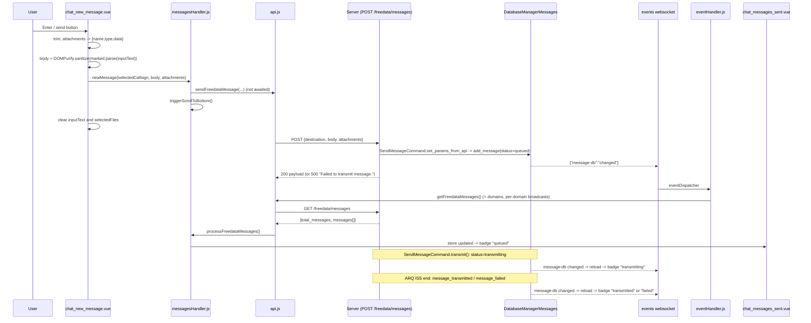

# Chat and Broadcasts

This document covers the GUI side of FreeDATA's two messaging features:

- **Chat**: peer-to-peer (P2P) messages to a single callsign, sent over an ARQ session.
- **Broadcasts**: group messages to a "domain" (e.g. `EUROPE-1`), sent with the NORM burst transport.

Server-side storage and transport are documented in [../../freedata_server/docs/message-system.md](../../freedata_server/docs/message-system.md). All REST calls go through [api.js](../src/js/api.js); live updates arrive on the `events` websocket handled in [eventHandler.js](../src/js/eventHandler.js).

---

## 1. File map

| File | Role |
|---|---|
| [chat_screen.vue](../src/components/chat_screen.vue) | Chat page layout: conversation sidebar, message area, composer, scroll-to-bottom watcher |
| [chat_conversations.vue](../src/components/chat_conversations.vue) | Conversation list (one row per callsign), "start new chat" button, mark-as-read on select |
| [chat_messages.vue](../src/components/chat_messages.vue) | Message list for each callsign, date separators, picks sent/received bubble |
| [chat_messages_sent.vue](../src/components/chat_messages_sent.vue) | Outgoing bubble: status badge, attempt counter, retransmit/info/delete/ADIF buttons |
| [chat_messages_received.vue](../src/components/chat_messages_received.vue) | Incoming bubble: info/ADIF/delete buttons |
| [chat_messages_image_preview.vue](../src/components/chat_messages_image_preview.vue) | Inline `` preview for image attachments |
| [chat_new_message.vue](../src/components/chat_new_message.vue) | Composer: textarea, markdown buttons, attachments, emoji picker |
| [broadcasts_screen.vue](../src/components/broadcasts_screen.vue) | Broadcast page layout: domain sidebar, message area, composer |
| [broadcast_domains.vue](../src/components/broadcast_domains.vue) | Domain list with message/unread counts, "start new broadcast" button |
| [broadcast_messages.vue](../src/components/broadcast_messages.vue) | Message list per domain, picks one of four bubble components |
| [broadcast_message_sent.vue](../src/components/broadcast_message_sent.vue) / [broadcast_message_received.vue](../src/components/broadcast_message_received.vue) | Text broadcast bubbles |
| [broadcast_message_metar_sent.vue](../src/components/broadcast_message_metar_sent.vue) / [broadcast_message_metar_received.vue](../src/components/broadcast_message_metar_received.vue) | METAR broadcast bubbles (decoded weather + wind compass) |
| [broadcast_new_message.vue](../src/components/broadcast_new_message.vue) | Inline composer for the selected domain |
| [broadcast_modal.vue](../src/components/broadcast_modal.vue) | "New broadcast" modal: domain, type, MESSAGE or METAR form |
| [messagesHandler.js](../src/js/messagesHandler.js) | Builds conversations from the message list; wrappers around chat API calls (returning their promises); `parseServerTimestamp`, `loadBeaconData` |
| [broadcastsHandler.js](../src/js/broadcastsHandler.js) | Stores broadcast API responses; wrappers around broadcast API calls (returning their promises); UTF-8 helpers `utf8Bytes`, `encodeBroadcastText`, `decodeBroadcastText` and `BROADCAST_MAX_BYTES` |
| [metar.js](../src/js/metar.js) | METAR parser, flight category, formatters, SVG wind compass, `lookupAirport` |
| [chatStore.js](../src/store/chatStore.js) | Pinia store for chat (plus beacon/speed chart arrays used by modals) |
| [broadcastStore.js](../src/store/broadcastStore.js) | Pinia store for broadcasts |
| [stationStore.js](../src/store/stationStore.js) | Pinia store holding `stationInfo` (callsign, gridsquare, personal info). Not referenced by any chat or broadcast component |

Related, out of this document's scope: the new-chat, delete-chat, delete-domain, message-info and broadcast-info modals live in [main_modals.vue](../src/components/main_modals.vue).

---

## 2. Chat

### 2.1 Component structure

```
chat_screen.vue
 |- chat_conversations.vue          (sidebar, col-lg-3)
 |- chat_messages.vue               (shown when chat.selectedCallsign is set)
 |    |- chat_messages_sent.vue     (direction === 'transmit')
 |    |    '- chat_messages_image_preview.vue
 |    '- chat_messages_received.vue (direction === 'receive')
 |         '- chat_messages_image_preview.vue
 '- chat_new_message.vue            (shown when chat.selectedCallsign is set)
```

- Mobile layout (`useIsMobile(992)` in `chat_screen.vue`): the sidebar is shown only when no callsign is selected, the message area only when one is; a back button clears `chat.selectedCallsign`.
- `chat_screen.vue` watches `chat.scrollTrigger` and scrolls the message container to the bottom on `nextTick`. `triggerScrollToBottom()` is called when a conversation is selected and after `newMessage()`.
- The header has a disabled callsign button and a graph button that runs `loadBeaconData(chat.selectedCallsign)` and opens `#deleteChatModal` (that modal in `main_modals.vue` contains the beacon histogram and the delete-chat action).

### 2.2 Chat store ([chatStore.js](../src/store/chatStore.js))

| Field | Meaning |
|---|---|
| `callsign_list` | Object keyed by callsign: `{timestamp, body, unread_messages}` for the newest message, keys sorted newest-first |
| `sorted_chat_list` | Object keyed by callsign: array of message objects as returned by the server |
| `selectedCallsign` | Currently open conversation |
| `totalUnreadMessages` | Count of all messages with `is_read === false` |
| `inputText` | Composer text (shared between visits) |
| `newChatCallsign`, `newChatMessage` | New-chat modal fields |
| `messageInfoById` | Parsed message shown in the info modal (`null` while loading, if unknown, or on error) |
| `loading` | Set by `getFreedataMessages()` |
| `scrollTrigger` / `triggerScrollToBottom()` | Scroll signal |
| `beaconDataArray`, `beaconLabelArray` | Beacon SNR history for the selected callsign (written by `loadBeaconData`) |
| `sorted_beacon_list`, `unsorted_beacon_list`, `chartSpeedPER*`, `arq_speed_list_*` | Used outside the chat components |

### 2.3 Building conversations

`getFreedataMessages()` ([api.js](../src/js/api.js)) does `GET /freedata/messages` and passes the result to `processFreedataMessages(data)` ([messagesHandler.js](../src/js/messagesHandler.js)). That function also accepts a Promise (it awaits its argument) and ignores anything that does not have a `messages` array:

1. **`createCallsignListFromAPI`**: the conversation key is `message.origin` for `direction === "receive"`, otherwise `message.destination`. For each key it keeps the newest `timestamp` and its `body`, and counts unread messages. `totalUnreadMessages` is the sum over all messages. Keys are re-inserted in descending timestamp order.
2. **`createSortedMessagesList`**: groups messages by the same key, keeping the server's order.
3. If nothing is selected and the device is not mobile (`isMobile.value` from `useIsMobile(768)`), the first (most recent) key of `callsign_list` is selected and its beacon data is loaded with `loadBeaconData()`.

Because the key includes the SSID (e.g. `DL1ABC-0` vs `DL1ABC-7`), the same station with different SSIDs gives separate conversations.

The conversation row ([chat_conversations.vue](../src/components/chat_conversations.vue)) shows the callsign, an unread badge, a preview from `previewBody(body)` and the time (today) or date (older). `previewBody` strips all tags (`DOMPurify.sanitize(body, {ALLOWED_TAGS: [], RETURN_DOM: true}).textContent`), trims, shows `<file>` when no text is left (attachment-only message or empty body) and cuts longer text to 35 characters plus `...`. It is rendered with `{{ }}` (escaped). Times are parsed with `parseServerTimestamp` (2.5).

### 2.4 Selecting a conversation and mark-as-read

`chatSelected(callsign)` in `chat_conversations.vue`:

1. Sets `chat.selectedCallsign = callsign.toUpperCase()` and triggers scroll.
2. `loadBeaconData(callsign)` ([messagesHandler.js](../src/js/messagesHandler.js)): `GET /freedata/beacons/{callsign}` -> `beaconLabelArray`/`beaconDataArray`. A failed or non-array response gives empty arrays.
3. `setMessagesAsRead`: for each message in the conversation with `is_read === false`, calls `setFreedataMessageAsRead(id)` (`PATCH /freedata/messages/{id}` body `{is_read: true}`), sets `is_read = true` locally, and after 500 ms reloads with `getFreedataMessages()`.

### 2.5 Message list and bubbles

[chat_messages.vue](../src/components/chat_messages.vue) renders one tab-pane per callsign, active when it matches `selectedCallsign`. A date separator is inserted before the first message and whenever the local date changes. Items are keyed by `item.id`.

P2P message timestamps are UTC but come from the database without a timezone designator (e.g. `2024-04-04T17:22:14.002502`), which JavaScript would read as local time. `parseServerTimestamp(input)` in messagesHandler.js treats numbers as Unix seconds and appends `Z` to strings without `Z`/`+hh:mm`. The conversation list, the date separators and both bubbles use it.

| | Sent ([chat_messages_sent.vue](../src/components/chat_messages_sent.vue)) | Received ([chat_messages_received.vue](../src/components/chat_messages_received.vue)) |
|---|---|---|
| Alignment / width | right; `col-7` or `col-8` by body length | left; `col-6`/`col-7`/`col-9` by body length |
| Attachments | header per attachment: image preview, file name, download button | same |
| Body | `v-html` of sanitised markdown (see 2.8) | same |
| Footer | status badge, `attempt + 1`, UTC time `HH:MM:SS` labelled UTC | UTC time `HH:MM:SS` labelled UTC |
| Buttons | retransmit, info, delete (disabled while `queued`/`transmitting`), ADIF | info, ADIF, delete |

Both time displays use `getUTCHours()`/`getUTCMinutes()`/`getUTCSeconds()`, matching the "UTC" label and the broadcast bubbles.

The info button clears `chatStore.messageInfoById` to `null` and awaits `requestMessageInfo(id)`, which stores the parsed message (or `null` if unknown or on error); the modal never sees a Promise.

### 2.6 Message status display

The sent bubble badge ([chat_messages_sent.vue](../src/components/chat_messages_sent.vue)):

| `message.status` | Badge class | Label |
|---|---|---|
| `failed` | `text-bg-danger` | `grid.components.msgstatusfailed` |
| `transmitting` | `text-bg-primary` | `grid.components.msgstatustransmitting` |
| `transmitted` | `text-bg-secondary` | `grid.components.msgstatustransmitted` |
| `queued` | `text-bg-secondary` | `grid.components.msgstatusqueued` |
| anything else | no colour class | raw status string |

Received bubbles show no status. Server-side status transitions (`queued` -> `transmitting` -> `transmitted`/`failed`, inbound `received`) are described in the server's message-system doc.

### 2.7 Live updates

The GUI never polls. The server calls `event_manager.freedata_message_db_change()` on every insert/update/delete of a P2P message or broadcast, which sends `{"message-db": "changed", "message_id": ...}` on the `events` websocket ([event_sock.js](../src/js/event_sock.js)). `eventDispatcher` in [eventHandler.js](../src/js/eventHandler.js) then:

```js
getFreedataDomains();
getFreedataBroadcastsPerDomain(broadcast.selectedDomain);
// getFreedataMessages() also updates the chat store
getFreedataMessages();
```

So every chat **and** broadcast DB change reloads the full message list, the domain list and the selected domain's broadcasts. `message_id` is ignored. On connect (`/states` socket open), the same three loads run once through `loadAllData()`.

### 2.8 Markdown rendering and sanitisation

Libraries: `marked` ^18 and `dompurify` ^3.4 ([package.json](../package.json)).

| Location | What happens | Sanitised? |
|---|---|---|
| [chat_new_message.vue](../src/components/chat_new_message.vue) `transmitNewMessage` | `DOMPurify.sanitize(marked.parse(inputText))` - the **HTML** result is what gets sent as `body` | Yes (default DOMPurify config) |
| [main_modals.vue](../src/components/main_modals.vue) `newChat` (new-chat modal) | `newMessage(callsign, chat.newChatMessage)` - raw text, no marked/DOMPurify | No (send side) |
| [chat_messages_sent.vue](../src/components/chat_messages_sent.vue) / [chat_messages_received.vue](../src/components/chat_messages_received.vue) `parsedMessageBody` | `marked.parse(body)` -> `DOMPurify.sanitize()` -> temp `div` -> every `<a>` gets `target="_blank" rel="noopener noreferrer"` -> `v-html` | Yes (default config) |
| [chat_conversations.vue](../src/components/chat_conversations.vue) preview | `DOMPurify.sanitize(..., {ALLOWED_TAGS: [], RETURN_DOM: true}).textContent`, rendered with `{{ }}` (escaped) | Yes |
| Attachment names | `{{ attachment.name }}` | Escaped by Vue |
| Composer toasts (image prepared, attachment too large) | `file.name` passed through `escapeHtml` ([popupHandler.js](../src/js/popupHandler.js)) before it goes into the HTML string for `displayToast` | Yes |
| Broadcast bubbles | `decodeBroadcastText(final)` -> `marked.parse` -> `DOMPurify.sanitize()` -> `v-html` | Yes (default config) |

Display-side sanitisation is what protects the GUI: received bodies come from remote stations and are always run through DOMPurify before `v-html`. Send-side sanitisation does not protect anyone, and it means bodies sent from the composer are HTML (e.g. `<p>Hi</p>\n`), which other clients receive verbatim. The default DOMPurify profile still allows tags such as ``, so a received message can make the GUI load a remote URL.

The composer's B/I/U buttons wrap the selection in `**...**`, `_..._` and `<u>...</u>`.

### 2.9 Attachments

Selection ([chat_new_message.vue](../src/components/chat_new_message.vue)): paperclip button -> hidden `<input type="file" multiple>`, or drag-and-drop onto the composer navbar. `handleFiles` processes each file:

- **Images** (`file.type` starts with `image/`): compressed with `js-image-compressor` using `quality: 0.5`, `maxWidth/maxHeight: 750`, `convertSize: Infinity`, `loose: true`, `redressOrientation: true`. If the result is not smaller, the original file is used. A success toast shows the sizes and ratio; errors show a danger toast.
- **Other files**: read unchanged.
- Both paths use `FileReader.readAsBinaryString` + `btoa()` and push `{name, size, type, content}` to `selectedFiles`.

**Size limit**: `MAX_ATTACHMENT_BYTES = 100 * 1024` (100 KiB) for all attachments of one message together, counted in raw bytes after image compression. Attachments are sent base64-encoded over ARQ, so even this means minutes to hours of airtime on HF. `fitsAttachmentLimit(name, size)` checks the new file against the bytes already attached: before reading a non-image file, after compressing an image, and again in each `FileReader.onload` (other files may have been added meanwhile). A file that does not fit is not attached, and a warning toast names the (escaped) file name, its size, the limit and the amount already attached. There is no limit on the number of files. Selected files are shown as cards (image preview for images, type, size) with a remove button.

On send, attachments become `[{name, type, data: content}]`. The server's `validate_message_attachment` requires `name`, `type`, `data` and non-empty `name`/`data`.

Display: [chat_messages_image_preview.vue](../src/components/chat_messages_image_preview.vue) treats `gif, png, jpg, jpeg, svg` (by file extension) as images and renders ``. The `data` comes straight from `GET /freedata/messages`, whose `to_dict()` embeds full attachment data, so every reload transfers all attachment bytes.

Download: `getFreedataAttachmentBySha512(hash)` -> `GET /freedata/messages/attachment/{hash_sha512}`; the base64 `data` is decoded into a `Blob` with the stored `type` and saved through a temporary `<a download>`.

### 2.10 Actions and API calls

| Action | Where | GUI call | HTTP |
|---|---|---|---|
| Send | composer / new-chat modal | `newMessage()` -> `sendFreedataMessage(destination, body, attachments)` | `POST /freedata/messages` `{destination, body, attachments}` |
| Retransmit | sent bubble | `repeatMessageTransmission(id)` -> `retransmitFreedataMessage` | `PATCH /freedata/messages/{id}` `{action: "retransmit"}` |
| Mark read | selecting a conversation | `setFreedataMessageAsRead(id)` | `PATCH /freedata/messages/{id}` `{is_read: true}` |
| Delete message | both bubbles | `deleteMessageFromDB(id)` -> `deleteFreedataMessage` | `DELETE /freedata/messages/{id}` |
| Delete conversation | delete-chat modal | `deleteCallsignFromDB(callsign)` - skips messages with status `queued`/`transmitting` (the server would answer 409) and shows a warning toast with how many were skipped; one DELETE per remaining message, run in parallel and awaited | `DELETE /freedata/messages/{id}` (n times) |
| Info | both bubbles | `requestMessageInfo(id)` -> `getFreedataMessageById` | `GET /freedata/messages/{id}` |
| ADIF log | both bubbles | `sendADIFviaUDP(id)` -> `postFreedataMessageADIF` | `POST /freedata/messages/{id}/adif` `{action: "retransmit"}` |
| Download attachment | both bubbles | `getMessageAttachment(hash)` | `GET /freedata/messages/attachment/{hash}` |
| Beacon history | selecting a conversation, header graph button, desktop auto-select | `loadBeaconData(callsign)` -> `getBeaconDataByCallsign` | `GET /freedata/beacons/{callsign}` |

The handlers return the API promise, but apart from `deleteCallsignFromDB` and `requestMessageInfo` the components do not use the result; the UI updates through the `message-db` websocket event. A failed POST/PATCH/DELETE shows an error toast with the server's message (4.1).

`transmitNewMessage` falls back to the first conversation if none is selected and returns without sending if there is none. The former `BC-` branch (which returned without sending) is gone.

### 2.11 Emoji picker

`chat_new_message.vue` contains a Bootstrap modal `#chatEmojiPickerModal` with `VuemojiPicker` (`vuemoji-picker`). The button is hidden on mobile. `@emoji-click` appends `detail.unicode` to `chat.inputText` (always at the end, not at the cursor).

### 2.12 Sequence: sending a chat message



---

## 3. Broadcasts

### 3.1 Component structure

```
broadcasts_screen.vue
 |- broadcast_domains.vue            (sidebar)
 |- broadcast_messages.vue           (shown when broadcast.selectedDomain is set)
 |    |- transmit: msg_type 'METAR' ? broadcast_message_metar_sent : broadcast_message_sent
 |    '- receive:  msg_type 'METAR' ? broadcast_message_metar_received : broadcast_message_received
 '- broadcast_new_message.vue        (shown when broadcast.selectedDomain is set)
broadcast_modal.vue                  (mounted by main_modals.vue)
```

`broadcasts_screen.vue` has a `messagesContainer` ref but, unlike `chat_screen.vue`, **no watcher on `broadcast.scrollTrigger`**, so `triggerScrollToBottom()` has no effect here.

### 3.2 Broadcast store ([broadcastStore.js](../src/store/broadcastStore.js))

| Field | Meaning |
|---|---|
| `domains` | Response of `GET /freedata/broadcasts/domains`: `{domain: {message_count, unread_count, last_message_id, last_message_timestamp, ...}}` |
| `selectedDomain` | Open domain |
| `domainBroadcasts` | Response of `GET /freedata/broadcasts/{domain}/`: `{domain: [messages]}` (replaced on each load, so it holds one domain) |
| `inputText`, `newDomain`, `newMessageType`, `newPriority` | Composer/modal state (`newPriority` is unused) |
| `selectedMessage` | Message shown in the broadcast-info modal |
| `totalUnreadMessages` | Sum of `unread_count` over domains (navbar badge) |
| `loading`, `scrollTrigger` | UI state |

### 3.3 Domains

- `getFreedataDomains()` is called from the left navbar, on websocket connect, on every `message-db` event and 1 s after sending from the modal. `processFreedataDomains` stores the object and sums `unread_count`.
- The sidebar shows each domain with `message_count`, an unread badge (red if > 0, green otherwise) and `last_message_timestamp` (seconds -> time today / date otherwise).
- `domainSelected(domain)` sets `selectedDomain = domain.toUpperCase()` and loads `GET /freedata/broadcasts/{domain}/` with the original case. That GET is read-only. If the domain has unread broadcasts (`domains[domain].unread_count > 0`), it also calls `setFreedataBroadcastDomainAsRead(domain)` -> `PATCH /freedata/broadcasts/{domain}/read`, which runs `mark_domain_as_read` on the server and fires a `message-db` event, so the domain list and the navbar badge refresh.
- Background reloads (`eventDispatcher` on every `message-db` event, `loadAllData()`) only GET the selected domain, so broadcasts that arrive later stay unread (and counted in the badge) until the user selects the domain again.
- Delete domain: the graph button in the `broadcasts_screen.vue` header opens `#deleteBroadcastModal` (it no longer calls a handler itself). The modal header shows `broadcast.selectedDomain`; its button calls `deleteBroadcastDomainFromDB(selectedDomain)` -> `DELETE /freedata/broadcasts/{domain}` and clears `selectedDomain`. The server endpoint is shared with message delete: it tries the value as a message id first, then as a domain.

### 3.4 Sending

Two entry points build the same payload for `POST /freedata/broadcasts` via `newBroadcastMessage(params)` ([broadcastsHandler.js](../src/js/broadcastsHandler.js)):

| Field | [broadcast_new_message.vue](../src/components/broadcast_new_message.vue) (inline) | [broadcast_modal.vue](../src/components/broadcast_modal.vue) |
|---|---|---|
| `origin` | `settings.remote.STATION.mycall + '-' + myssid` | same |
| `domain` | `broadcast.selectedDomain` (falls back to first domain) | `broadcast.newDomain` trimmed, default `GLOBAL-1`; datalist offers `EUROPE-1`, `ASIA-1`, `NA-1`, `SA-1`, `AFRICA-1` |
| `gridsquare` | `settings.remote.STATION.mygrid` | same |
| `type` | `"MESSAGE"` | `newMessageType` uppercased, default `MESSAGE` |
| `priority` | `1` (number) | `1` (number) |
| `data` | `encodeBroadcastText(DOMPurify.sanitize(marked.parse(inputText)))` | MESSAGE: same; METAR: `encodeBroadcastText(metarString)` |

`encodeBroadcastText(text)` ([broadcastsHandler.js](../src/js/broadcastsHandler.js)) UTF-8 encodes the text (`TextEncoder`) and base64-encodes the bytes, so emoji, Cyrillic, CJK etc. no longer make `btoa()` throw.

**Size limit**: `BROADCAST_MAX_BYTES = 15 * 26` (390), the amount the server keeps. Both entry points measure the payload that is actually sent (sanitised HTML or raw METAR) in UTF-8 bytes with `utf8Bytes()`:

- Inline composer: no `maxlength` on the textarea any more. Once the payload passes 75 % of the limit, a `bytes/390` counter appears next to the textarea (red and bold when over the limit), and the send button is disabled while the payload is too large. B/I/U markdown buttons; Enter sends. The emoji button is commented out, but its modal is still declared, now as `#broadcastEmojiPickerModal`.
- Modal: shows `N / 390 bytes` under the MESSAGE textarea and under the METAR preview (red when too large, plus a "too long" note for MESSAGE) and disables "Send Broadcast" while the payload is too large.
- In both, sending a payload over the limit (for example via Enter) is refused with a warning toast "Broadcast too long: N of 390 bytes (after formatting)".
- Modal: after sending, it waits 1 s, then reloads domains and the target domain and selects it. The type `<select>` only offers `MESSAGE`; the `METAR` option is commented out, so the METAR form (IATA/ICAO input with airports datalist, time, AUTO/COR, wind, visibility/CAVOK, cloud layers, temp/dew, QNH, remarks, live preview) is not reachable from the UI.
- Server side ([command_norm.py](../../freedata_server/command_norm.py)): requires `origin`, `domain`, `data`, `type`, `gridsquare`; `priority` is coerced to an int and falls back to 1 if missing, not a number or outside 0-7; appends `-0` to `origin`/`domain` if they are not valid callsigns; **truncates the decoded data to 390 bytes** (15 x 26). With `EXP.enable_groupchat` off, the endpoint refuses the request with **409** ("Group chat is disabled ..."), which api.js shows as an error toast.

### 3.5 Rendering received and sent broadcasts

All bubbles decode `message.payload_data.final` with `decodeBroadcastText()` inside a `try` (`<decode error>` on invalid base64). It base64-decodes and then UTF-8 decodes the bytes; legacy messages that were sent with plain `btoa()` and are not valid UTF-8 fall back to the Latin-1 string. Timestamps are Unix seconds and shown as UTC `HH:MM:SS` via `toISOString()`.

| Component | Body | Footer | Buttons |
|---|---|---|---|
| `broadcast_message_sent.vue` | `DOMPurify.sanitize(marked.parse(body))`, links get `target=_blank`, `v-html` | `msg_type`, time, `origin` | info, retransmit, delete |
| `broadcast_message_received.vue` | same; placeholder skeleton until `final` exists | `origin`, `msg_type`, `priority`, time | info, delete |
| `broadcast_message_metar_sent.vue` | METAR card (below) | `msg_type`, time, `origin` | info, retransmit, delete |
| `broadcast_message_metar_received.vue` | METAR card | `origin`, `msg_type`, `priority ?? 1`, time | info, delete |

There is no ADIF button on broadcasts: the server has no ADIF endpoint for them (only `POST /freedata/messages/{id}/adif` for P2P messages), so the buttons, `sendBroadcastADIFviaUDP` and `postFreedataBroadcastADIF` were removed. Delete handlers are methods that await the API call inside `try/catch`.

The info button sets `broadcast.selectedMessage` for `#broadcastMessageInfoModal`. The per-domain endpoint returns `priority`, which the received bubbles show in their footer.

### 3.6 METAR support ([metar.js](../src/js/metar.js))

`parseMetar(raw)` splits on whitespace (after removing the first `=`) and extracts:

| Field | Rule |
|---|---|
| `iata` | Station code as given (3-letter IATA or 4-character ICAO), found by `_findStation`: the station token right before the `DDHHMMZ` time group, else the first station-like token before it. Without a time group only the first token after `METAR`/`SPECI`/`COR`/`AMD` is accepted; the body is never scanned. A station token is `^[A-Z]{3}$` or `^[A-Z][A-Z0-9]{3}$` and not a reserved word (`METAR`, `SPECI`, `COR`, `AMD`, `AUTO`, `NIL`, `CAVOK`, `NSC`, `NCD`, `SKC`, `CLR`, `NSW`, `RMK`, `NOSIG`, `TEMPO`, `BECMG`) |
| `day`, `hh`, `mm` | token `DDHHMMZ` |
| `wind` | `(ddd|VRB)ss(Ggg)KT`; variable range `dddVddd` |
| `visibility` | `CAVOK` (-> 10000 m) or first 4-digit token |
| `temp_c`, `dew_c` | `M?dd/M?dd` (`M` = minus) |
| `qnh_hpa` | `Qnnnn`, or `Annnn` converted from inHg |
| `clouds` | `(FEW|SCT|BKN|OVC)nnn(CB|TCU)?`, base in feet |
| `auto`, `cor` | presence of `AUTO` / `COR` |

Other helpers: `determineFlightCategory` (VFR/MVFR/IFR/LIFR from visibility and lowest BKN/OVC ceiling; CAVOK = VFR), `categoryClass` (Bootstrap badge class; LIFR uses `.text-bg-magenta` defined in the METAR components), string formatters, and `buildCompassSVG(wind, {size})` which returns an SVG string with a WMO-style wind barb (or a circle for calm/VRB) and a dashed ring when gusts exceed the mean speed. All values interpolated into the SVG are numbers, so its `v-html` use is safe.

Airport lookup: both METAR bubbles call `lookupAirport(code)` in metar.js. On first use it builds one index from [airports.json](../src/assets/airports.json) (6,685 entries): IATA codes first (6,644 entries have one), then ICAO codes from the `icao` field where it is a valid 4-character code (only 35 entries) and not already taken. If the code is found, the label is `CODE - airport name` (IATA, else ICAO); otherwise just the code or `METAR`. Because so few entries carry an ICAO code, most 4-letter ICAO stations (e.g. `EFHK`, the modal's placeholder) still show no airport name.

### 3.7 Retransmit and delete

| Action | GUI call | HTTP |
|---|---|---|
| Retransmit (sent only) | `repeatBroadcastTransmission(id)` | `PATCH /freedata/broadcasts/{id}` `{action: "retransmit"}` |
| Delete message | `deleteBroadcastMessageFromDB(id)` | `DELETE /freedata/broadcasts/{id}` |
| Delete domain | `deleteBroadcastDomainFromDB(domain)` | `DELETE /freedata/broadcasts/{domain}` |

The handlers now return the API promise, so the components' `try/await` waits for the request. api.js never throws (it returns `undefined` on failure and shows an error toast itself), so the components' `catch` blocks only see unexpected exceptions.

---

## 4. Cross-check: GUI payloads vs server ([api/freedata.py](../../freedata_server/api/freedata.py))

### 4.1 Error handling in the GUI

`apiGet/apiPost/apiPatch/apiDelete` in [api.js](../src/js/api.js) share `apiRequest()`, which catches every error and returns `undefined`. For a non-2xx response it reads the server's message from the FastAPI error body (`detail.error`, `detail` string or validation list) and logs it. Failed POST/PATCH/DELETE requests (send, retransmit, mark read, delete, ADIF) also show a "Server error" toast with method, endpoint and message (identical toasts are suppressed for 5 s); failed GETs (message list, domains, broadcasts, attachments, beacons) are only logged. Requests are sent regardless of the WebSocket connection state.

### 4.2 Endpoint table

| Endpoint | GUI sends | Server expects / returns | Notes |
|---|---|---|---|
| `POST /freedata/messages` | `{destination, body, attachments?}` | `SendMessageCommand`: `destination` (gets `-0` if no SSID; `ValueError` if invalid), `body`, optional `attachments[{name,type,data}]`. 500 "Failed to transmit message." if the command raises | Match. Invalid callsign -> 500, shown as an error toast |
| `PATCH /freedata/messages/{id}` retransmit | `{action: "retransmit"}` | 404 unknown id; sets `queued`, increments attempts; 500 on update failure | Match. GUI allows retransmit in any status, including `queued`/`transmitting` |
| `PATCH /freedata/messages/{id}` read | `{is_read: true}` | 404 unknown id; `update_message` accepts `is_read`; 500 on failure | Match. The GUI sets `is_read` locally before the response; on failure the 500 ms reload restores the server state |
| `DELETE /freedata/messages/{id}` | empty JSON body | 404 not found; **409** if `queued`/`transmitting` | Single-message delete button is disabled for those statuses. Delete conversation skips `queued`/`transmitting` messages and says so in a toast; any other refusal shows an error toast |
| `GET /freedata/messages/{id}` | - | The message as a JSON object; 404 for an unknown id | Match. `requestMessageInfo` stores the object, or `null` on 404 |
| `POST /freedata/messages/{id}/adif` | `{action: "retransmit"}` | Body ignored; 404 if ADIF unavailable | Harmless extra body |
| `GET /freedata/messages/attachment/{hash}` | - | 404 if missing; `{id, name, type, data, checksum_crc32, hash_sha512}` | Match (`data`, `type` used). 404 -> `undefined.data` TypeError, caught and logged |
| `POST /freedata/broadcasts` | `{origin, domain, gridsquare, type, priority, data}` | `Norm`: same keys, `priority` coerced to int (0-7, else 1); **409** if `EXP.enable_groupchat` is off; 500 if the constructor raises | Match. Both entry points send `priority: 1`. Errors show a toast |
| `PATCH /freedata/broadcasts/{id}` | `{action: "retransmit"}` | 404 unknown id; 400 other actions | Match |
| `DELETE /freedata/broadcasts/{id or domain}` | empty JSON body | 200 on success; **404** if neither a message id nor a domain matches; 500 on a database error | Match. Errors show a toast |
| `GET /freedata/broadcasts/{domain}/` | - | `{domain: [...]}` including `priority`; read-only | `selectedDomain === undefined` on startup gives `GET /freedata/broadcasts/undefined/` |
| `PATCH /freedata/broadcasts/{domain}/read` | no body | Marks all unread broadcasts of the domain read; `{domain, marked_read, status}` | Called from `domainSelected()` when the domain has unread broadcasts |
| `GET /freedata/broadcasts/domains` | - | `{domain: {message_count, unread_count, last_message_*}}` | Match |
| `GET /freedata/broadcasts` | - | All broadcasts as a flat list | `getFreedataBroadcasts()` groups the list by `domain` and stores it like the per-domain endpoint. No caller in the GUI |
| `POST /freedata/broadcasts/{id}/adif` | - | Does not exist | The GUI no longer calls it (broadcast ADIF removed) |

---

## 5. Known issues

### Security

1. **No unsanitised `v-html` found in this area.** Every `v-html` of chat or broadcast content (`chat_messages_sent/received.vue`, `broadcast_message_sent/received.vue`) runs `DOMPurify.sanitize()` after `marked.parse()`; the METAR `v-html` renders `buildCompassSVG` output built only from numbers. Toasts that include file names escape them with `escapeHtml`. Remaining risks:
   - DOMPurify runs with its **default profile**, which allows ``, `<a href>` and similar. A remote station can make the GUI load external URLs (tracking/privacy), and links open in a new tab.
   - Sending sanitised HTML instead of markdown is no protection for receivers, and the new-chat modal sends raw text anyway. The receiver must always sanitise (it does).

### Bugs and limitations

2. **Every `message-db` event reloads everything**: full message list (including all attachment base64 data), domain list, selected domain's broadcasts.
3. **Failed loads are silent.** GET errors (message list, domains, broadcasts, attachments, beacons) are only logged; only POST/PATCH/DELETE failures show a toast (4.1).
4. **Broadcast scroll-to-bottom is not wired** (no watcher on `broadcast.scrollTrigger` in `broadcasts_screen.vue`).
5. **METAR**: the METAR type is still disabled in the modal. ICAO lookup now exists, but only 35 entries of `airports.json` carry an ICAO code, so most ICAO stations (e.g. `EFHK`) show no airport name.
6. **Broadcasts in the open domain stay unread.** Mark-as-read only happens when a domain is selected, so broadcasts arriving while the user is looking at that domain keep the unread badge until the domain is selected again.
7. **`GET /freedata/broadcasts/undefined/`** at startup: `broadcast.selectedDomain` starts as `undefined` and is requested anyway.
8. **Dead code**: `chat_conversations.vue` `newChat()` is unused; `broadcastStore.newPriority` is unused; `stationStore` is not used by these components; `broadcast_new_message.vue` declares `#broadcastEmojiPickerModal` although its emoji button is commented out; `getFreedataBroadcasts()` has no caller.
9. **Attachments**: the 100 KiB limit counts raw bytes per message; there is no limit on the number of files, and files are still read completely with `readAsBinaryString` + `btoa()`.
