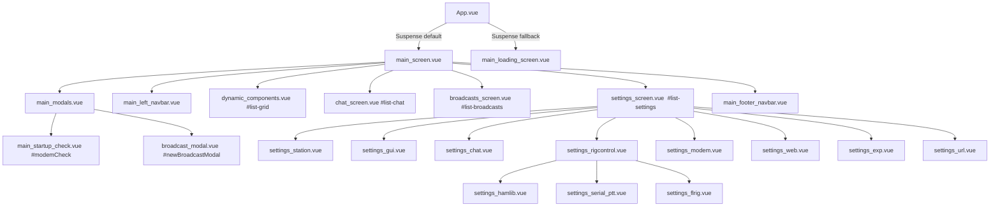

# Screens, Modals and Settings

This document covers the GUI shell (screen layout and navigation), the startup check / loading screen, the global modals, the settings screen and its persistence, and the footer/navbar status indicators.

Source files covered:
[App.vue](../src/App.vue),
[main_screen.vue](../src/components/main_screen.vue),
[main_left_navbar.vue](../src/components/main_left_navbar.vue),
[main_footer_navbar.vue](../src/components/main_footer_navbar.vue),
[main_modals.vue](../src/components/main_modals.vue),
[main_startup_check.vue](../src/components/main_startup_check.vue),
[main_loading_screen.vue](../src/components/main_loading_screen.vue),
all `settings_*.vue` components,
[settingsStore.js](../src/store/settingsStore.js),
[serialStore.js](../src/store/serialStore.js).

---

## 1. Screen structure and navigation

### No router

There is no `vue-router` (not in `package.json`, not imported anywhere in `src/`). All "screens" are rendered at once and switched with **Bootstrap tab panes** (`data-bs-toggle="list"` / `data-bs-toggle="tab"`). Hidden screens stay mounted; only their CSS visibility changes.

### Bootstrapping

1. [main.js](../src/main.js) creates the app, installs i18next and the shared Pinia instance, mounts `#app`, sets the i18n language and applies the colour mode from `settings.local` right away, then calls `getRemote()` and, when it settles (success or failure), `initConnections()` (WebSockets). The modem state is fetched by `loadAllData()` when the `/states` socket opens.
2. [App.vue](../src/App.vue) wraps the main screen in `<Suspense>`. `main_screen.vue` is loaded with `defineAsyncComponent`, so the fallback [main_loading_screen.vue](../src/components/main_loading_screen.vue) (a CSS spinner and "Loading...") is shown only while the JS chunk for the main screen is being fetched. It does **no** server checks.
3. `App.vue` `onMounted` sets `<html lang>` from the current i18next language and keeps it in sync on `languageChanged`, sets `data-bs-theme="light"` only if no theme is set yet, and installs the delegated Bootstrap `Tooltip` on `document.body` and the delegated `Popover` on `<html>` (one Bootstrap instance per element). Settings components rely on these delegates and do not create their own tooltips.

### Main layout ([main_screen.vue](../src/components/main_screen.vue))

| Region | Component | Notes |
|---|---|---|
| Global modals | `main_modals` | Rendered once at the top; includes the startup check modal |
| Toasts | `#mainToastContainer` | Target container for toast popups (created elsewhere) |
| Left column | `main_left_navbar` | Health button + tab list |
| Tab pane `#list-grid` (default active) | `dynamic_components.vue` | Home / grid dashboard |
| Tab pane `#list-chat` | `chat_screen.vue` | P2P chat |
| Tab pane `#list-broadcasts` | `broadcasts_screen.vue` | Broadcast / group chat |
| Tab pane `#list-settings` | `settings_screen.vue` | Settings |
| Bottom | `main_footer_navbar` | Status indicators and progress bar |

### Component tree



### Left navbar ([main_left_navbar.vue](../src/components/main_left_navbar.vue))

| Item | Target | Click action (API) | Visible / enabled when |
|---|---|---|---|
| Health button (`bi-activity`, or spinner) | opens modal `#modemCheck` | - | always |
| Home (`bi-columns-gap`) | `#list-grid` | `loadAllData()` (via list click handler) | disabled if `state.modem_connection !== "connected"` |
| Chat (`bi-chat-text`) + unread badge | `#list-chat` | `getFreedataMessages()` + `loadAllData()` | same |
| Broadcasts (`bi-broadcast`) + unread badge | `#list-broadcasts` | `getFreedataDomains()` + `loadAllData()` | only rendered if `settings.remote.EXP.enable_groupchat` |
| Settings (`bi-gear-wide-connected`) | `#list-settings` | `loadAllData()` (via list click handler only) | disabled when disconnected |
| Station button (`bi-person-circle`, bottom) | `#stationInfoModal` | - | hard-coded `disabled` |

The whole `#main-list-tab` container has `@click="loadAllData()"` (when connected), so **any** click on a nav item reloads modem state, sysinfo, audio/serial device lists, radio status, the remote config, messages and broadcast domains ([eventHandler.js](../src/js/eventHandler.js) `loadAllData`).

### Settings screen ([settings_screen.vue](../src/components/settings_screen.vue))

A Bootstrap card with nested `nav-tabs`: Station, GUI, Chat, Radio control, Modem, Web, Experimental, Links. The Radio control tab ([settings_rigcontrol.vue](../src/components/settings_rigcontrol.vue)) has its own sub-tabs: Hamlib, Serial PTT, flrig.

---

## 2. Startup check and loading screen

### Loading screen

[main_loading_screen.vue](../src/components/main_loading_screen.vue) is purely visual (spinner + "Loading..."), shown by `<Suspense>` while `main_screen.vue` loads. It is not related to server health.

### Startup check modal ([main_startup_check.vue](../src/components/main_startup_check.vue))

Rendered inside `main_modals`, id `#modemCheck`, static backdrop (cannot be closed with Esc or backdrop click; only the X button).

On mount, in this order:
1. `getSysInfo()` (a single `GET /version`) fills `state.api_version`, `modem_version`, `os_info`, `python_info`. If the request fails (all fields `"N/A"`) and values were already loaded (for example by `loadAllData()`), they are not overwritten.
2. `new Modal('#modemCheck').show()` - the modal is **opened on every page load**, regardless of health.

It can be reopened at any time via the health button in the left navbar.

The modal is an accordion; each section header carries a badge:

| Section | Badge source | Green when | Contents / actions |
|---|---|---|---|
| Network | `state.modem_connection` | `"connected"` | Info alert; read-only API URL (`window.location` protocol/host/port) |
| Modem | `state.is_modem_running` | truthy | Audio input/output selects (`AUDIO.input_device` / `output_device`, options from `audioStore`, `@change=onChange`); "Manual modem restart" button: `stopModem()` (`POST /modem/stop`), then `startModem()` (`POST /modem/start`) after 5 s |
| Radio control | `getRigControlStatus()` | `RADIO.control == "disabled"`, otherwise `state.radio_status`; an unknown control type returns `false` (red) | `RADIO.control` select (same 5 options as settings); when `rigctld_bundle`: `RADIO.serial_port` select from `serialStore` and a "Test Hamlib" button. The test only reads the radio status (`getRadioStatus()`, `GET /radio`) and never transmits; while it runs the button is disabled, afterwards an online/offline badge shows, with frequency and mode when the rig answers |
| System info | - | - | API/modem versions, OS info, Python info from `state` |

There is a "Reload GUI" button (`location.reload()`).

What the user sees on failure: the modal just shows red badges ("disconnected", "inactive", "offline"); there is no blocking error, retry loop, or guided fix. Connection state itself comes from the WebSocket layer ([event_sock.js](../src/js/event_sock.js): opening the `/states` socket sets `connected`, an error on the `/states` or `/events` socket sets `disconnected`, `close` reconnects after 1 s). A modem `failed` event (`{"freedata_server": "failed"}`) shows a "startup failed" toast ([eventHandler.js](../src/js/eventHandler.js)). Failed modem start/stop requests show an error toast with the server's message.

---

## 3. Modals ([main_modals.vue](../src/components/main_modals.vue))

| Modal id | Opened by | What it does | API |
|---|---|---|---|
| `#modemCheck` | auto on mount; left-navbar health button | Startup/system check (section 2) | `GET /version`, `/modem/start`, `/modem/stop`, `GET /radio` (Test Hamlib), `POST /config` |
| `#dxStationInfoModal` | `chat_screen.vue`, `grid/grid_active_heard_stations.vue` | Read-only list of `station.stationInfo.info` for a remote station, plus a "preview" note | (data loaded by the opener) |
| `#deleteChatModal` | graph button in the `chat_screen.vue` header (also reloads the beacon data of the selected callsign with `loadBeaconData()`) | Beacon SNR histogram (Bar chart from `chat.beaconLabelArray` / `beaconDataArray`) and "Delete chat" button -> `deleteCallsignFromDB(chat.selectedCallsign)` | via [messagesHandler.js](../src/js/messagesHandler.js) |
| `#deleteBroadcastModal` | graph button in the `broadcasts_screen.vue` header (opens the modal only) | Header shows `broadcast.selectedDomain`; "Delete broadcast domain" -> `deleteBroadcastDomainFromDB(broadcast.selectedDomain)` | via [broadcastsHandler.js](../src/js/broadcastsHandler.js) |
| `#messageInfoModal` | `chat_messages_sent.vue`, `chat_messages_received.vue` (clear `messageInfoById`, then await `requestMessageInfo()`) | Statistics of `chat.messageInfoById` (bpm/bps, duration, size) and SNR/speed line+bar chart | `GET /freedata/messages/{id}` |
| `#newChatModal` | `chat_conversations.vue`, heard-stations grid widget | Callsign (max 9 chars, uppercased) + first message; Enter or button -> `newMessage(call, msg)`. Heading id `newChatModalLabel` | via messagesHandler |
| `#broadcastMessageInfoModal` | `broadcast_message_*` components | Details of `broadcast.selectedMessage` (id, type, timestamps, origin, grid, payload size, bursts) | - |
| `#audioModal` | `grid/grid_tune.vue` | Audio tuning: "Transmit test frame" (`#audioModalSendTestFrame`, `sendModemTestFrame()`, `POST /modem/send_test_frame`), RX/TX level sliders (`#audioModalLevelRX` / `#audioModalLevelTX`, -30..20 dB, `AUDIO.rx_audio_level` / `tx_audio_level`, `@change=onChange`), sine tone start/stop (`#audioModalSineToneStart` / `Stop`, `sendSineTone(true/false)`) | `POST /config` on slider release |
| `#stationInfoModal` | left-navbar station button (disabled) | Edit own station info (name, city, age, radio, antenna, website, email, social media, comments); fetch on `show.bs.modal` and on mount; Save -> `setStationInfoByCallsign("<mycall>-<myssid>")` | `GET/POST /freedata/station/{callsign}` via [stationHandler.js](../src/js/stationHandler.js) |
| `#newBroadcastModal` | `broadcast_domains.vue` | Separate component [broadcast_modal.vue](../src/components/broadcast_modal.vue) (documented with broadcasts) | - |

Note: `main_modals.vue` calls `fetchMyStationInfo()` in `onMounted`, i.e. a `GET /freedata/station/<mycall>-<myssid>` at startup (with whatever `mycall` is in the store at that time).

---

## 4. Settings

### 4.1 Storage model

[settingsStore.js](../src/store/settingsStore.js) exports a plain `reactive()` object (not a Pinia store):

```
settingsStore = { local: {...}, remote: {...} }
```

| Part | Persisted where | Loaded | Saved |
|---|---|---|---|
| `settings.local` | Browser `localStorage["localConfig"]` (JSON) | Module load: stored JSON deep-merged over `defaultConfig.local` (missing keys get their default; unreadable data falls back to the defaults) | Automatically by a deep `watch` on `settingsStore.local` -> `saveLocalSettingsToConfig()` on every change (errors caught and logged) |
| `settings.remote` | Server `config.ini` | Starts as a deep copy of `defaultConfig.remote`; `getRemote()` -> `getConfig()` (`GET /config`) | `onChange()` -> `setConfig(copy of remote)` (`POST /config`) |

GUI-only (`local`) keys: `host`, `port`, `spectrum`, `wf_theme`, `enable_sys_notification`, `grid_layout`, `grid_preset`, `grid_enabled`, `language`, `colormode`. Only `language`, `colormode` and `wf_theme` are edited in the settings screen; the grid keys are used by the dashboard.

Server-side keys exposed in the GUI but stored in `config.ini`: `GUI.auto_run_browser` and `GUI.distance_unit` (despite the GUI name, they live in `remote`).

### 4.2 Load / save flow

- **`getRemote()`**: `GET /config` only; it never POSTs. On success replaces `settingsStore.remote`, converts `STATION.callsign_blacklist` from array to a newline-joined string (for the textarea) and marks the config as loaded. On failure (`undefined`) it keeps the current values, which are the defaults until the first successful load.
- **`onChange()`**:
  - If no config has been loaded from the server yet, it does **not** POST. It shows a "Settings not saved: configuration not loaded from server yet" warning toast and calls `getRemote()`. This prevents the GUI defaults (for example `mygrid: ""`) from overwriting the server config.
  - Otherwise it deep-copies `remote`, converts `callsign_blacklist` in the copy back to an array (split on `\n`, trim, drop empties; non-arrays become `[]`) and POSTs the copy. On success it replaces `settingsStore.remote` with the server response and re-joins the blacklist.
  - On failure, api.js shows an error toast with the server's message (for example 400 "Invalid configuration") and `onChange()` reloads the config with `getRemote()`, so the form shows what the server actually stored.
- **When the POST happens**: every settings input uses `@change` (fires on blur/select, not on each keystroke). There is **no debounce**; each change posts the complete `remote` config.
- **Number fields** (`NETWORK.modemport`, `RIGCTLD.port`, `FLRIG.port`, `QSO_LOGGING.adif_udp_port`) use `@focus="rememberNumber(...)"` and `@change="onNumberChange(...)"` instead of plain `onChange`. A cleared or non-numeric field (`v-model.number` gives `""`) is restored to the value remembered on focus (or reloaded with `getRemote()` if there is none) and nothing is posted. Valid values are rounded to an integer and clamped to the input's `min`/`max` before `onChange()`. The helper is copied into each of `settings_modem.vue`, `settings_hamlib.vue`, `settings_flrig.vue` and `settings_chat.vue`.
- **Callers of `getRemote()`**: `main.js` at startup, `loadAllData()` (`/states` socket open, `hello-client` event, modem `started`/`restarted` events, every left-navbar click), `onChange()` (config not loaded yet, or save failed), `settings_station.vue` to revert an invalid callsign, and the number-field handler when there is no previous value.
- **Server side** ([../freedata_server/api/config.py](../../freedata_server/api/config.py) `post_config`): validates `STATION.mycall` and `STATION.mygrid` (400 "Invalid configuration" if either is invalid); returns early without writing if the payload equals the current config; otherwise writes `config.ini` (type-checked against `config_types`, raising `ValueError` on a type mismatch) and **queues a modem restart** (`modem_service.put("restart")`) when any section other than `GUI` differs from the stored config. Changes that only touch `GUI.*` (`distance_unit`, `auto_run_browser`) are written without a restart.
- The Modem tab shows a red notice that changes restart the server/modem, and offers a "Reload" button (`stopModem()` then `startModem()` after 5 s).

### 4.3 Per-component field tables

Path = `settingsStore` path. "Server" column cross-checks against [config.ini.example](../../freedata_server/config.ini.example) and `config_types` in [config.py](../../freedata_server/config.py) (all `remote` keys used by the GUI exist there).

#### [settings_station.vue](../src/components/settings_station.vue) - Station

| Field | Path | Input / validation |
|---|---|---|
| Callsign | `remote.STATION.mycall` | text, displayed uppercase; on change: uppercased, `validateCallsignWithoutSSID()`; valid -> `onChange`, invalid -> `getRemote()` (silently reverts) |
| SSID | `remote.STATION.myssid` | select 0-15, `v-model.number` |
| Grid locator | `remote.STATION.mygrid` | text, maxlength 6; regex `^[A-Ra-r]{2}[0-9]{2}([A-Xa-x]{2})?$`, normalised (`JN48ea`) then `onChange`; invalid -> `alert()` and the field is reverted to the last valid value (remembered on focus), so the invalid value never reaches the store or the server |
| Respond to CQ | `remote.STATION.respond_to_cq` | switch |
| Enable callsign blacklist | `remote.STATION.enable_callsign_blacklist` | switch |
| Callsign blacklist | `remote.STATION.callsign_blacklist` | textarea, one call per line (string in GUI, list on server) |

#### [settings_gui.vue](../src/components/settings_gui.vue) - GUI

| Field | Path | Input / action |
|---|---|---|
| Language | `local.language` | select from `availableLanguages` ([i18n.js](../src/js/i18n.js)); `i18next.changeLanguage()` |
| Colour mode | `local.colormode` | select `light` / `dark` / `auto`; `applyColorMode()` sets `data-bs-theme` |
| Waterfall theme | `local.wf_theme` | select 0-9 (string values), `setColormap()` |
| Auto-launch browser | `remote.GUI.auto_run_browser` | switch, `onChange` |
| Distance unit | `remote.GUI.distance_unit` | select `km` / `mi` / `nm`, `onChange`. When the component is created, a value that is not one of these three is set to `km` locally (not posted) |

#### [settings_chat.vue](../src/components/settings_chat.vue) - Chat / logging

| Field | Path | Input / validation |
|---|---|---|
| Message auto repeat | `remote.MESSAGES.enable_auto_repeat` | switch |
| ADIF UDP logging | `remote.QSO_LOGGING.enable_adif_udp` | switch |
| ADIF UDP host | `remote.QSO_LOGGING.adif_udp_host` | text |
| ADIF UDP port | `remote.QSO_LOGGING.adif_udp_port` | number, `min=1025 max=65534`, enforced by the number-field handler (4.2) |
| Wavelog logging | `remote.QSO_LOGGING.enable_adif_wavelog` | switch |
| Wavelog host | `remote.QSO_LOGGING.adif_wavelog_host` | text |
| Wavelog API key | `remote.QSO_LOGGING.adif_wavelog_api_key` | password input (`autocomplete="off"`) with a show/hide eye button |

#### [settings_rigcontrol.vue](../src/components/settings_rigcontrol.vue) - Radio control

| Field | Path | Input |
|---|---|---|
| Rig control type | `remote.RADIO.control` | select `disabled` / `serial_ptt` / `rigctld` / `rigctld_bundle` / `flrig` |

Sub-tabs are always all visible regardless of the selected control type (only part of the Hamlib tab is conditional).

#### [settings_hamlib.vue](../src/components/settings_hamlib.vue) - Hamlib

Always visible:

| Field | Path | Input |
|---|---|---|
| Rigctld host | `remote.RIGCTLD.ip` | text |
| Rigctld port | `remote.RIGCTLD.port` | number, `min=1 max=65535`, number-field handler (4.2) |
| Enable VFO | `remote.RIGCTLD.enable_vfo` | switch |

Visible only when `RADIO.control == "rigctld_bundle"` (`d-none` otherwise):

| Field | Path | Input / options |
|---|---|---|
| Radio model | `remote.RADIO.model_id` | select, number; `0` = ignore, plus hard-coded Hamlib model list |
| Radio port | `remote.RADIO.serial_port` | select from `serialStore.serialDevices` |
| Custom radio port | `remote.RADIO.serial_port` | text (same key as above), id `hamlibCustomSerialPort`, placeholder "e.g. /dev/ttyUSB0 or COM3" |
| Serial speed | `remote.RADIO.serial_speed` | select `0` (ignore), 1200-115200, number |
| Data bits | `remote.RADIO.data_bits` | select `0` (ignore), 7, 8 |
| Stop bits | `remote.RADIO.stop_bits` | select `0` (ignore), 1, 2 |
| Serial handshake | `remote.RADIO.serial_handshake` | select `ignore`, `None` |
| PTT device port | `remote.RADIO.ptt_port` | select from `serialStore` |
| PTT type | `remote.RADIO.ptt_type` | `ignore`, NONE, RIG, USB, RTS, PARALLEL, MICDATA, CM108 |
| PTT mode | `remote.RADIO.ptt_mode` | `ignore`, TX, TX_MIC, TX_DATA |
| DCD | `remote.RADIO.serial_dcd` | `ignore`, NONE, RIG, DSR, CTS, CD, PARALLEL |
| DTR | `remote.RADIO.serial_dtr` | `ignore`, OFF, ON |
| RTS | `remote.RADIO.serial_rts` | `ignore`, OFF, ON |
| Rigctld command | (none) | disabled text input; copy button has no handler |
| Custom arguments | `remote.RIGCTLD.arguments` | text |

#### [settings_serial_ptt.vue](../src/components/settings_serial_ptt.vue) - Serial PTT

| Field | Path | Input |
|---|---|---|
| PTT COM port | `remote.RADIO.ptt_port` | select from `serialStore` |
| Custom PTT port | `remote.RADIO.ptt_port` | text (same key), id `serialPttCustomPort`, placeholder "e.g. /dev/ttyUSB0 or COM3" |
| PTT via DTR | `remote.RADIO.serial_dtr` | `ignore` (Disabled), `OFF` (LOW), `ON` (HIGH) |
| PTT via RTS | `remote.RADIO.serial_rts` | same options |

`ptt_port`, `serial_dtr`, `serial_rts` are shared with the Hamlib tab.

#### [settings_flrig.vue](../src/components/settings_flrig.vue) - flrig

| Field | Path | Input |
|---|---|---|
| flrig host | `remote.FLRIG.ip` | text |
| flrig port | `remote.FLRIG.port` | number, `min=1 max=65535`, number-field handler (4.2) |

#### [settings_modem.vue](../src/components/settings_modem.vue) - Modem / audio

| Field | Path | Input / validation |
|---|---|---|
| Reload modem | - | button: `stopModem()` then `startModem()` after 5 s |
| Modem port | `remote.NETWORK.modemport` | number, `min=1025 max=65534`, number-field handler (4.2) |
| Modem host | `remote.NETWORK.modemaddress` | select `127.0.0.1` / `localhost` / `0.0.0.0` |
| Audio input | `remote.AUDIO.input_device` | select from `audioStore.audioInputs` (`device.id`) |
| Audio output | `remote.AUDIO.output_device` | select from `audioStore.audioOutputs` |
| RX audio level | `remote.AUDIO.rx_audio_level` | range -30..20 |
| TX audio level | `remote.AUDIO.tx_audio_level` | range -30..20 |
| RX auto level | `remote.AUDIO.rx_auto_audio_level` | switch |
| TX auto level | `remote.AUDIO.tx_auto_audio_level` | switch |
| TX delay | `remote.MODEM.tx_delay` | select 0-1000 ms in 50 ms steps |
| Maximum bandwidth | `remote.MODEM.maximum_bandwidth` | select 250 / 500 / 1700 / 2438 Hz |

#### [settings_web.vue](../src/components/settings_web.vue) - Web / Explorer

| Field | Path | Input |
|---|---|---|
| Publish to explorer | `remote.STATION.enable_explorer` | switch |

#### [settings_exp.vue](../src/components/settings_exp.vue) - Experimental

| Field | Path | Input |
|---|---|---|
| Ring buffer | `remote.EXP.enable_ring_buffer` | switch |
| VHF | `remote.EXP.enable_vhf` | switch |
| Group chat | `remote.EXP.enable_groupchat` | switch (also shows/hides the Broadcasts nav item) |

#### [settings_url.vue](../src/components/settings_url.vue) - Links

No settings; buttons open external sites with `window.open(url, "_blank")` (website, wiki, explorer map, statistics, GitHub, Discord).

### 4.4 Server keys not editable in the GUI

`STATION.ssid_list`, `STATION.enable_stats`, `RIGCTLD.path`, `RIGCTLD.command`, `MODEM.enable_morse_identifier`, the whole `SOCKET_INTERFACE` section. They round-trip unchanged through `GET`/`POST /config`. (`STATION.enable_stats` is in the GUI `defaultConfig` as `false`.)

### 4.5 serialStore ([serialStore.js](../src/store/serialStore.js))

Pinia store with `serialDevices` and `loadSerialDevices()` (`getSerialDevices()`, `GET /devices/serial`). On empty/failed response it uses a placeholder `{description: "No devices received from modem", port: "ignore"}`; it always appends `{description: "-- ignore --", port: "ignore"}` if no `ignore` entry exists. Loaded from `loadAllData()`.

---

## 5. Footer and navbar indicators

### Left navbar health button

| Visual | Source |
|---|---|
| Spinner instead of `bi-activity` icon | `state.is_network_traffic` (reference-counted in `apiRequest()` in [api.js](../src/js/api.js); stays on until the last concurrent request finishes) |
| Background colour | `getOverallHealth()` ([eventHandler.js](../src/js/eventHandler.js)): +5 not connected, +3 modem not running, +2 `radio_status === false`, +1 `process.env.FDUpdateAvail === "1"`. `> 4` red, `2..4` yellow, `< 2` none |

`getOverallHealth()` also writes state (sets `is_modem_running` and `radio_status` to `false` when disconnected) and is called directly from the template.

Chat / Broadcast badges: `chat.totalUnreadMessages`, `broadcast.totalUnreadMessages`.

### Footer ([main_footer_navbar.vue](../src/components/main_footer_navbar.vue))

| Indicator | Source | Display |
|---|---|---|
| PTT (`bi-broadcast-pin`) | `state.ptt_state` | red when true |
| Modem busy (`bi-cpu`) | `state.busy_state` | red when true |
| Frequency (lg+ only) | `state.frequency / 1000` | "N kHz" |
| Speed level (lg+ only) | `state.speed_level` 0-4 | `bi-reception-0..4` icon |
| Total bytes (lg+ only) | `state.arq_total_bytes` | number |
| Direction | `state.arq_is_receiving` | "from" / "to" |
| DX callsign | `state.dxcallsign` | or `-----` |
| Progress bar | `state.arq_transmission_percent`, `arq_bytes_per_minute`, `arq_bits_per_second` | "% [ bpm / bps ]" (mobile: % only) |
| Timeout bar | `state.arq_seconds_until_timeout(_percent)` | `hidden` (marked TODO for removal) |

---

## 6. Known issues

Observed in code; not runtime-verified unless stated.

1. **Every non-GUI setting change restarts the modem.** `POST /config` queues a restart whenever a section other than `GUI` changed (server side, [config.py](../../freedata_server/api/config.py)); GUI-only keys no longer restart. There is no debounce or batching; each `@change` posts the full config, and the resulting `restarted` event runs `loadAllData()` again.
2. **Config reloads are frequent.** `getRemote()` no longer POSTs, but it still runs through `loadAllData()` on every `/states` (re)connect, on modem `started`/`restarted` and on every left-navbar click, so the full config (and messages, devices, radio status) is re-fetched each time.
3. **Startup check modal always opens** on every page load, even when everything is healthy.
4. **Unreachable or dead UI**: the station info button in the left navbar is hard-coded `disabled`, so `#stationInfoModal` cannot be opened from the UI. The Hamlib "Rigctld command" field is disabled and never filled, and its copy button has no handler.
5. **Shared keys across tabs**: `RADIO.ptt_port`, `serial_dtr` and `serial_rts` are edited both in Hamlib and in Serial PTT, with different labels (`OFF`/`ON` vs `LOW`/`HIGH`). `RADIO.serial_port` / `ptt_port` each have both a select and a free-text input bound to the same key.
6. **Invalid callsign revert depends on the server.** `validateCall()` reverts an invalid callsign by calling `getRemote()`. If that GET fails, the invalid value stays in the store; the next save is then rejected by the server (400, shown as a toast) and the config is reloaded.
7. **Number-field handling is duplicated.** `rememberNumber` / `onNumberChange` are copied into four components (`settings_modem.vue`, `settings_hamlib.vue`, `settings_flrig.vue`, `settings_chat.vue`) instead of living in a shared helper. Other numeric values are selects or ranges and are not covered.
8. **`wf_theme` type**: stored as a string from the select but defaults to the number `2`.
