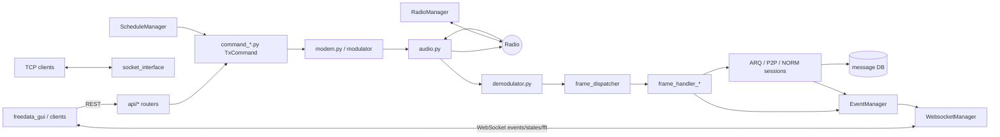

# FreeDATA Server — Developer Documentation

`freedata_server` is the backend of FreeDATA: an HF data modem built on the
[codec2](https://github.com/drowe67/codec2) FreeDV data modes, exposed through a
FastAPI REST/WebSocket API (consumed by `freedata_gui`) and an optional
VARA-style TCP socket interface.

These documents describe the code as it currently is. Each one ends with a list
of known issues and oddities that remain in the source.

## Contents

| Document | Covers |
|---|---|
| [architecture.md](architecture.md) | Startup, `AppContext`, threads and queues, managers (event, state, service, radio, schedule, websocket), configuration keys, events, scheduled jobs, utility modules |
| [api.md](api.md) | REST endpoint reference, WebSocket streams, validation, how API calls become transmit commands |
| [modem-audio-radio.md](modem-audio-radio.md) | RX/TX audio paths, codec2 ctypes binding and modes, demodulators, audio devices, CW ID, radio control backends (rigctld, flrig, serial PTT, dummy) |
| [protocol-frames.md](protocol-frames.md) | Frame types, byte layouts, frame dispatch and handlers, `TxCommand` classes |
| [arq-sessions.md](arq-sessions.md) | ARQ ISS/IRS state machines, speed-level adaptation, data-type handlers, P2P connections, TCP socket interface, NORM broadcasts |
| [message-system.md](message-system.md) | SQLite database and schema, P2P message lifecycle and wire format, attachments, beacons, stations, broadcasts |
| [testing.md](testing.md) | Running the test suite, test-mode mechanics, test isolation, writing tests, known gaps |

## Big picture

Everything shares a single `AppContext` ([context.py](../context.py)) created
in [server.py](../server.py), which holds the config, managers and inter-thread
queues. Start with [architecture.md](architecture.md).

## Reading order for new contributors

1. [architecture.md](architecture.md): how the process is wired together.
2. [protocol-frames.md](protocol-frames.md): what goes over the air.
3. [arq-sessions.md](arq-sessions.md): reliable transfer on top of those frames.
4. [message-system.md](message-system.md): the main user feature built on ARQ.
5. [api.md](api.md) and [modem-audio-radio.md](modem-audio-radio.md) as reference.
6. [testing.md](testing.md) before changing behaviour: run the suite, then add a test.
