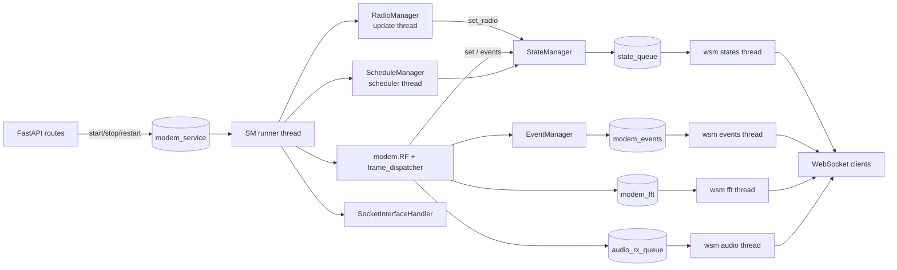

# FreeDATA Server Architecture

This document covers the core runtime of `freedata_server`: process startup, the shared
`AppContext`, the manager classes, threads and queues, configuration, the event system,
scheduled jobs and the small utility modules. Protocol, modem/DSP, API router and database
details are documented separately.

Files covered: [server.py](../server.py), [context.py](../context.py), [constants.py](../constants.py),
[config.py](../config.py), [config.ini.example](../config.ini.example), [event_manager.py](../event_manager.py),
[state_manager.py](../state_manager.py), [schedule_manager.py](../schedule_manager.py),
[service_manager.py](../service_manager.py), [radio_manager.py](../radio_manager.py),
[websocket_manager.py](../websocket_manager.py), [log_handler.py](../log_handler.py), [stats.py](../stats.py),
[explorer.py](../explorer.py), [adif_udp_logger.py](../adif_udp_logger.py),
[wavelog_api_logger.py](../wavelog_api_logger.py), [helpers.py](../helpers.py), [maidenhead.py](../maidenhead.py),
[exceptions.py](../exceptions.py), [serial_ports.py](../serial_ports.py),
[list_ports_winreg.py](../list_ports_winreg.py), [\_\_init\_\_.py](../__init__.py) (empty).

---

## 1. Startup sequence

The console entry point is `freedata = "freedata_server.server:main"` (see `pyproject.toml` in the
repository root). Most of the startup work happens at **module import time** of
[server.py](../server.py); `main()` only launches uvicorn.

### 1.1 Import-time steps in `server.py`

1. **Resolve the config path** - `resolve_config_path()`:
   - Uses env var `FREEDATA_CONFIG` (`constants.CONFIG_ENV_VAR`) if set, otherwise
     `DEFAULT_APP_DIR/config.ini`. The path is made absolute.
   - `DEFAULT_APP_DIR` ([constants.py](../constants.py)) is per-OS:
     | OS | Directory |
     |---|---|
     | Windows | `%APPDATA%\FreeDATA` (falls back to `~`) |
     | macOS | `~/Library/Application Support/FreeDATA` |
     | Linux/other | `$XDG_CONFIG_HOME/FreeDATA` or `~/.config/FreeDATA` |
   - If the file does not exist, the directory is created and the bundled
     [config.ini.example](../config.ini.example) is copied there (message to stderr). If the template
     is missing or an `OSError` occurs, the process exits with code 1.
2. **Logging** - `setup_logging(filename=<config dir>/freedata_server.log, level="INFO")`
   ([log_handler.py](../log_handler.py)). The log file always lives next to the config file.
3. **AppContext** - `ctx = AppContext(config_file)` followed by `ctx.startup()` (see section 2).
   Note: constructing `AppContext` already starts the service-manager runner thread.
   `ctx.radio_manager` stays `None` until the service manager processes `start`.
4. **FastAPI app** - `FastAPI(title="FreeDATA API", version=str(API_VERSION), lifespan=lifespan)`.
   - `app.state.ctx = ctx` - used by the dependency `context.get_ctx()`, which returns
     `request.app.state.ctx` (or the WebSocket equivalent).
   - `lifespan`: nothing on startup; on exit calls `ctx.shutdown()`, logs "Shutdown complete" and
     then calls `os._exit(0)`, so leftover threads (audio, rig, sockets) cannot keep the process alive.
   - `CORSMiddleware` with `allow_origins=["*"]`, all methods/headers, credentials allowed.
   - HTTP middleware `nocache` sets `Cache-Control: no-store, no-cache, must-revalidate, private`
     and `Pragma: no-cache` on every response and logs `[API] METHOD path -> status`.
5. **GUI static mounting** - the first existing directory of:
   | Candidate | Comment in code |
   |---|---|
   | `<package dir>/gui` | nuitka standalone build |
   | `<package parent>/freedata_gui/dist` | pip install (sibling package) |
   | `../freedata_gui/dist` | cwd-relative fallback |
   | `freedata_gui/dist` | cwd-relative fallback |
   | `FreeDATA/freedata_gui/dist` | cwd-relative fallback |

   is mounted at `/gui` via `StaticFiles(directory=..., html=True)`. If none exists a warning
   listing all searched candidates is logged.
6. **Routers** registered:
   | Router module | Prefix | Tag |
   |---|---|---|
   | `api.general` | `""` | General |
   | `api.config` | `/config` | Configuration |
   | `api.devices` | `/devices` | Devices |
   | `api.radio` | `/radio` | Radio |
   | `api.modem` | `/modem` | Modem |
   | `api.freedata` | `/freedata` | FreeDATA |
   | `api.websocket` | `""` | WebSocket |

### 1.2 `main()`

- `host = config["NETWORK"]["modemaddress"] or "0.0.0.0"`, `port = int(config["NETWORK"]["modemport"])`
  (default 5000).
- If a GUI dir was found, logs `[GUI] AVAILABLE ON http://<host>:<port>/gui` and, if
  `GUI.auto_run_browser` is true (default `True` when missing), starts a daemon thread that waits 2 s
  and calls `webbrowser.open(url)`.
- `uvicorn.run(app, host=host, port=port, log_config=None, log_level="info")` - `log_config=None`
  keeps the structlog/stdlib configuration from `setup_logging`.

### 1.3 `AppContext.startup()` / `shutdown()`

[context.py](../context.py)

`startup()`:
1. `config_manager.read()`
2. `websocket_manager.startWorkerThreads(self)` - starts the four WebSocket push threads.
3. `modem_service.put("start")` - the service-manager runner thread then starts radio manager,
   modem and (optionally) socket interface.
4. Database setup: `DatabaseManager(self)` -> `check_database_version()`,
   `initialize_default_values()`, `database_repair_and_cleanup()`; then
   `DatabaseManagerAttachments(self).clean_orphaned_attachments()`.

`shutdown()`:
1. For every IRS session: `transmission_aborted()`; for every ISS session:
   `abort_transmission(send_stop=False)` + `transmission_aborted()` (exceptions swallowed).
2. `websocket_manager.shutdown()`, `schedule_manager.stop()`, `service_manager.shutdown()`.

`shutdown()` returns normally and does **not** exit the process, so tests can create and shut down
several contexts in one interpreter. The hard `os._exit(0)` lives in the server's `lifespan` hook
(section 1.1) and is only used when the server itself stops.

---

## 2. AppContext

`AppContext` ([context.py](../context.py)) is the single object passed (as `ctx`) to virtually every
component. Construction order matters because several managers start threads in their constructors.

### 2.1 Attributes

| Attribute | Type / initial value | Notes |
|---|---|---|
| `config_manager` | `CONFIG(self, config_file)` | Created first; reads + validates the config file. |
| `constants` | the `constants` module | e.g. `ctx.constants.MODEM_VERSION`. |
| `p2p_data_queue` | `Queue()` | No producer/consumer in the package outside `context.py`; referenced only by tests. |
| `state_queue` | `Queue()` | State/radio updates (see 2.2). |
| `modem_events` | `Queue()` | Event bus output (see 2.2). |
| `modem_fft` | `Queue()` | FFT data for the waterfall. |
| `modem_service` | `Queue()` | Commands for the service manager. |
| `audio_rx_queue` | `Queue(maxsize=10)` | Streaming RX audio chunks. |
| `event_manager` | `EventManager(self, [self.modem_events])` | Broadcasts only into `modem_events`. |
| `state_manager` | `StateManager(self.state_queue)` | |
| `schedule_manager` | `ScheduleManager(self)` | Scheduler thread started later by `start(modem)`. |
| `service_manager` | `ServiceManager(self)` (`service_manager.SM`) | Starts its runner thread in `__init__`; sets `ctx.rf_modem = False`. |
| `websocket_manager` | `WebsocketManager(self)` (`websocket_manager.wsm`) | Threads started in `startup()`. |
| `radio_manager` | `None` | Created only by the service manager (`start_radio_manager()` on `start`/`restart`); reset to `None` on `stop`/`restart`. API code must handle `None` (e.g. `POST /radio/` returns 503). |
| `socket_interface_manager` | `None` | Set by the service manager if `SOCKET_INTERFACE.enable`. |
| `rf_modem` | `None` (then `False` from `SM.__init__`) | `modem.RF` instance once started; `None` after stop. |
| `message_system_db_manager` | `DatabaseManager(self)` | |
| `message_system_db_attachments` | `DatabaseManagerAttachments(self)` | |
| `TESTMODE` | `False` | When true, events are also copied to `TESTMODE_EVENTS`, and `start_modem` skips the audio test. |
| `TESTMODE_TRANSMIT_QUEUE` | `Queue()` | Filled by `modem.py` with `[mode, frames]` in test mode. |
| `TESTMODE_RECEIVE_QUEUE` | `Queue()` | Used by tests. |
| `TESTMODE_EVENTS` | `Queue()` | Copy of every broadcast event in test mode. |

`CONFIG.write_to_file()` additionally sets `ctx.config` (the freshly re-read dict) as a side effect;
the rest of the code reads configuration through `ctx.config_manager.config`.

### 2.2 Queue ownership

| Queue | Producers | Consumer |
|---|---|---|
| `modem_events` | `EventManager.broadcast()` (all event helpers) | `wsm` events thread -> `events_client_list` |
| `state_queue` | `StateManager.sendState/sendStateUpdate/set/set_radio/set_channel_slot_busy/add_activity` | `wsm` states thread -> `states_client_list` |
| `modem_fft` | `audio.calculate_fft(...)` called from `modem.py` | `wsm` fft thread -> `fft_client_list` |
| `audio_rx_queue` | `modem.py` `enqueue_streaming_audio_chunks(...)` | `wsm` audio thread -> `audio_rx_client_list` (binary frames) |
| `modem_service` | `AppContext.startup()` (`"start"`), `api/modem.py` (`"start"`, `"stop"`), `api/config.py` (`"restart"`), `modem.py` (`"stop"`), `SM.shutdown()` (`"stop"`, then `"shutdown"` as a wake-up) | `SM.runner` thread |
| `TESTMODE_*` | see table above | tests |

---

## 3. Threads and data flow

| Thread | Started by | Loop |
|---|---|---|
| Main / uvicorn event loop | `main()` | FastAPI request + WebSocket handling (`wsm.handle_connection` awaits `receive_text()` to detect disconnects). |
| `runner thread` (daemon) | `SM.__init__` | Blocking `modem_service.get()`; handles `start` / `stop` / `restart`; clears the queue after each command. |
| Radio update thread (daemon) | `RadioManager._init_rig_control()` | Every `refresh_rate` (1 s): `radio.get_parameters()` -> `state_manager.set_radio(...)`. |
| 4 WebSocket worker threads (daemon) | `wsm.startWorkerThreads()` | `queue.get(timeout=1)` -> send to every client in the matching set. |
| Scheduler thread (non-daemon) | `ScheduleManager.start(modem)` | `sched.scheduler.run()` executing the recurring jobs in section 7. |
| Browser opener (daemon) | `main()` | One-shot: wait 2 s, open browser. |
| ADIF UDP / Wavelog sender (daemon) | `send_adif_qso_data` / `send_wavelog_qso_data` | One-shot network send per QSO. |

Modem/DSP threads, the frame dispatcher and socket-interface servers are started by the service
manager but are documented elsewhere.

The WebSocket worker threads call `asyncio.run(client.send_text(...))` /
`asyncio.run(client.send_bytes(...))` from the worker thread for each client; a client that raises is
removed from its set.

---

## 4. Managers

### 4.1 EventManager - [event_manager.py](../event_manager.py)

Broadcasts dict events into a list of queues (in practice only `ctx.modem_events`).

- `broadcast(data)`: if `ctx.TESTMODE`, also puts into `TESTMODE_EVENTS`. For each queue: while
  `qsize() > 10` the **oldest** event is removed (`get_nowait()`), then `put(data)`.
- State: `lastpttstate` (dedupes PTT events).

Event payloads are listed in section 6.

### 4.2 StateManager - [state_manager.py](../state_manager.py)

Holds mutable runtime state and pushes state snapshots to `state_queue`.

**Important state**

| Attribute | Initial | Meaning |
|---|---|---|
| `channel_busy_slot` | `[False]*5` | Per-slot busy flags. |
| `channel_busy_event`, `channel_busy_condition_traffic`, `channel_busy_condition_codec2` | `threading.Event()`, all set (= channel free) | Channel-busy logic (see below). The constructor calls `set_channel_busy_condition_traffic(False)` and `set_channel_busy_condition_codec2(False)`, so the channel counts as free until the FFT or demodulator report otherwise. Without this, `is_receiving_codec2_signal()` would stay true when the modem isn't running and message sending would wait forever. |
| `is_modem_running` | `False` | |
| `is_modem_busy` | Event, set (= not busy) | Managed via `setARQ/getARQ`. |
| `is_beacon_running`, `is_away_from_key` | `False` | |
| `transmitting_event` | Event, set (= not transmitting) | Managed via `setTransmitting/isTransmitting`. |
| `audio_dbfs` | `0` | |
| `dxcallsign`, `dxgrid` | `b"ZZ9YY-0"`, `b"------"` | |
| `heard_stations` | `[]` | Rows built by `helpers.add_to_heard_stations`. |
| `activities_list` | `{}` | id (random 8-byte hex) -> activity dict. |
| `arq_iss_sessions`, `arq_irs_sessions` | `{}` | session id -> session object. |
| `p2p_connection_sessions` | `{}` | session_id -> P2P connection. |
| `radio_frequency`, `radio_mode`, `radio_bandwidth`, `radio_rf_level`, `s_meter_strength`, `radio_tuner`, `radio_swr`, `radio_status` | `0` / `None` / `False` | Radio mirror. |

**Key methods**

| Method | Behaviour |
|---|---|
| `set(key, value)` | `setattr`, then builds a `state-change` event and enqueues it only if it differs from the last one (`newstate`). |
| `set_radio(key, value)` | Same for `radio-change` events (`newradio`). |
| `sendState()` | Enqueues a full `state` event and returns it. |
| `sendStateUpdate(state)` | Raw enqueue. |
| `get_state_event(changed)` | `{"type": "state"\|"state-change", is_modem_running, is_beacon_running, is_away_from_key, radio_status, channel_busy_slot, is_codec2_traffic, audio_dbfs, activities, is_modem_busy}` |
| `get_radio_event(changed)` | `{"type": "radio"\|"radio-change", radio_status, radio_frequency, radio_rf_level, radio_mode, s_meter_strength, radio_swr, radio_tuner}` |
| `get_radio_status()` | Same radio fields without `type`. |
| `set_channel_slot_busy(array)` | Replaces `channel_busy_slot` and enqueues a `state-change` if any slot differs. |
| `setTransmitting(bool)` / `isTransmitting()` / `waitForTransmission()` | `transmitting_event` cleared while transmitting; `waitForTransmission()` blocks until set. |
| `setARQ(bool)` / `getARQ()` | `getARQ()` returns `True` while busy (event cleared). |
| `waitForChannelBusy()` | `channel_busy_event.wait(2)`. |
| `set_channel_busy_condition_traffic(busy)` / `set_channel_busy_condition_codec2(traffic)` | Set the condition event when not busy, otherwise `.clear()` it; then `calculate_channel_busy_state()`. |
| `calculate_channel_busy_state()` | Sets `channel_busy_event` (= channel available) if both conditions are set, otherwise `.clear()`s it. |
| `is_receiving_codec2_signal()` | `not channel_busy_condition_codec2.is_set()`. |
| `register_/get_/remove_arq_iss_session`, `..._irs_session` | Dict management; `register_*` returns `False` on duplicate id; `get_*` returns `None` for unknown ids. |
| `check_if_running_arq_session(irs=False)` | Removes outdated sessions (`is_session_outdated()`), returns `True` if any session is not in `ENDED/ABORTED/FAILED`. |
| `stop_transmission()` | IRS: `transmission_aborted()` (kept for resume). ISS: `abort_transmission(send_stop=False)`, `transmission_aborted()`, removed. |
| `add_activity(data)` | Adds `timestamp` / `frequency` if missing, stores under random id, enqueues `self.newstate`. |
| `register_/get_p2p_connection_session` | Dict management keyed by `session.session_id`; `get_*` returns `None` for unknown ids. |
| `get_dxcall_by_session_id(id)` | Looks in ISS, IRS (`.dxcall`), then P2P (`.destination`); `None` if not found. |

### 4.3 ServiceManager (`SM`) - [service_manager.py](../service_manager.py)

Owns the modem lifecycle. Constructor sets `ctx.rf_modem = False`, creates `shutdown_flag` and
starts the `runner thread` (a daemon thread, so an `AppContext` that is never shut down cannot keep
the interpreter alive).

**Commands processed by `runner()`**

| Command | Actions |
|---|---|
| `start` | `config_manager.read()`, `start_radio_manager()`, `start_modem()`, then `SocketInterfaceHandler(ctx).start_servers()` if `SOCKET_INTERFACE.enable`, else `socket_interface_manager = None`. |
| `stop` (only if `ctx.rf_modem` is truthy) | `stop_modem()`, `stop_radio_manager()`, stop socket servers if enabled, wait 0.5 s ("avoiding a portaudio crash"). |
| `restart` | stop modem, radio manager, socket servers; wait 0.5 s; `config_manager.read()`; `start_modem()` (emits `modem_restarted` on success); `start_radio_manager()`; restart socket servers if enabled. |
| anything else | warning `[SVC] freedata_server command processing failed`. |

After each command the remaining queue content is discarded (`modem_service.queue.clear()`).

**Methods**

- `start_modem()` -> `bool`: refuses if `STATION.mycall == "XX1XXX"` or the modem already runs.
  Unless `TESTMODE`, runs `test_audio()`; on failure sets `is_modem_running=False` and emits
  `modem_failed`. Otherwise creates `ctx.rf_modem = modem.RF(ctx)`, `frame_dispatcher.DISPATCHER(ctx)`
  (`.start()`), emits `modem_started`, sets `is_modem_running=True`, calls `rf_modem.start_modem()`
  and `schedule_manager.start(rf_modem)`.
- `stop_modem()`: `rf_modem.stop_modem()`, `rf_modem=None`, `is_modem_running=False`,
  `schedule_manager.stop()`, `frame_dispatcher.stop()` if the service manager holds one, emits `modem_stopped`.
- `test_audio()`: `audio.test_audio_devices(AUDIO.input_device, AUDIO.output_device)`; `[False, False]` on exception.
- `start_radio_manager()`: calls `stop_radio_manager()` first (so only one instance runs), then
  `ctx.radio_manager = RadioManager(ctx)`.
- `stop_radio_manager()`: if `ctx.radio_manager` is set, `ctx.radio_manager.stop()`; `ctx.radio_manager = None`.
- `shutdown()`: puts `"stop"`, waits 2 s, sets `shutdown_flag`, then puts `"shutdown"` to wake the
  runner (which is blocked in `modem_service.get()`) so it sees the flag and returns; joins the
  runner (5 s).

### 4.4 RadioManager - [radio_manager.py](../radio_manager.py)

Selects a rig backend from `RADIO.control` and mirrors radio parameters into the state manager.

| `RADIO.control` | Backend |
|---|---|
| `rigctld`, `rigctld_bundle` | `rigctld.radio(ctx)` |
| `serial_ptt` | `serial_ptt.radio(ctx)` |
| `flrig` | `flrig.radio(ctx)` |
| anything else (e.g. `disabled`) | `rigdummy.radio()` |

- `set_ptt(state)`: calls backend `set_ptt`; when switching off it is sent twice ("reducing chance of
  stuck PTT"); then attempts to notify the socket interface command handler (`socket_respond_ptt`).
- `set_tuner`, `set_frequency`, `set_mode`, `set_rf_level`: call backend and `state_manager.set_radio(...)`.
- `update_parameters()` (thread, every 1 s): reads `frequency, mode, bandwidth, rf, tuner, strength`
  and, while transmitting, `alc` (stored in `self.radio_alc`) and `swr`.
- `stop()`: sets `stop_event`, `radio.disconnect()`, `radio.stop_service()`.

### 4.5 WebsocketManager (`wsm`) - [websocket_manager.py](../websocket_manager.py)

- Client sets: `events_client_list`, `fft_client_list`, `states_client_list`, `audio_rx_client_list`.
- `handle_connection(websocket, client_list, event_queue)` (async): adds the client, then loops on
  `receive_text()` until an exception, then removes it. `event_queue` is unused.
- `transmit_sock_data_worker(client_list, queue)`: JSON-encodes each non-empty item and sends text.
- `transmit_sock_audio_worker(client_list, queue)`: sends `np.ndarray` items as raw bytes
  (`ndarray.tobytes()`); other item types are ignored.
- `startWorkerThreads(app)`: events <- `modem_events`, states <- `state_queue`, fft <- `modem_fft`,
  audio <- `audio_rx_queue`.
- `shutdown()`: sets `shutdown_flag`, joins each thread with 0.5 s timeout.

### 4.6 ScheduleManager - [schedule_manager.py](../schedule_manager.py)

Uses `sched.scheduler(time.time, self.stop_event.wait)`, so the scheduler sleeps on an Event that
`stop()` can interrupt. `start(modem)` waits 0.1 s, stores the modem, clears `stop_event`, sets
`running=True`, enters every job with delay 0 and runs the scheduler in a new non-daemon thread.
`schedule_event()` runs the job and re-enters it after `interval` while `running`.
`stop()` clears `running`, cancels all queued events, sets `stop_event` (waking the thread at once
instead of after up to 600 s, the longest job interval) and joins the thread (1 s). `start` is called
from `SM.start_modem()`; `stop` from `SM.stop_modem()` and `AppContext.shutdown()`. Jobs are
listed in section 7.

### 4.7 CONFIG - [config.py](../config.py)

See section 5.

---

## 5. Configuration

### 5.1 Sections and keys

Defined in `CONFIG.config_types`; example values from [config.ini.example](../config.ini.example).

| Section | Key | Type | Example |
|---|---|---|---|
| NETWORK | `modemaddress` | str | `127.0.0.1` |
| | `modemport` | int | `5000` |
| STATION | `mycall` | str | `AA1AAA` |
| | `mygrid` | str | `JN48ea` |
| | `myssid` | int | `1` |
| | `ssid_list` | list | `[0, 1, ..., 9]` |
| | `enable_explorer` | bool | `False` |
| | `enable_stats` | bool | `False` |
| | `respond_to_cq` | bool | `True` |
| | `enable_callsign_blacklist` | bool | `False` |
| | `callsign_blacklist` | list | `[]` |
| AUDIO | `input_device` | str | `5a1c` |
| | `output_device` | str | `bd6c` |
| | `rx_audio_level` | int | `0` |
| | `tx_audio_level` | int | `0` |
| | `rx_auto_audio_level` | bool | `True` |
| | `tx_auto_audio_level` | bool | `False` |
| RADIO | `control` | str | `disabled` |
| | `serial_port` | str | `/dev/cu.Bluetooth-Incoming-Port` |
| | `model_id` | int | `1001` |
| | `serial_speed` | int | `38400` |
| | `data_bits` | int | `8` |
| | `stop_bits` | int | `1` |
| | `serial_handshake` | str | `ignore` |
| | `ptt_port` | str | `ignore` |
| | `ptt_mode` | str | `TX` |
| | `ptt_type` | str | `USB` |
| | `serial_dcd` | str | `NONE` |
| | `serial_dtr` | str | `OFF` |
| | `serial_rts` | str | `OFF` |
| RIGCTLD | `ip` | str | `127.0.0.1` |
| | `port` | int | `4532` |
| | `path` | str | (empty) |
| | `command` | str | (empty) |
| | `arguments` | str | (empty) |
| | `enable_vfo` | bool | `False` |
| FLRIG | `ip` | str | `127.0.0.1` |
| | `port` | int | `12345` |
| MODEM | `enable_morse_identifier` | bool | `False` |
| | `maximum_bandwidth` | int | `2438` |
| | `tx_delay` | int | `50` |
| SOCKET_INTERFACE | `enable` | bool | `False` |
| | `host` | str | `127.0.0.1` |
| | `cmd_port` | int | `9000` |
| | `data_port` | int | `9001` |
| MESSAGES | `enable_auto_repeat` | bool | `True` |
| QSO_LOGGING | `enable_adif_udp` | bool | `False` |
| | `adif_udp_host` | str | `127.0.0.1` |
| | `adif_udp_port` | int | `2237` |
| | `enable_adif_wavelog` | bool | `False` |
| | `adif_wavelog_host` | str | `http://raspberrypi` |
| | `adif_wavelog_api_key` | str | `API-KEY` |
| GUI | `auto_run_browser` | bool | `True` |
| | `distance_unit` | str | `km` |
| EXP | `enable_ring_buffer` | bool | `False` |
| | `enable_vhf` | bool | `False` |
| | `enable_groupchat` | bool | `False` |

`STATION.enable_stats` controls whether ARQ IRS sessions push session statistics to
`STATS_API_URL` (see `stats.py` in section 9).

### 5.2 Loading, validation and type conversion

`CONFIG.__init__(ctx, configfile)`:
1. `ConfigParser(inline_comment_prefixes="#", allow_no_value=True)`.
2. `config_exists()` - `parser.read(file)`; returns `True` if a file was read.
3. `validate_config()` - **rewrites the file structure**:
   - removes sections and keys not present in `config_types` (logged);
   - adds missing sections/keys with defaults by type: `list -> "[]"`, `bool -> "False"`,
     `int -> "0"`, `str -> ""`;
   - writes the file (`write_to_file()`).
4. `read()` - builds `{section: {key: value}}` and converts each value via `handle_setting()`.

`handle_setting(section, key, value, is_writing)`:

| Type | Reading | Writing |
|---|---|---|
| list | `json.loads(str)` (lists passed through) | JSON string (strings are first `json.loads`-ed) |
| bool | `parser.getboolean()` | unchanged |
| int | `parser.getint()` | unchanged |
| str | unchanged | unchanged |

Unknown keys log `[CFG] key error ...` and return `None`.

`read()` re-reads the file from disk on every call (via `config_exists()`), stores the result in
`self.config` and returns it (`False` on error).

### 5.3 Writing and applying changes at runtime

- `write(data)`: `validate_data(data)` checks each value with `isinstance` against `config_types`
  and raises `ValueError` on mismatch; then each value is converted with `handle_setting(..., True)`,
  stored in the parser and `write_to_file()` is called (creates the directory if needed, writes,
  re-reads, sets `ctx.config`, returns the dict or `False`).
- Runtime application: the config API route (`api/config.py`) writes the new config and then puts
  `"restart"` into `ctx.modem_service`. The service manager's restart handler stops modem, radio
  manager and socket interface, calls `config_manager.read()`, and starts them again. Components
  that read `ctx.config_manager.config[...]` on each use (scheduler jobs, explorer, loggers) see the
  new values immediately after the write.

---

## 6. Event system

All events go through `EventManager.broadcast()` into `ctx.modem_events` and are pushed as JSON to
clients on the events WebSocket.

| Method | Payload |
|---|---|
| `send_ptt_change(on)` | `{"ptt": bool}` (only when changed from `lastpttstate`) |
| `send_scatter_change(data)` | `{"scatter": json.dumps(data)}` |
| `send_buffer_overflow(data)` | `{"buffer-overflow": str(data)}` |
| `send_custom_event(**kw)` | `kw` as-is |
| `send_arq_session_new(outbound, session_id, dxcall, total_bytes, state)` | `{"type": "arq", "arq-transfer-<outbound\|inbound>": {session_id, dxcall, total_bytes, state}}` |
| `send_arq_session_progress(outbound, session_id, dxcall, received_bytes, total_bytes, state, speed_level, statistics=None)` | `{"type": "arq", "arq-transfer-<dir>": {session_id, dxcall, received_bytes, total_bytes, state, speed_level, statistics}}` |
| `send_arq_session_finished(outbound, session_id, dxcall, success, state, data=False, statistics=None)` | `{"type": "arq", "arq-transfer-<dir>": {session_id, dxcall, statistics, success, state, data}}` - `data` is base64 (dicts are JSON-encoded first); `False` if no data. |
| `modem_started()` | `{"freedata_server": "started"}` |
| `modem_restarted()` | `{"freedata_server": "restarted"}` |
| `modem_stopped()` | `{"freedata_server": "stopped"}` |
| `modem_failed()` | `{"freedata_server": "failed"}` |
| `freedata_message_db_change(message_id=None)` | `{"message-db": "changed", "message_id": id}` |
| `freedata_logging(type, status, message)` | `{"type": "message-logging", "endpoint": type, "status": status, "message": message}` |

State and radio snapshots (`state`, `state-change`, `radio`, `radio-change`) are not events; they
travel through `state_queue` to the states WebSocket (section 4.2).

---

## 7. Scheduled jobs

From `ScheduleManager.events` ([schedule_manager.py](../schedule_manager.py)). All start immediately
when the scheduler starts.

| Job | Interval (s) | Condition | Action |
|---|---|---|---|
| `check_for_queued_messages` | 15 | `not getARQ()`, `channel_busy_event.is_set()` (channel available), modem running | `DatabaseManagerMessages.get_first_queued_message()` -> `SendMessageCommand(ctx, msg).transmit()` |
| `explorer_publishing` | 60 | `STATION.enable_explorer` and modem running | `explorer.Explorer(ctx).push()` |
| `transmitting_beacon` | 600 | not ARQ busy, `is_beacon_running`, modem running | `command_beacon.BeaconCommand(ctx).run()` |
| `beacon_cleanup` | 600 | always | `DatabaseManagerBeacon.beacon_cleanup_older_than_days(2)` |
| `update_transmission_state` | 10 | always | IRS sessions idle > 90 s: removed from the state manager if `ENDED`, otherwise set to `RESUME` (unless already `RESUME`). ISS sessions idle > 90 s in `ABORTED`/`FAILED` are removed. |
| `check_missing_broadcast_bursts` | 20 | `EXP.enable_groupchat` and modem running | `DatabaseManagerBroadcasts.check_missing_bursts()`; if any, increment attempts and send a NORM NACK burst via `NormTransmission.create_and_transmit_nack_burst()` |
| `check_queued_messages` | 20 | `EXP.enable_groupchat` and modem running | First queued broadcast -> increment attempts -> `NormTransmissionISS.retransmit_data(msg)` |

Most jobs catch exceptions and `print()` them.

---

## 8. Logging

[log_handler.py](../log_handler.py) `setup_logging(filename="", level="DEBUG")`:
- stdlib `dictConfig` with a colored structlog `ConsoleRenderer` on stdout and, when `filename` is
  given, a `RotatingFileHandler` (10 MB, 10 backups) with a plain renderer.
- structlog configured with log level, positional-argument formatting, ISO timestamps, stack/exception
  rendering, stdlib `LoggerFactory`/`BoundLogger`, logger caching.
- Installs `sys.excepthook` that logs uncaught exceptions (except `KeyboardInterrupt`).
- Returns a structlog logger. `server.py` calls it with level `INFO`.

---

## 9. Utility modules

- **[constants.py](../constants.py)** - `CONFIG_ENV_VAR="FREEDATA_CONFIG"`, `DEFAULT_CONFIG_FILE="config.ini"`,
  `DEFAULT_APP_DIR`, `MODEM_VERSION="0.19.0"`, `API_VERSION=4`, `ARQ_PROTOCOL_VERSION=1`,
  `LICENSE="GPL3.0"`, `DOCUMENTATION_URL`, `STATS_API_URL`, `EXPLORER_API_URL`,
  `MESSAGE_SYSTEM_DATABASE_VERSION=2`. The `_default_app_dir()` docstring mentions
  `FREEDATA_DATABASE` as a second override variable.
- **[stats.py](../stats.py)** - `stats(ctx).push(status, session_statistics, dxcall, receiving=True)`
  POSTs session statistics (callsign, grid, frequency, avg SNR computed from the session's
  `snr_histogram`, bytes/min, size, duration, status, direction `IRS`/`ISS`, version, time/SNR/BPM
  histograms) to `STATS_API_URL`. Called by ARQ IRS sessions in a background daemon thread
  (`push_statistics`) when `STATION.enable_stats` is true. This happens after a received
  `ARQ_STOP` (`send_stop_ack`) and in `transmission_failed`, not after a successful transfer.
- **[explorer.py](../explorer.py)** - `Explorer(ctx).push()` POSTs station info (callsign-ssid, grid,
  frequency, strength, band `"USB"`, version, bandwidth, beacon, away-from-key) and a `lastheard` list
  built from `state_manager.heard_stations` to `EXPLORER_API_URL`. Skips the default callsigns
  `AA1AAA-1` and `XX1XXX-6`.
- **[adif_udp_logger.py](../adif_udp_logger.py)** - `send_adif_qso_data(ctx, adif_data)`: if
  `QSO_LOGGING.enable_adif_udp`, sends the ADIF string via UDP to `adif_udp_host:adif_udp_port` in a
  daemon thread (3 s timeout) and emits a `message-logging` event with `endpoint="udp"` and
  `status` True on success, False on timeout or error.
- **[wavelog_api_logger.py](../wavelog_api_logger.py)** - `send_wavelog_qso_data(ctx, data)`: if
  `QSO_LOGGING.enable_adif_wavelog`, POSTs `{key, station_profile_id: "1", type: "adif", string}` to
  `<adif_wavelog_host>/index.php/api/qso` in a daemon thread; emits `message-logging` with
  `endpoint="wavelog"` and `status` True/False.
- **[helpers.py](../helpers.py)** - Misc: busy-wait `wait()`; CRC-8 (CCITT, xorout 0x55), CRC-16
  (CCITT-FALSE), CRC-24 (OpenPGP), CRC-32 (bitwise reflected); `add_to_heard_stations()` (row
  `[call, grid, ts, datatype, snr, offset, freq, km, miles, away_from_key]`, replaced per callsign);
  callsign codecs `callsign_to_bytes`/`bytes_to_callsign`/`encode_call`/`decode_call` (6-bit chars +
  binary SSID in 6 bytes); `check_callsign()` (match CRC-24 across an SSID list);
  `check_session_id()`; grid codec `encode_grid`/`decode_grid` (26 bits in 4 bytes);
  `snr_to_bytes`/`snr_from_bytes` (x10, signed byte, clipped +-12.7); `safe_execute`,
  `return_key_from_object`, `bool_to_string`; HMAC token-file helpers (`get_hmac_salt`,
  `search_hmac_salt`, `delete_last_line_from_hmac_list`, `check_if_file_exists`) using `hmac/` files;
  bit/flag helpers (`set_bit`, `get_bit`, `set_flag`, `get_flag`); `find_binary_paths()` (search cwd
  and optionally PATH/Hamlib dirs, default `rigctld`); `kill_and_execute()` and `kill_process()` via psutil.
- **[maidenhead.py](../maidenhead.py)** - `haversine()` (km), `maidenhead_to_latlon()` (grid ->
  centre lat/lon), `latlon_to_maidenhead(lat, lon, precision=6)` (4/6/8 chars),
  `distance_between_locators()` (`{"kilometers", "miles"}`), `generate_full_maidenhead()` (pads 2- or
  4-char locators to 6 chars with **random** characters; other lengths except >6 raise `ValueError`).
- **[exceptions.py](../exceptions.py)** - `NoCallsign(UserWarning)`, `MessageStatusError(UserWarning)`.
- **[serial_ports.py](../serial_ports.py)** - `get_ports()` returns `[{"port", "description"}]`; the
  description is suffixed with the CRC-16 hex of the HWID. On Windows uses
  `freedata_server.list_ports_winreg`,
  otherwise `serial.tools.list_ports.comports()`.
- **[list_ports_winreg.py](../list_ports_winreg.py)** - Windows port enumeration from pyserial PR #70:
  combines `list_ports_windows.comports()` with ports from `HKLM\HARDWARE\DEVICEMAP\SERIALCOMM`
  (`winreg_comports`, `comports_list`, `comports`) to include virtual COM ports.
- **[\_\_init\_\_.py](../__init__.py)** - empty.

---

## 10. Known oddities

Behaviour visible in the code that may surprise maintainers:

- `ctx.radio_manager` is `None` until the service manager has processed `start` (and again after
  `stop`); code using it has to check for `None`.
- `EventManager.broadcast()` keeps each queue bounded at about 10 entries by dropping the oldest
  events, so a slow consumer loses old events.
- `stats.py` and `explorer.py` `json.dumps()` the payload and then pass it to
  `requests.post(json=...)`, so the body is a JSON-encoded string (double encoding).
- When `modemaddress` is empty the logged/opened GUI URL uses `0.0.0.0`.
- The server exits with `os._exit(0)` from its `lifespan` hook, so `atexit` handlers don't run when
  the server stops.
