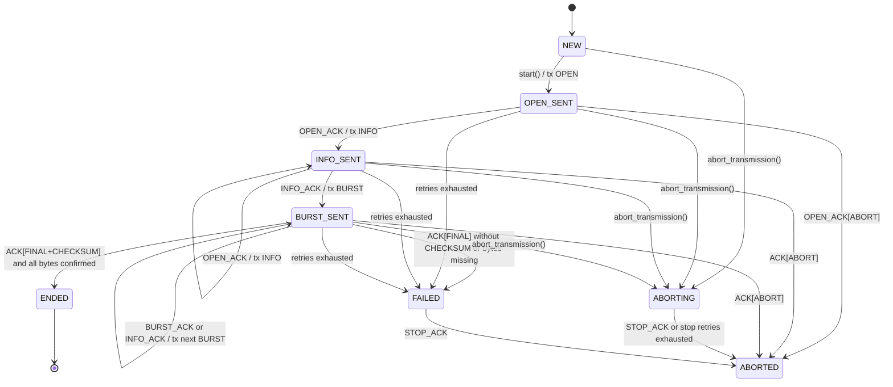
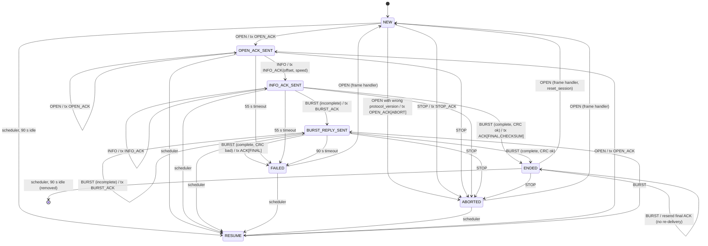
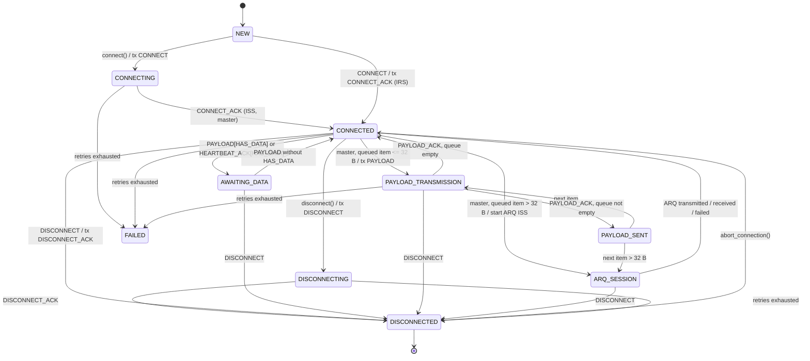
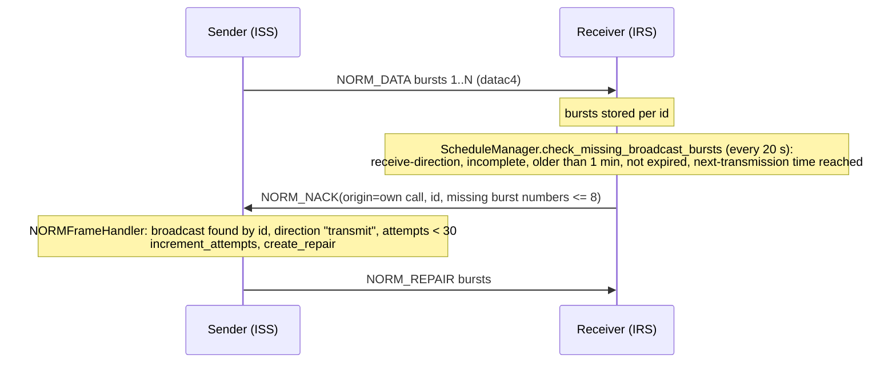

# ARQ sessions, P2P connections, socket interface and NORM broadcasts

This document covers the stateful protocols built on top of the frames described in
[protocol-frames.md](protocol-frames.md).

Scope:
[arq_session.py](../arq_session.py),
[arq_session_iss.py](../arq_session_iss.py),
[arq_session_irs.py](../arq_session_irs.py),
[arq_data_type_handler.py](../arq_data_type_handler.py),
[p2p_connection.py](../p2p_connection.py),
[socket_interface.py](../socket_interface.py),
[socket_interface_commands.py](../socket_interface_commands.py),
[socket_interface_data.py](../socket_interface_data.py),
[norm/](../norm/).

Terminology: **ISS** = Information Sending Station (sender), **IRS** = Information Receiving Station (receiver).

---

## 1. Common ARQ session base (`ARQSession`)

[arq_session.py](../arq_session.py)

| Aspect | Behaviour |
|---|---|
| Creation | `__init__` calls `state_manager.setARQ(True)` (modem "busy" flag) and sets `protocol_version = constants.ARQ_PROTOCOL_VERSION` (= 1 in [constants.py](../constants.py)), `speed_level = 0`, `frames_per_burst = 1` and `session_max_age = 500` s |
| Frame input | `on_frame_received(frame)` sets `event_frame_received`, then looks up `STATE_TRANSITION[state][frame_type_int]` and calls the named method. Each action returns `(data, type_byte)`. If `data` is a `bytearray` and `type_byte` an `int`, `ARQDataTypeHandler.dispatch(type_byte, data, stats, session_id=self.id)` is called. Unknown (state, frame) pairs are logged and ignored |
| Output | `transmit_frame(frame, mode="auto")` calls `rf_modem.transmit(mode, 1, 1, frame)`. `"auto"` means the mode of the current speed level |
| State | `set_state()` updates `last_state_change_timestamp` (used by the scheduler, see 2.4) |
| Statistics | `calculate_session_statistics(confirmed, total)` returns `total_bytes`, `duration`, `bytes_per_minute`, `bits_per_second` and time/SNR/BPM/BPS histograms. `update_histograms()` appends one sample and keeps the last 20 |
| Cleanup | `is_session_outdated()`: state in `FAILED/ENDED/ABORTED` and `session_ended` older than 500 s. It is used by `state_manager.check_if_running_arq_session()` |
| `reset_session()` | Clears received data/CRC/length, `delivered_crc`, histograms, `maximum_bandwidth` and `abort` |

---

## 2. ARQ ISS (sender) state machine

[arq_session_iss.py](../arq_session_iss.py), class `ARQSessionISS`, states `ISS_State`.

### 2.1 Constants

| Constant | Value | Used for |
|---|---:|---|
| `RETRIES_CONNECT` | 5 | `ARQ_SESSION_OPEN` |
| `RETRIES_INFO` | 10 | `ARQ_SESSION_INFO` |
| `RETRIES_DATA` | 25 | each burst |
| `RETRIES_STOP` | 5 | `ARQ_STOP` |
| `TIMEOUT_CONNECT_ACK` | 4.5 s | wait after OPEN and after INFO |
| `TIMEOUT_TRANSFER` | 3.5 s | wait after a burst |
| `TIMEOUT_STOP_ACK` | 4.5 s | wait after STOP, and the delay before sending STOP |
| `TIMEOUT_CHANNEL_BUSY` | 0 | added to all of the above |

### 2.2 Session id and resume

`generate_id()`:

1. If an existing ISS session has the same `data_crc` (CRC-32 of the prepared data) and is `FAILED` or
   `ABORTED`, that session is removed and its id reused. This is the resume path. The IRS still holds its
   session under that id and reports its received byte offset in `ARQ_SESSION_INFO_ACK`.
2. Otherwise: `int.from_bytes(crc32, "little") % 256` if unused, else random 1-255. Returns `False` when 255
   sessions exist. Note that step 2 can yield `0`.

The constructor also calls `rf_modem.demodulator.set_decode_mode(modes_to_decode=None, is_arq_irs=False)`.

### 2.3 Retry engine

`launch_twr()` runs `transmit_wait_and_retry(frame_or_burst, timeout, retries, mode, isARQBurst)` in a
daemon thread:

* Loop while `retries > 0` and state is not `ABORTED`/`ABORTING`: transmit all frames, clear the event,
  wait `timeout`. If any frame arrives, return.
* Burst fallback: when `isARQBurst`, `speed_level > 0` and two timeouts have occurred
  (`retries == RETRIES_DATA - 2`), it sets `speed_level = 0`, calls `send_data(..., fallback=True)` (rebuilds
  the burst at level 0 from `confirmed_bytes` with a fresh retry thread), and returns.
* When the loop ends: if the state is `ABORTED`/`ABORTING` nothing more happens (an abort is not
  overridden). Otherwise `set_state(FAILED)` and `transmission_failed()`.

### 2.4 Transitions

| Current state | Trigger | Action | Next state |
|---|---|---|---|
| `NEW` | `start()` (from a command) | event `arq_session_new`; send `ARQ_SESSION_OPEN(dxcall, id, MODEM.maximum_bandwidth, protocol_version)` in `signalling`, 4.5 s x 5 | `OPEN_SENT` |
| `OPEN_SENT` | `ARQ_SESSION_OPEN_ACK` | `send_info`: if `ABORT` flag, `transmission_aborted`. Otherwise send `ARQ_SESSION_INFO(id, total_length, crc32, type_byte)` in `signalling`, 4.5 s x 10 | `INFO_SENT` (or `ABORTED`) |
| `INFO_SENT` | `ARQ_SESSION_OPEN_ACK` | `send_info` again | `INFO_SENT` |
| `INFO_SENT` | `ARQ_SESSION_INFO_ACK` | `send_data` (see below) | `BURST_SENT` |
| `BURST_SENT` | `ARQ_SESSION_INFO_ACK` or `ARQ_BURST_ACK` | `send_data` | `BURST_SENT` / `ENDED` / `FAILED` / `ABORTED` |
| `FAILED`, `ABORTING`, `ABORTED` | `ARQ_STOP_ACK` | `transmission_aborted` (no-op if already `ABORTED`/`ENDED`) | `ABORTED` |
| any waiting state (not `ABORTING`/`ABORTED`) | retries exhausted | `transmission_failed` | `FAILED` |
| any | `abort_transmission(send_stop)` | event `arq_session_finished(success=False)`; clear `rf_modem.audio_out_queue`; break retries; wait until not transmitting; if `send_stop`, wait 4.5 s then `send_stop()`; `setARQ(False)` | `ABORTING` |
| `ABORTING` | no `ARQ_STOP_ACK` after `RETRIES_STOP` stop frames (only when `send_stop`) | `transmission_aborted` | `ABORTED` |

`send_data(irs_frame, fallback=None)`:

1. If the ACK has `offset`, set `expected_byte_offset = offset`. If the state is `ABORTED`/`ABORTING`,
   return.
2. Update histograms. `update_speed_level(frame)` adopts the ACK's `speed_level` if it is in range.
3. Refresh `running_p2p_connection.last_data_timestamp` if the session belongs to a P2P connection.
4. `confirmed_bytes = expected_byte_offset` (capped at `total_length`, unchanged for fallback). Emit
   `arq_session_progress`.
5. `ABORT` flag -> `transmission_aborted`.
6. `FINAL` flag -> `transmission_ended` if `confirmed_bytes == total_length` and `CHECKSUM` is set,
   otherwise `transmission_failed`.
7. Otherwise build `frames_per_burst` (always 1) `ARQ_BURST_FRAME`s of `get_data_payload_size()` bytes
   starting at `confirmed_bytes`, in the speed-level mode, and send them with 3.5 s x 25 and
   `isARQBurst=True`.

Burst ACKs carry no offset (the field is commented out in the template). After a burst ACK,
`expected_byte_offset` therefore keeps the value set when the burst was built, i.e. the end of the
transmitted chunk.

Terminal handlers:

| Handler | Effects |
|---|---|
| `transmission_ended` | `ENDED`, event `arq_session_finished(success=True)`, `arq_data_type_handler.transmitted(type, data, stats, session_id=id)`, removes the ISS session, `setARQ(False)` |
| `transmission_failed` | `FAILED`, event `arq_session_finished(success=False)`, `setARQ(False)`, `arq_data_type_handler.failed(..., session_id=id)`. The session stays registered so it can be resumed |
| `transmission_aborted` | `ABORTED`, sets the event, event `arq_session_finished(success=False)`, `setARQ(False)` |

`ARQ_STOP` path: `send_stop()` builds `ARQ_STOP(id)` and starts `transmit_stop_and_wait()` in a daemon
thread (it does not use `launch_twr`, whose loop stops as soon as the state is `ABORTING`). That loop
sends the stop frame in `signalling` mode and waits `TIMEOUT_STOP_ACK` (4.5 s), up to `RETRIES_STOP` (5)
times, while the state stays `ABORTING`. If the state is still `ABORTING` afterwards, it calls
`transmission_aborted()` anyway. Currently no caller passes `send_stop=True`:
[context.py](../context.py) and [state_manager.py](../state_manager.py) call
`abort_transmission(send_stop=False)`, and [p2p_connection.py](../p2p_connection.py) calls
`abort_transmission()` (default `False`). Note that the IRS sends `ARQ_STOP_ACK` in `signalling_ack`
mode, where it is parsed as `ARQ_BURST_ACK` (see section 10), so in practice the stop loop would usually
end by exhausting its retries.

### 2.5 Scheduler interaction

`ScheduleManager.update_transmission_state` ([schedule_manager.py](../schedule_manager.py), every 10 s)
removes ISS sessions in `ABORTED`/`FAILED` whose last state change is more than 90 s old.

---

## 3. ARQ IRS (receiver) state machine

[arq_session_irs.py](../arq_session_irs.py), class `ARQSessionIRS`, states `IRS_State`.

### 3.1 Constants and waiting

| Constant | Value | Used after sending |
|---|---:|---|
| `TIMEOUT_CONNECT` | 55 s | `ARQ_SESSION_OPEN_ACK`, `ARQ_SESSION_INFO_ACK`, `ARQ_STOP_ACK` |
| `TIMEOUT_DATA` | 90 s | non-final `ARQ_BURST_ACK` |

The IRS never retries. `launch_transmit_and_wait()` sends once in a thread, then waits on
`event_frame_received`. On timeout, unless the state is `ABORTED`/`FAILED`, it calls `transmission_failed()`.
The final ACKs (success or CRC failure) are sent with `transmit_frame()` and no wait.

On creation, if a P2P connection with the same session id exists, the IRS links itself
(`running_p2p_connection.running_arq_session = self`) and sets that connection to `ARQ_SESSION`
(`get_p2p_connection_session` returns `None` when there is none). It also creates
`self.statistics = stats.stats(ctx)` for the optional statistics push, and initializes `delivered_crc = None`.

### 3.2 Transitions

| State | `ARQ_SESSION_OPEN` | `ARQ_SESSION_INFO` | `ARQ_BURST_FRAME` | `ARQ_STOP` |
|---|---|---|---|---|
| `NEW` | `send_open_ack` | - | - | `send_stop_ack` |
| `OPEN_ACK_SENT` | `send_open_ack` | `send_info_ack` | - | `send_stop_ack` |
| `INFO_ACK_SENT` | - | `send_info_ack` | `receive_data` | `send_stop_ack` |
| `BURST_REPLY_SENT` | - | - | `receive_data` | `send_stop_ack` |
| `ENDED` | - (handler resets, see 3.3) | - | `receive_data` | `send_stop_ack` |
| `FAILED` | - (handler resets to `NEW`) | - | `receive_data` | - |
| `ABORTED` | - (handler resets to `NEW`) | - | - | `send_stop_ack` |
| `RESUME` | `send_open_ack` | - | `receive_data` | - |

Actions:

| Action | Behaviour | Resulting state |
|---|---|---|
| `send_open_ack` | Negotiated bandwidth = `min(frame.maximum_bandwidth, MODEM.maximum_bandwidth)`. Event `arq_session_new`. If `protocol_version` differs, `abort = True` and state `ABORTED`. Sends `ARQ_SESSION_OPEN_ACK(id, dxcall, version, flag_abort)` in `signalling`, waits 55 s | `OPEN_ACK_SENT` (or `ABORTED`) |
| `send_info_ack` | If nothing has been received yet, allocates `received_data = bytearray(total_length)`. Stores `total_length`, `total_crc` (hex), `type_byte`. `calibrate_speed_settings()`. Sends `ARQ_SESSION_INFO_ACK(id, offset=received_bytes, speed_level, frames_per_burst=1, flag_abort)` in `signalling`, waits 55 s | `INFO_ACK_SENT` (unless `abort`) |
| `receive_data` (already delivered) | If `delivered_crc == total_crc`, the data was already handed to the data-type handler (the ISS probably missed the final ACK and repeats its last burst): resend `ARQ_BURST_ACK(FINAL, CHECKSUM)` in `signalling_ack`, return `(None, None)` | unchanged |
| `receive_data` (no buffer) | If `received_data is None` (e.g. after `transmission_failed`), the burst is logged and ignored; the ISS has to re-open the session | unchanged |
| `receive_data` (not complete) | `process_incoming_data` (see 3.4), histograms, `calibrate_speed_settings(burst_frame)`, `ARQ_BURST_ACK(id, speed_level, flag_abort)` in `signalling_ack`, waits 90 s | `BURST_REPLY_SENT` |
| `receive_data` (complete, CRC ok) | `ARQ_BURST_ACK(FINAL, CHECKSUM)`, `delivered_crc = total_crc`, event `arq_session_finished(success=True, data=received_data)`, returns `(received_data, type_byte)` -> data-type dispatch | `ENDED` |
| `receive_data` (complete, CRC bad) | `ARQ_BURST_ACK(FINAL, no CHECKSUM)`, then `transmission_failed()` | `FAILED` |
| `send_stop_ack` | `ARQ_STOP_ACK` in `signalling_ack`, waits 55 s, `setARQ(False)`, event `arq_session_finished(success=False)`; if `STATION.enable_stats`, pushes statistics in a daemon thread (`push_statistics`) | `ABORTED` |
| `transmission_failed` | Clears `received_data` and `received_bytes`, event `arq_session_finished` (outbound `False`), statistics push if enabled, `setARQ(False)` | `FAILED` |
| `abort_transmission()` | Sets `abort = True` only. Later INFO/BURST ACKs carry the `ABORT` flag, and the ISS aborts on receiving it | unchanged |

`ENDED` + `ARQ_BURST_FRAME` runs `receive_data` again. The `delivered_crc` guard resends the final ACK
without returning the data, so the data-type handler does not run a second time for the same data.
`reset_session()` (on a re-opened `ENDED` session) clears `delivered_crc`, so a new transfer under the
same id is delivered normally.

`FAILED` + `ARQ_BURST_FRAME` also runs `receive_data`, but because `transmission_failed` cleared
`received_data`, the burst is ignored until the ISS re-opens the session.

### 3.3 Session (re)creation in `ARQFrameHandler`

See [frame_handler_arq_session.py](../frame_handler_arq_session.py). On `ARQ_SESSION_OPEN` for a known
session id:

| Existing state | Handling before `on_frame_received` |
|---|---|
| `NEW`, `OPEN_ACK_SENT` | unchanged (lost OPEN_ACK, ISS retries) |
| `FAILED`, `ABORTED` | `state = NEW` |
| `ENDED` | `reset_session()`, `state = NEW` |
| others (e.g. `RESUME`) | unchanged |

For an unknown id, the open is discarded when `state_manager.check_if_running_arq_session()` reports a
running **ISS** session (the default `irs=False`). Otherwise a new IRS is created.

For `ARQ_SESSION_INFO`, `ARQ_BURST_FRAME` and `ARQ_STOP` (IRS) and the ACK frames (ISS), the session is
looked up with `get_arq_irs_session` / `get_arq_iss_session`. These return `None` for unknown ids, and
the handler then discards the frame with a warning.

`ScheduleManager.update_transmission_state` (every 10 s) looks at IRS sessions whose last state change is
more than 90 s old. Sessions in `ENDED` are removed from the state manager; all others are set to
`RESUME` (unless already `RESUME`).

### 3.4 Reassembly (`process_incoming_data`)

* If `frame.offset != received_bytes`, the mismatch is logged and `received_bytes` is set to the frame's
  offset. The frame is not rejected.
* `data_part` = frame data truncated to `total_length - received_bytes`. This strips the zero padding of
  the final burst.
* `received_data[offset:] = data_part` replaces everything from `offset` to the end, and then
  `received_bytes = len(received_data)`. A retransmitted or lower-speed burst at an earlier offset
  therefore truncates and overwrites the tail.
* Refreshes the linked P2P connection (`last_data_timestamp`, `ARQ_SESSION` state) and emits
  `arq_session_progress`.

---

## 4. Speed-level and bandwidth adaptation

`ARQSession.SPEED_LEVEL_DICT`:

| Level | Mode | `min_snr` (dB) | `duration_per_frame` (s) | Bandwidth (Hz) | Slots (`FREEDV_MODE_USED_SLOTS`) |
|---:|---|---:|---:|---:|---|
| 0 | `datac4` | -10 | 5.17 | 250 | `[F, F, T, F, F]` |
| 1 | `data_ofdm_500` | 0 | 3.19 | 500 | `[F, F, T, F, F]` |
| 2 | `datac1` | 3 | 4.18 | 1700 | `[F, T, T, T, F]` |
| 3 | `data_ofdm_2438` | 8.5 | 5.5 | 2438 | `[T, T, T, T, T]` |

A level 4 (`qam16c2`) is commented out.

**Bandwidth negotiation**: the ISS sends `MODEM.maximum_bandwidth` in `ARQ_SESSION_OPEN`. The IRS uses the
lower of that and its own `MODEM.maximum_bandwidth`. A value of `0` means "max of the table" (2438) inside
`get_appropriate_speed_level`.

**Level selection** is done by the IRS only, in `calibrate_speed_settings()` on `ARQ_SESSION_INFO` and on
every non-final `ARQ_BURST_FRAME`:

1. `latest_snr = self.snr` (SNR of the last received frame, set by the frame handler via `set_details`), or
   `-10` if not set.
2. `get_appropriate_speed_level(snr, maximum_bandwidth)` walks the levels from highest to lowest and picks
   the first with `snr >= min_snr`, `bandwidth <= maximum_bandwidth`, and
   `check_channel_busy(state_manager.channel_busy_slot, mode_slots)`. That check fails if any slot is both
   busy and used by the mode. If no level qualifies, it falls back to level 0.
3. The demodulator is set to decode the current, previous and newly selected modes
   (`rf_modem.demodulator.set_decode_mode({...})`).
4. `speed_level` jumps directly to the selected level. The one-step-at-a-time logic is commented out.

The IRS reports the level in `ARQ_SESSION_INFO_ACK.speed_level` / `ARQ_BURST_ACK.speed_level`. The ISS
adopts it in `update_speed_level()` and builds the next burst in that level's mode.

**ISS fallback**: after two consecutive burst timeouts at a level above 0, the ISS drops to level 0 on its
own (section 2.3).

---

## 5. Data integrity

| Layer | Mechanism | Where |
|---|---|---|
| Per modem frame | CRC16 from codec2 (`freedv_gen_crc16`), appended by the modulator | [modulator.py](../modulator.py) |
| Per session | CRC-32 (`helpers.get_crc_32`) of the **prepared** (possibly compressed) data, sent in `ARQ_SESSION_INFO.total_crc` | ISS `__init__`, IRS `final_crc_matches()` compares `total_crc` (hex) with the CRC-32 of `received_data` |
| Result signalling | `ARQ_BURST_ACK` with `FINAL` + `CHECKSUM` = success; `FINAL` without `CHECKSUM` = CRC failure | IRS `receive_data`, ISS `send_data` |
| Addressing | CRC-24 of `CALL-SSID` in `destination_crc`; `session_id` for all later frames | [frame_handler.py](../frame_handler.py) |

---

## 6. Data-type handlers (`ARQDataTypeHandler`)

[arq_data_type_handler.py](../arq_data_type_handler.py). The type byte travels in
`ARQ_SESSION_INFO.type`.

| `ARQ_SESSION_TYPES` | Value | `prepare` (ISS, before CRC) | `handle` (IRS, on success) | `failed` (ISS) | `transmitted` (ISS) |
|---|---:|---|---|---|---|
| `raw` | 0 | unchanged | returns data | no-op | returns data |
| `raw_lzma` | 10 | `lzma.compress` | `lzma.decompress`, returned only | no-op | decompress, returned only |
| `raw_gzip` | 11 | `gzip.compress` | `gzip.decompress`, returned only | no-op | decompress, returned only |
| `p2pmsg_zlib` | 20 | raw deflate (`zlib.compressobj(level=6, wbits=-MAX_WBITS, Z_FILTERED)`, no header) | inflate, then `message_p2p.message_received(ctx, data, stats)` (stores the message in the DB) | inflate, then `message_failed` | inflate, then `message_transmitted` |
| `p2pmsg_zlib_aesgcm` | 21 | as `p2pmsg_zlib`, then AES-256-GCM with the destination's key (`KeyMissingError` without a key), see [encryption.md](encryption.md) | decrypt with the key of `dxcall`, inflate, `message_received(..., encrypted=True)`; without a fitting key the payload is stored in `pending_encrypted_message` | decrypt own payload, inflate, then `message_failed` | decrypt own payload, inflate, then `message_transmitted(..., encrypted=True)` |
| `p2p_connection` | 30 | raw deflate (as above) | inflate, then `received_arq(data)` on the owning P2P connection | `failed_arq()` on the owning P2P connection | `transmitted_arq(data)` on the owning P2P connection |

Entry points:

* `prepare(data, session_type)` returns `(prepared_bytes, session_type.value)`. It is called by
  `ARQRawCommand`, `SendMessageCommand` and `P2PConnection.transmit_arq`.
* `dispatch(type_byte, data, stats, session_id=None)` is called from `ARQSession.on_frame_received` when
  the IRS returns data. `failed(...)` and `transmitted(...)` are called from the ISS terminal handlers.
  All three call `state_manager.setARQ(False)` first. Unknown types are logged as warnings.
* All three pass the ARQ session id through `call_handler()`. Only `p2p_connection` handlers receive it
  (as `session_id=`). The ARQ session id equals the id of the owning P2P connection, so
  `get_p2p_connection_sessions(session_id)` returns just that connection. If the id is not registered,
  a warning is logged and no connection is notified. Only when `session_id` is `None` are all P2P
  connections notified (legacy fallback).

For `raw*` types, the decompressed result of `handle_*` is returned to `on_frame_received` and discarded.
The IRS's `arq_session_finished` event carries `received_data`, which is the bytes as received (still
compressed for `raw_lzma`/`raw_gzip`).

---

## 7. P2P connection

[p2p_connection.py](../p2p_connection.py), class `P2PConnection`, states `States`.

### 7.1 Parameters

| Attribute | Value |
|---|---|
| `RETRIES_CONNECT` / `TIMEOUT_CONNECT` | 3 / 5 s (CONNECT, DISCONNECT) |
| `RETRIES_DATA` / `TIMEOUT_DATA` | 5 / 5 s (PAYLOAD) |
| `TIMEOUT_HEARTBEAT` | 10 s, 10 retries |
| `ENTIRE_CONNECTION_TIMEOUT` | 180 s |
| `bandwidth` | fixed 2300 (reported in `CONNECTED`) |
| `session_id` | random 1-255 not in `p2p_connection_sessions` (the IRS side overwrites it with the received id) |

The constructor calls `rf_modem.demodulator.set_decode_mode(is_p2p_connection=True)` and starts a
background worker thread.

Retry behaviour: `transmit_wait_and_retry` sets `transmission_in_progress = True` and resets it when a
frame is received. When retries are exhausted it resets `transmission_in_progress = False` and logs a
warning. If the state is `DISCONNECTING`, it calls `received_disconnect_ack(None)` (the connection is
treated as closed, `DISCONNECTED`). If the state is not `DISCONNECTED`, `ABORTED`, `FAILED` or
`ARQ_SESSION`, it calls `session_failed()`, which sets `FAILED` and sends `DISCONNECTED` on the command
socket. Responses from the passive side
(`CONNECT_ACK`, `PAYLOAD_ACK`, `HEARTBEAT_ACK`, `DISCONNECT_ACK`) are sent once via `launch_twr_irs` with
no wait.

### 7.2 Worker loop (every 100 ms, both sides)

| Condition | Action |
|---|---|
| No frame for 180 s and state not in `DISCONNECTING, DISCONNECTED, ARQ_SESSION, FAILED, PAYLOAD_TRANSMISSION` | `disconnect()`, worker exits |
| `is_ISS`, state `CONNECTED`/`PAYLOAD_SENT`, > 5 s since last data, not `transmission_in_progress` | `transmit_heartbeat(has_data = tx queue not empty)`. Skipped if a codec2 signal is being received |
| state `CONNECTED`/`PAYLOAD_SENT` and `is_Master` | wait 0.5 s, `process_data_queue()` |
| every 60 s | `IAMALIVE` on the command socket |

`process_data_queue()`: if the TX queue is empty, `is_Master = False`. Otherwise: send `BUFFER <bytes>` to
the command socket, pop one item, and raw-deflate it (`zlib`, `wbits=-MAX_WBITS`). Then by compressed
length:

| Compressed size | Transport | State |
|---|---|---|
| <= 11 bytes | `P2P_CONNECTION_PAYLOAD` in `signalling` | `PAYLOAD_TRANSMISSION` |
| 12-32 bytes | `P2P_CONNECTION_PAYLOAD` in `datac4` | `PAYLOAD_TRANSMISSION` |
| > 32 bytes | `transmit_arq(raw_data)`: waits 3 s, prepares as `p2p_connection`, creates `ARQSessionISS` with `id = p2p session_id` to the peer, links it and starts it | `ARQ_SESSION` |

The payload frame has a random `sequence_id` (0-255) and `HAS_DATA` set if more items are queued. The
receiver inflates `data` as is, without stripping the `0x00` frame padding. The raw-deflate decompressor
ignores trailing bytes after the end of the stream.

### 7.3 Transitions

| State | Frame / call | Action | Next state |
|---|---|---|---|
| `NEW` | `connect()` (via `P2PConnectionCommand`) | `is_ISS = True`; tx `CONNECT(destination, origin, id)`, 5 s x 3 | `CONNECTING` |
| `NEW` | `CONNECT` | `connected_irs`: register, set the socket command handler's `session` (if a command client exists), store origin/destination from the frame, socket `CONNECTED`, tx `CONNECT_ACK` | `CONNECTED` (`is_ISS = False`, `is_Master = False`) |
| `NEW` | `HEARTBEAT` | `received_heartbeat` (ignored if `is_ISS`) calls `connected_irs(frame)`. Heartbeat frames carry no callsigns, so origin/destination are kept. Then normal heartbeat handling | `CONNECTED` or `ARQ_SESSION` |
| `CONNECTING` | `CONNECT_ACK` | `connected_iss`: socket `CONNECTED origin destination 2300` | `CONNECTED` (`is_ISS`, `is_Master`) |
| `CONNECTED` | `CONNECT` / `CONNECT_ACK` | `connected_irs` / `connected_iss` again | `CONNECTED` |
| `CONNECTED`, `AWAITING_DATA` | `PAYLOAD` | `received_data`: tx `PAYLOAD_ACK(id, 0)`, inflate, send to the data socket | `AWAITING_DATA` if `HAS_DATA`, else `CONNECTED` |
| `PAYLOAD_TRANSMISSION`, `PAYLOAD_SENT`, `ARQ_SESSION` | `PAYLOAD_ACK` | `transmitted_data`: socket `BUFFER <n>` | `CONNECTED` if the queue is empty, else `PAYLOAD_SENT` |
| `CONNECTED`, `PAYLOAD_*`, `AWAITING_DATA`, `FAILED` | `HEARTBEAT` | `received_heartbeat` (ignored if `is_ISS`): `is_Master = not peer HAS_DATA and own queue not empty`; `ANNOUNCE_ARQ` -> `ARQ_SESSION`; tx `HEARTBEAT_ACK(HAS_DATA = own queue)` | unchanged or `ARQ_SESSION` |
| `CONNECTED`, `PAYLOAD_*`, `AWAITING_DATA`, `ARQ_SESSION` | `HEARTBEAT_ACK` | peer has data and we do not -> `is_Master = False`, `AWAITING_DATA`; otherwise `is_Master = True`, `CONNECTED`; `ANNOUNCE_ARQ` -> `ARQ_SESSION` | as described |
| `ARQ_SESSION` | data-type callback `transmitted_arq` / `received_arq` / `failed_arq` (only on the connection whose id equals the ARQ session id) | delete ARQ ISS/IRS sessions with this id; `received_arq` forwards data to the data socket; `transmitted_arq` sets `is_Master = True` | `CONNECTED` |
| not `DISCONNECTING`/`DISCONNECTED`/`ARQ_SESSION` | `disconnect()` | abort a linked ARQ session, tx `DISCONNECT`, 5 s x 3 | `DISCONNECTING` |
| most states | `DISCONNECT` | `received_disconnect`: abort ARQ, socket `DISCONNECTED`, tx `DISCONNECT_ACK` | `DISCONNECTED` |
| `DISCONNECTING`, `DISCONNECTED`, `ABORTED`, `FAILED` | `DISCONNECT_ACK` | socket `DISCONNECTED` | `DISCONNECTED` |
| `DISCONNECTING` | retries of `DISCONNECT` exhausted | `received_disconnect_ack(None)` | `DISCONNECTED` |
| not `DISCONNECTED`/`ABORTED`/`FAILED`/`ARQ_SESSION`/`DISCONNECTING` | retries exhausted (CONNECT, PAYLOAD, HEARTBEAT) | `session_failed()`: socket `DISCONNECTED` | `FAILED` |
| any | `abort_connection()` (socket `ABORT`) | abort ARQ, no frame | `DISCONNECTED` |

`ANNOUNCE_ARQ` is never set by any sender (`flag_announce_arq` is always `False`). The states
`CONNECT_SENT`, `CONNECT_ACK_SENT` and `ABORTED` are never entered. `FAILED` is set by `session_failed()`
when retries are exhausted.

Notes from the code:

* On the IRS side, `connected_irs` sets `self.origin = frame["origin"]` (the caller) and
  `self.destination = frame["destination"]` (us), then builds
  `CONNECT_ACK(destination_crc=CRC(self.destination), origin=self.origin)`. The ACK's `origin` field
  therefore carries the initiator's callsign. Receivers only use `session_id` for `CONNECT_ACK`.
* `connected_irs` and `connected_iss` only touch the socket command handler if
  `ctx.socket_interface_manager` exists and its command server has a `command_handler` (a command client
  has connected). Other paths, such as `process_data_queue` and `received_disconnect_ack`, still
  dereference the socket interface without that check.
* `transmit_frame(mode="auto")` would call a non-existent `get_mode_by_speed_level`. All callers pass an
  explicit mode.

---

## 8. TCP socket interface

[socket_interface.py](../socket_interface.py),
[socket_interface_commands.py](../socket_interface_commands.py),
[socket_interface_data.py](../socket_interface_data.py). The files are marked "WORK IN PROGRESS". The
command names and responses (`MYCALL`, `BW`, `PUBLIC`, `CWID`, `LISTEN`, `COMPRESSION`, `WINLINK SESSION`,
`IAMALIVE`, `BUFFER`, `REGISTERED`, `CONNECTED`) match a VARA-style TNC text protocol, but the code does
not name a reference protocol. Only the subset listed below is implemented.

### 8.1 Servers

| Item | Value |
|---|---|
| Enabled by | `SOCKET_INTERFACE.enable` ([service_manager.py](../service_manager.py) calls `SocketInterfaceHandler(ctx).start_servers()`) |
| Bind address | `SOCKET_INTERFACE.host` |
| Command port | `SOCKET_INTERFACE.cmd_port` (`0` -> 8300) |
| Data port | `SOCKET_INTERFACE.data_port` (`0` -> 8301) |
| Server class | `CustomThreadedTCPServer` (`ThreadingMixIn` + `TCPServer`, address/port reuse). Each server runs in a daemon thread |
| Handler registration | Each new command connection replaces `command_server.command_handler`. Each new data connection replaces `data_server.data_handler`, so only the most recent client of each port receives server-initiated messages |

`config.ini.example` ships `cmd_port = 9000`, `data_port = 9001`.

### 8.2 Command port

Input is UTF-8 text with lines terminated by **CR** (`\r`) (`TextIOWrapper(newline="\r")`). A line is
matched by `startswith()` against the commands below, in table order. The rest of the line is
whitespace-split into arguments. Unmatched lines get `WRONG \r`. Every response is terminated by `\r`.

| Command | Arguments | Behaviour | Responses |
|---|---|---|---|
| `CONNECT` | `<origin> <destination>` | `P2PConnectionCommand(ctx, {origin, destination}).run()`. The session is stored in the handler, and `connecting_callsign = origin` | `OK`, `REGISTERED <origin>`, `UNENCRYPTED LINK` (sent whether or not the session was created). `ERR: [args]` on exception |
| `DISCONNECT` | - | `session.disconnect()` | `OK` |
| `MYCALL` | `<call> [<call> ...]` | stores the list as `socket_interface_callsigns`. These callsigns are accepted as `P2P_CONNECTION_CONNECT` destinations (see [protocol-frames.md](protocol-frames.md#4-base-framehandler-lifecycle)) | `OK`, `UNENCRYPTED LINK`, `ENCRYPTION DISABLED` |
| `BW` | `<int>` | stores `socket_interface_bandwidth`. The value is not used anywhere else | `OK` |
| `ABORT` | - | `session.abort_connection()` | `OK`, (`ERR: <e>` on exception), `DISCONNECTED` |
| `PUBLIC` | ignored | none | `OK` |
| `CWID` | ignored | none | `OK` |
| `LISTEN` | ignored | none | `OK` |
| `COMPRESSION` | ignored | none (own compression is always used) | `OK` |
| `WINLINK SESSION` | ignored | none | `OK` |
| `VERSION` | - | none | `VERSION FREEDATA` |

Server-initiated messages (methods of `SocketCommandHandler`):

| Message | Sent by |
|---|---|
| `UNENCRYPTED LINK`, `LINK REGISTERED`, `CONNECTED <origin> <destination> <bandwidth>` | `socket_respond_connected`, from `P2PConnection.connected_iss` / `connected_irs` |
| `DISCONNECTED` | `socket_respond_disconnected`, from P2P disconnect / disconnect-ack / `session_failed` (retry exhaustion) |
| `BUFFER <bytes>` | `socket_respond_buffer_size`, from `process_data_queue` and `transmitted_data` |
| `IAMALIVE` | `socket_respond_iamalive`, P2P worker every 60 s |
| `PTT ON` / `PTT OFF` | `socket_respond_ptt`, from `RadioManager.set_ptt` ([radio_manager.py](../radio_manager.py)) via `ctx.socket_interface_manager` when the socket interface is enabled |

### 8.3 Data port

* Inbound: `select` with a 1 s timeout, then `recv(1024)`. The binary data is used unmodified (nothing is
  stripped). A zero-length result closes the handler. `get_target_sessions()` decides where each chunk
  goes: to the `p2p_data_tx_queue` of the command socket's active session
  (`command_server.command_handler.session`, set on `CONNECT` or when being connected) if that session is
  still registered in `p2p_connection_sessions`. Otherwise, as a legacy fallback, the chunk goes to every
  registered P2P connection.
* Outbound: `SocketDataHandler.send_data_to_client(data)` sends `data` unmodified (no terminator). It is
  used for P2P payload frames and for completed ARQ transfers of type `p2p_connection`.
* `p2p_data_rx_queue` exists but is unused (its reader is in a disabled string block).

---

## 9. NORM broadcast transmissions

[norm/](../norm/): [norm_transmission.py](../norm/norm_transmission.py) (base + enums + bit packing),
[norm_transmission_iss.py](../norm/norm_transmission_iss.py),
[norm_transmission_irs.py](../norm/norm_transmission_irs.py).

All NORM code returns early unless `EXP.enable_groupchat` is set. Frames are always sent with
`rf_modem.transmit(FREEDV_MODE.datac4, 1, 200, frame)`. Bursts carry a fixed 26-byte payload
(`MAX_PAYLOAD_SIZE`), and `burst_info` uses 4-bit fields, so a broadcast has at most 15 bursts
(`command_norm.Norm` truncates input to 390 bytes). The frame layouts are in
[protocol-frames.md](protocol-frames.md#234-norm-frames).

### 9.1 Identification

* `checksum` = CRC-24 of the full payload (3 bytes on air, hex in the DB).
* Broadcast id = `blake2b(f"{timestamp}:{domain}:{checksum_hex}", digest_size=5).hexdigest()`, which is 10
  hex characters. The ISS computes it in `add_to_database`, and the IRS computes it for every received burst
  from the frame fields. It is sent as ASCII in `NORM_NACK.id`.

### 9.2 ISS (`NormTransmissionISS`)

States `NORM_ISS_State` (`NEW, TRANSMITTING, ENDED, FAILED, ABORTING, ABORTED`) exist, but only `NEW` is
ever set.

| Method | Behaviour |
|---|---|
| `prepare_and_transmit_data(origin, domain, gridsquare, data, priority, message_type)` | Called from `command_norm.Norm` in a thread: `create_data()`, `add_to_database()`, `transmit_bursts()` |
| `create_data()` | Splits into 26-byte chunks. One `NORM_DATA` per chunk with `burst_info = (n << 4) / total`, `flag = encode_flags(type, priority, is_last)`, `payload_size = len(full data)`, the same timestamp and checksum |
| `add_to_database()` | Stores each burst via `DatabaseManagerBroadcasts.process_broadcast_message(direction="transmit", status="assembling", nexttransmission_at=now+1h, expires_at=now+1d, ...)` |
| `transmit_bursts(bursts)` | Random 0-5 s delay, waits up to 0.5 s on `channel_busy_condition_codec2`, sends each burst |
| `create_repair(db_msg, burst_numbers)` | Rebuilds the requested bursts from the stored `payload_data["final"]` as `NORM_REPAIR` frames. Raises on missing fields or out-of-range numbers |
| `retransmit_data(msg)` | Rebuilds and resends all `NORM_DATA` bursts of a stored message. Used by the API (`api/freedata.py`) and by `ScheduleManager.check_queued_messages` (every 20 s) |

### 9.3 IRS (`NormTransmissionIRS`)

Instantiated by `NORMFrameHandler` for every `NORM_DATA` and `NORM_REPAIR` frame (no addressing check):

1. Decode `flag` -> `is_last, msg_type, priority`, and `burst_info` -> `burst_number, total_bursts`.
2. Trim the payload: to 26 bytes if `total_bursts == 1`. For the last burst, to
   `26 - (total_bursts*26 - payload_size)` bytes.
3. Compute the broadcast id and store the burst with
   `DatabaseManagerBroadcasts.process_broadcast_message(direction="receive", status="assembling", expires_at=now+1d, ...)`.
   Reassembly happens in the DB layer.

`NormTransmissionIRS.__init__` does not call the base constructor, so it has no `frame_factory` or `state`.

### 9.4 Repair loop (NACK / REPAIR)

* The NACK is sent by `NormTransmission(ctx).create_and_transmit_nack_burst(myfullcall, id, missing)`
  after `increment_attempts_and_update_next_transmission(id)`.
* The NACK handler answers a NACK only if its id is in the local broadcast DB with
  `direction == "transmit"` (a broadcast this station sent itself), up to 30 attempts. NACKs for
  broadcasts that were only received are logged and ignored. The NACK's sender or addressing is not
  checked.
* `NormTransmission.on_frame_received` references `STATE_TRANSITION`, `event_frame_received` and
  `arq_data_type_handler`, none of which exist on NORM classes. It is never called.

---

## 10. Known issues

| Where | Observation |
|---|---|
| `ARQ_STOP_ACK` | Sent in `signalling_ack` mode, so the receiver parses it as an `ARQ_BURST_ACK` (see [protocol-frames.md](protocol-frames.md#31-the-headerless-arq_burst_ack)). An ISS waiting in `ABORTING` therefore usually finishes the abort only after its stop retries run out (section 2.4) |
| ISS `send_stop` | No caller currently passes `send_stop=True`, so `ARQ_STOP` is never sent in practice |
| ARQ SNR fields | `OPEN_ACK`, `INFO` and `INFO_ACK` always carry SNR 0.1 (constant `snr_to_bytes(1)`) |
| [p2p_connection.py](../p2p_connection.py) | `transmit_frame(mode="auto")` would call the non-existent `get_mode_by_speed_level` (all callers pass an explicit mode) |
| [socket_interface.py](../socket_interface.py) | When the command socket has no active, registered session, data-port input still falls back to **all** P2P sessions. (The same `session_id=None` fallback exists in `ARQDataTypeHandler.get_p2p_connection_sessions`, but all ARQ sessions pass their id) |
