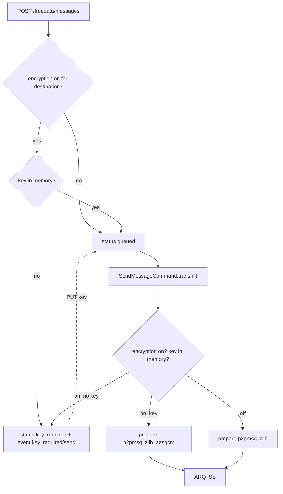

# Per-station message encryption

P2P chat messages can be encrypted with AES-256-GCM and a key the two operators
share in advance. Encryption is **off by default** and is switched on per station in the GUI.

> **Legal note.** Most amateur radio regulations prohibit messages encoded to
> obscure their meaning: ITU Radio Regulations 25.2A, and national rules such as
> FCC §97.113(a)(4). Only use encryption on frequencies and under licences that
> allow it. The GUI shows this warning and asks for confirmation every time
> encryption is turned on for a station.

## What is and isn't encrypted

| Encrypted | Sent in the clear |
|---|---|
| The P2P message JSON: id, origin, destination, body and attachments | ARQ session frames (open, info, burst headers, ACKs) with the callsign checksums |
| | Beacons, CQ/QRV, PING, NORM broadcasts, P2P connections, raw ARQ data |
| | CW ID and other station identification |

An eavesdropper can still see who is talking to whom, when, and roughly how much
data was sent.

## Code

| File | Role |
|---|---|
| [encryption.py](../encryption.py) | `parse_key`, `encrypt`, `decrypt`, `key_fingerprint`, `StationKeyStore`, `DecryptionError`, `KeyMissingError` |
| [arq_data_type_handler.py](../arq_data_type_handler.py) | ARQ type `p2pmsg_zlib_aesgcm = 21`: compress, then encrypt (and the reverse) |
| [message_p2p.py](../message_p2p.py) | `encrypted_message_received`, `decrypt_pending_messages`, `decompress_p2pmsg` |
| [command_message_send.py](../command_message_send.py) | Picks the encrypted type for stations with encryption on, holds messages without a key |
| [message_system_db_encryption.py](../message_system_db_encryption.py) | `DatabaseManagerEncryption`: pending received messages, messages waiting for a key |
| [message_system_db_station.py](../message_system_db_station.py) | `is_encryption_enabled`, `set_encryption_enabled` |
| [api/freedata.py](../api/freedata.py) | `/freedata/station/{callsign}/encryption` endpoints |

## Keys

- **Format.** The user enters either 64 hex characters (a raw 256-bit key, which the
  GUI's *Generate* button creates) or a passphrase of at least 12 characters.
  Passphrases are stretched with scrypt (`n=2^15, r=8, p=1`). Both stations must
  derive the same key, so the salt is a fixed FreeDATA constant, which makes
  passphrases weaker than random keys.
- **Storage.** Keys are kept in `ctx.station_keys` (`StationKeyStore`, thread safe), in
  memory only. They are never written to disk or sent over the air. After a server
  restart the GUI asks for them again when they are needed.
- **Lookup.** Keys are looked up by callsign including the SSID, the way message
  destinations are stored (`AA1AAA-0`). The receiving side uses the ARQ session's
  `dxcall`.
- **Fingerprint.** `key_fingerprint()` returns the first 64 bits of a SHA-256 hash
  as `XXXX XXXX XXXX XXXX`. The GUI shows it so both operators can check they
  entered the same key.

## Wire format

ARQ type byte `21` (`p2pmsg_zlib_aesgcm`). The ARQ payload is:

```
version (1 byte, = 1) | nonce (12 random bytes) | AES-256-GCM ciphertext | tag (16 bytes)
```

The plaintext is the same raw-deflate stream as type `20` (`p2pmsg_zlib`). The
version byte is passed as associated data. The overhead is 29 bytes per message.
A station that doesn't know type 21 logs `Unknown handling endpoint` and drops
the data.

## Sending



- Whether to encrypt is decided when the message is **transmitted**, not when it is
  queued. A message queued before encryption was turned on is sent encrypted.
- `key_required` is a message status that `get_first_queued_message()` skips, so a
  message waiting for a key doesn't block the queue. `PUT .../encryption/key` puts
  these messages back to `queued`.
- If encryption is turned off while messages wait for a key, they stay on hold. The
  user can resend them with the retry button, and they are then sent unencrypted.
- After the transfer, the ISS decrypts its own payload with the same key to find the
  message id and calls `message_transmitted(..., encrypted=True)`. If the key was
  removed during the transfer, the status can't be updated. A message left in
  `transmitting` is set to `failed` at the next start.

## Receiving

`handle_p2pmsg_zlib_aesgcm` calls `encrypted_message_received(ctx, dxcall, data, stats)`:

1. Key known and it fits: decrypt, inflate, `message_received(..., encrypted=True)`.
2. No key, or a key that doesn't decrypt: the encrypted payload goes into the
   `pending_encrypted_message` table and the event
   `{"type": "encryption", "status": "key_required", "callsign": ..., "reason": "receive" | "wrong_key"}`
   is sent. The GUI then opens the key dialog.

`PUT .../encryption/key` runs `decrypt_pending_messages()`. Every pending message the
key decrypts is stored as a received message, keeping its original statistics and
frequency, and removed from the pending table. If messages are pending and the key
decrypts **none** of them, the key is rejected (400) and not stored. Decrypting
received messages doesn't require turning encryption on for the station.

## Database (schema version 2)

| Change | Purpose |
|---|---|
| `station.encryption_enabled` (Boolean, default false) | Per-station on/off switch |
| `p2p_message.encrypted` (Boolean, default false) | Message was sent or received encrypted (lock icon in the GUI) |
| table `pending_encrypted_message` (`id`, `callsign`, `data` BLOB, `statistics` JSON, `frequency`, `received_at`) | Received messages waiting for a key; the data is still encrypted |
| status `key_required` | Outgoing message waiting for a key |

Older databases are migrated by the normal additive schema update
(`MESSAGE_SYSTEM_DATABASE_VERSION` 1 → 2).

## API

| Method | Path | Body | Response | Errors |
|---|---|---|---|---|
| GET | `/freedata/station/{callsign}/encryption` | none | status object (below) | 400 invalid callsign |
| PATCH | `/freedata/station/{callsign}/encryption` | `{"enabled": true\|false}` | status object | 400 `'enabled' must be true or false`; 500 on a database error |
| PUT | `/freedata/station/{callsign}/encryption/key` | `{"key": "<64 hex chars or passphrase>"}` | status object plus `decrypted` and `requeued` counts | 400 invalid key, or key doesn't decrypt the waiting messages |
| DELETE | `/freedata/station/{callsign}/encryption/key` | none | status object | 400 invalid callsign |

Status object:

```json
{"callsign": "AA1AAA-0", "enabled": true, "key_loaded": true,
 "fingerprint": "E1FA C658 B808 9106", "pending_received": 0, "waiting_to_send": 0}
```

The GUI side is described in
[freedata_gui/docs/chat-and-broadcasts.md](../../freedata_gui/docs/chat-and-broadcasts.md#encryption).

## Limitations

- No key exchange and no forward secrecy: anyone who later gets the key can decrypt
  recorded traffic.
- One key per station, used in both directions.
- Random 96-bit nonces are safe for far more messages than an HF link can carry.
- Message history in the local database is stored decrypted, as before.
- There is no replay protection beyond the duplicate message-id check in the database.
