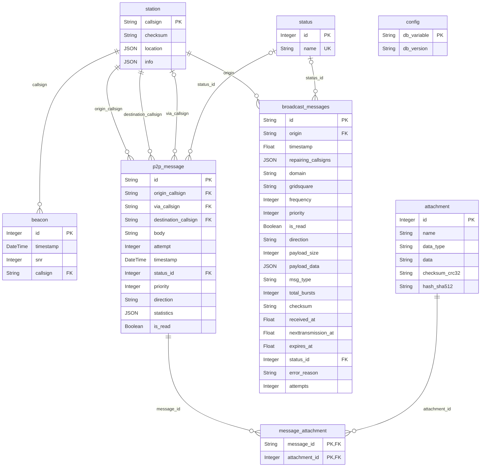
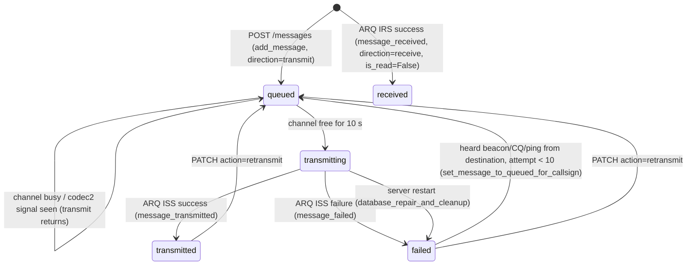
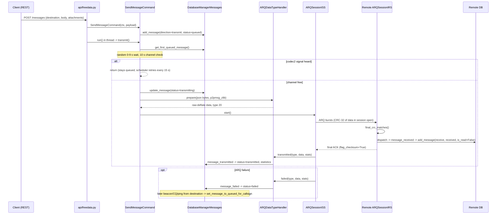

# Message System

The message system stores and moves FreeDATA peer-to-peer (P2P) chat messages, their attachments, received beacons, known stations and group broadcast messages. It is a set of SQLAlchemy models plus one manager class per table, all derived from a common `DatabaseManager`.

| File | Contents |
|---|---|
| [message_system_db_model.py](../message_system_db_model.py) | SQLAlchemy declarative models |
| [message_system_db_manager.py](../message_system_db_manager.py) | `DatabaseManager` base class: engine, sessions, versioning, repair |
| [message_system_db_messages.py](../message_system_db_messages.py) | `DatabaseManagerMessages`: P2P message CRUD, queueing, ADIF export |
| [message_system_db_attachments.py](../message_system_db_attachments.py) | `DatabaseManagerAttachments`: deduplicated attachment storage |
| [message_system_db_beacon.py](../message_system_db_beacon.py) | `DatabaseManagerBeacon`: received beacons |
| [message_system_db_broadcasts.py](../message_system_db_broadcasts.py) | `DatabaseManagerBroadcasts`: burst-based group broadcast messages |
| [message_system_db_station.py](../message_system_db_station.py) | `DatabaseManagerStations`: station info/location |
| [message_p2p.py](../message_p2p.py) | `MessageP2P` wire object and ARQ callbacks (`message_received`, `message_transmitted`, `message_failed`) |
| [command_message_send.py](../command_message_send.py) | `SendMessageCommand`: queues a message and starts an ARQ transfer |

---

## 1. Database

### Engine and location

- Backend: **SQLite** via SQLAlchemy `create_engine(..., echo=False)` ([message_system_db_manager.py](../message_system_db_manager.py)).
- Path resolution (`DatabaseManager.get_database()`):
  1. If the environment variable `FREEDATA_DATABASE` is set, its value is the file path.
  2. Otherwise `DEFAULT_APP_DIR/freedata-messages.db` (`DEFAULT_APP_DIR` comes from [constants.py](../constants.py)).
  
  The parent directory is created with `os.makedirs(..., exist_ok=True)`; the returned URL is `"sqlite:///" + path`.
- Every manager instance constructs its **own engine and sessionmaker** and runs `Base.metadata.create_all(engine)` in `__init__`. Managers are instantiated frequently (often per call, e.g. `DatabaseManagerMessages(ctx).update_message(...)`), and composite managers create nested managers (`DatabaseManagerMessages` creates a `DatabaseManagerAttachments` and a `DatabaseManagerStations`).

### Session handling and thread safety

- `get_thread_scoped_session()` stores a `scoped_session(self.session_factory)` on a `threading.local()` object of the manager instance and returns it. `scoped_session` itself is thread-local, so each thread gets its own `Session`.
- Public methods follow the pattern: obtain session -> query/modify -> `commit()` (or `rollback()` on exception) -> `session.remove()` in `finally`.
- Helpers that accept an optional `session` argument (`get_or_create_station`, `increment_message_attempts`) only commit/remove when they created the session themselves (`own_session`). Callers such as `add_message` pass their session so the station/attachment rows share the message transaction.
- `DatabaseManagerBeacon.add_beacon`, `get_all_beacons` and `beacon_cleanup_older_than_days` always call `session.remove()` in `finally`.
- No explicit SQLite pragmas (WAL, busy timeout, `check_same_thread`) are configured.

### Startup sequence

Called from `AppContext.startup()` in [context.py](../context.py):

```python
db = DatabaseManager(self)
db.check_database_version()
db.initialize_default_values()
db.database_repair_and_cleanup()
DatabaseManagerAttachments(self).clean_orphaned_attachments()
```

### Schema versioning / migration

- The `config` table holds one row with `db_variable = "database_version"`; `db_version` is a string.
- Expected version: `MESSAGE_SYSTEM_DATABASE_VERSION = 1` ([constants.py](../constants.py)).
- `check_database_version()`:
  - No row -> inserts version `"0"`.
  - `current < expected` -> `update_database_schema()` then stores the expected version.
  - `current > expected` -> warning only ("Manual intervention might be required").
- `update_database_schema()` = `update_tables_schema()` + `update_columns_schema()`:
  - **Tables**: creates any table in `Base.metadata` missing from the DB (`inspect(engine).get_table_names()`).
  - **Columns**: for each existing table, every model column absent in the DB is added with `ALTER TABLE <t> ADD COLUMN <name> <type> [NOT NULL] [DEFAULT ...]`, executed inside `engine.begin()` (committed on success). A `DEFAULT` clause is only rendered for static scalar defaults; callable (e.g. lambda) and SQL-expression defaults are skipped.
  - Additive only: no column drops, renames or type changes.

### Default values

`initialize_default_values()` inserts any missing rows in `status`:
`transmitting`, `transmitted`, `received`, `failed`, `failed_checksum`, `aborted`, `queued`, `receiving`, `assembling`.

Additional statuses are created on demand by `get_or_create_status()`: the broadcast manager uses `expired` and `max_attempts_reached`.

### Repair and cleanup

`database_repair_and_cleanup()`:

1. Requires the `failed` status (raises `ValueError` -> logged otherwise).
2. Every `P2PMessage` with status `transmitting` is set to `failed` (recovers from a server interrupted mid-transmission).
3. `VACUUM`, `REINDEX`, `PRAGMA integrity_check` (logs pass/fail).

`DatabaseManagerAttachments.clean_orphaned_attachments()` deletes attachments with no `message_attachment` link (see section 5).

`DatabaseManagerBeacon.beacon_cleanup_older_than_days(days)` is run by the scheduler every 600 s with `days=2` ([schedule_manager.py](../schedule_manager.py)).

---

## 2. Data model

### ER diagram



### `config` (`Config`)

| Column | Type | Constraints | Notes |
|---|---|---|---|
| `db_variable` | String | PK | Only `"database_version"` is used |
| `db_version` | String | | Integer stored as string |

### `station` (`Station`)

| Column | Type | Constraints | Notes |
|---|---|---|---|
| `callsign` | String | PK | Full callsign incl. SSID, e.g. `XX1XXX-6` |
| `checksum` | String | nullable | `helpers.get_crc_24(callsign).hex()`, set on creation; used to resolve CRC-only frame origins (`get_callsign_by_checksum`) |
| `location` | JSON | nullable | Dict; manager code writes `{"gridsquare": ...}` |
| `info` | JSON | nullable | Free-form, set via `update_station_info` |

Relationship: `beacons` -> `Beacon` (ordered by `Beacon.id`, back-populates `station`).

### `beacon` (`Beacon`)

| Column | Type | Constraints |
|---|---|---|
| `id` | Integer | PK |
| `timestamp` | DateTime | |
| `snr` | Integer | |
| `callsign` | String | FK -> `station.callsign` |

### `status` (`Status`)

| Column | Type | Constraints |
|---|---|---|
| `id` | Integer | PK |
| `name` | String | UNIQUE |

Backrefs: `p2p_messages`, `broadcast_messages`.

### `p2p_message` (`P2PMessage`)

| Column | Type | Constraints / default | Notes |
|---|---|---|---|
| `id` | String | PK | `"{origin}_{destination}_{iso8601 timestamp}"` (see section 4) |
| `origin_callsign` | String | FK -> `station.callsign` | |
| `via_callsign` | String | FK -> `station.callsign`, nullable | Never set by the managers in scope |
| `destination_callsign` | String | FK -> `station.callsign` | |
| `body` | String | nullable | |
| `attempt` | Integer | default 0 | Retry counter |
| `timestamp` | DateTime | | Parsed from the part of `id` after the last `_`; current UTC time if that fails |
| `status_id` | Integer | FK -> `status.id`, nullable | |
| `priority` | Integer | default 10 | |
| `direction` | String | | `"transmit"` or `"receive"` |
| `statistics` | JSON | nullable | ARQ session statistics; `frequency` merged in |
| `is_read` | Boolean | default True | Local UI read flag |

Relationships: `message_attachments` -> `MessageAttachment` (`cascade="all, delete-orphan"`), `status` -> `Status`.

`to_dict()` returns `id, timestamp (ISO), attempt, origin, via, destination, direction, body, attachments[], status (name), priority, is_read, statistics`.

### `attachment` (`Attachment`)

| Column | Type | Notes |
|---|---|---|
| `id` | Integer PK | |
| `name` | String | |
| `data_type` | String | Exposed as `type` in `to_dict()` |
| `data` | String | Base64 text (see section 5) |
| `checksum_crc32` | String | Taken from input, `""` if absent |
| `hash_sha512` | String | SHA-512 hex of the `data` string; used for deduplication |

### `message_attachment` (`MessageAttachment`)

Association table (many-to-many between messages and attachments).

| Column | Type | Constraints |
|---|---|---|
| `message_id` | String | PK, FK -> `p2p_message.id` `ON DELETE CASCADE` |
| `attachment_id` | Integer | PK, FK -> `attachment.id` `ON DELETE CASCADE` |

### `broadcast_messages` (`BroadcastMessage`)

| Column | Type | Default | Notes |
|---|---|---|---|
| `id` | String PK | | |
| `origin` | String | | FK -> `station.callsign` |
| `timestamp` | Float | `datetime.now(timezone.utc).timestamp()` | POSIX timestamp |
| `repairing_callsigns` | JSON | nullable | |
| `domain` | String | | Group/domain key (e.g. `BB1AA-2` in docstring) |
| `gridsquare` | String | | |
| `frequency` | Integer | 0 | |
| `priority` | Integer | 1 | |
| `is_read` | Boolean | True | |
| `direction` | String | nullable | `"transmit"` / `"receive"` used in queries |
| `payload_size` | Integer | 0 | Bytes of assembled payload |
| `payload_data` | JSON | nullable | `{"bursts": {"1": b64, ...}, "final": b64}` |
| `msg_type` | String | | |
| `total_bursts` | Integer | 0 | |
| `checksum` | String | | CRC-24 hex of assembled payload |
| `received_at`, `nexttransmission_at`, `expires_at` | Float | `datetime.now(timezone.utc).timestamp()` | Used as POSIX timestamps in queries |
| `status_id` | Integer | nullable | FK -> `status.id` |
| `error_reason` | String | nullable | |
| `attempts` | Integer | 0 | |

Index: `idx_broadcast_domain_received (domain, received_at)` via `__table_args__`.

### Indexes

All indexes are declared via `__table_args__`, so they are attached to their tables and created by `create_all`:

| Table | Index | Columns |
|---|---|---|
| `beacon` | `idx_beacon_callsign` | `callsign` |
| `station` | `idx_station_callsign_checksum` | `callsign`, `checksum` |
| `p2p_message` | `idx_p2p_message_origin_timestamp` | `origin_callsign`, `via_callsign`, `destination_callsign`, `timestamp` |
| `attachment` | `idx_attachments_id_message_id` | `id`, `hash_sha512` |
| `broadcast_messages` | `idx_broadcast_domain_received` | `domain`, `received_at` |

`create_all` only creates indexes for tables it creates. On an existing database, missing indexes are not added (the schema migration only adds tables and columns).

---

## 3. P2P message lifecycle

### Status values used for P2P messages

| Status | Set by |
|---|---|
| `queued` | `SendMessageCommand.set_params_from_api` (new outgoing); `set_message_to_queued_for_callsign` (auto-repeat); API PATCH `action: retransmit` ([api/freedata.py](../api/freedata.py)) |
| `transmitting` | `SendMessageCommand.transmit` once the channel is free |
| `transmitted` | `message_transmitted` (ARQ ISS success callback) |
| `failed` | `message_failed` (ARQ ISS failure callback); `database_repair_and_cleanup` for stale `transmitting` |
| `received` | `message_received` (ARQ IRS success callback) |
| `failed_checksum`, `aborted`, `receiving`, `assembling` | Seeded, but not assigned to P2P messages by the files in scope |

### State transitions



### Creation via API

1. `POST /messages` ([api/freedata.py](../api/freedata.py)) calls `enqueue_tx_command(ctx, SendMessageCommand, payload)` ([api/command_helpers.py](../api/command_helpers.py)), which instantiates the command and runs `command.run` in a worker thread. If either step raises (e.g. a validation `ValueError`), it returns `False` and the endpoint answers 500.
2. `TxCommand.__init__` ([command.py](../command.py)) calls `set_params_from_api(payload)`:
   - origin = `"{STATION.mycall}-{STATION.myssid}"` from config,
   - `MessageP2P.from_api_params(origin, payload)` validates and builds the message,
   - `DatabaseManagerMessages.add_message(msg.to_dict(), statistics={}, direction="transmit", status="queued", frequency=radio_frequency)`.
3. `TxCommand.run()` -> `SendMessageCommand.transmit()` (see below).

`add_message` creates/gets origin and destination `Station` rows, resolves the `Status`, parses `timestamp` with `datetime.fromisoformat(id.rsplit("_", 1)[1])` (falling back to the current UTC time, with a warning, if the id does not have that shape), stores `frequency` into `statistics` (unless `None` or `"---"`), adds attachments, commits and fires `event_manager.freedata_message_db_change(message_id=...)`. A duplicate `id` raises `IntegrityError` -> rollback, warning, returns `None`.

### Transmission (`SendMessageCommand.transmit`)

1. Return early if an ARQ session is active (`state_manager.getARQ()`) or `ctx.rf_modem` is not set.
2. `get_first_queued_message()` - oldest `queued` message by `timestamp`.
3. Reload it with `get_message_by_id` and rebuild a `MessageP2P` with `from_api_params(message_dict["origin"], message_dict)` (keeps the stored `id`).
4. Collision avoidance: wait a random 0-9 s, wait while a codec2 signal is being received, then observe the channel for 10 s; if any codec2 signal appears, return and leave the message `queued`.
5. Set status `transmitting`.
6. `payload = message.to_payload().encode("utf-8")`, then `arq_data_type_handler.prepare(payload, ARQ_SESSION_TYPES.p2pmsg_zlib)`.
7. Create `ARQSessionISS(ctx, message.destination, data, data_type)` - the destination comes from the same queued message as the payload - register it with the state manager and `start()` it.

### Scheduler involvement ([schedule_manager.py](../schedule_manager.py))

| Job | Interval | Behaviour |
|---|---|---|
| `check_for_queued_messages` | 15 s | If no ARQ, channel available (`channel_busy_event` set), modem running: take `get_first_queued_message()`, construct `SendMessageCommand(ctx, first_queued_message)` and call `transmit()` |
| `beacon_cleanup` | 600 s | `beacon_cleanup_older_than_days(2)` |
| `check_missing_broadcast_bursts` | 20 s | Broadcast NACK handling (section 7) |
| `check_queued_messages` | 20 s | Broadcast (re)transmission (section 7) |

When the scheduler constructs `SendMessageCommand` with an existing queued message dict, `set_params_from_api` calls `add_message` again with the same `id`; this hits the `IntegrityError` path (warning, no new row).

### Retries

- `attempt` starts at 0.
- **Auto-repeat**: `FrameHandler.check_for_queued_message()` ([frame_handler.py](../frame_handler.py)) is called by the beacon, CQ and ping frame handlers. If `MESSAGES.enable_auto_repeat` is on and the frame SNR >= -2, it calls `set_message_to_queued_for_callsign(origin)`: the **first** `failed` message to that destination with `attempt < 10` gets `attempt += 1` and status `queued`.
- **Manual**: `PATCH /messages/{id}` with `{"action": "retransmit"}` checks the message exists (404 otherwise), sets status `queued` and calls `increment_message_attempts`.
- There is no time-based retry for P2P messages; queued messages are picked up by the 15 s scheduler job.

### Delivery, ACK and receipts

- Reliability is provided by the ARQ session. The ISS computes a CRC-32 over the (compressed) data (`helpers.get_crc_32`, [arq_session_iss.py](../arq_session_iss.py)); the IRS verifies it (`final_crc_matches()`, [arq_session_irs.py](../arq_session_irs.py)) and sends a final burst ACK with `flag_checksum=True` on success.
- On ISS success, `ARQDataTypeHandler.transmitted()` -> `transmitted_p2pmsg_zlib` -> `message_transmitted()`: status `transmitted`, then `statistics` updated (two separate `update_message` calls).
- On ISS failure, `ARQDataTypeHandler.failed()` -> `failed_p2pmsg_zlib` -> `message_failed()`: status `failed` and statistics updated.
- There is **no end-to-end read receipt** in the code in scope. `is_read` is a local flag: received messages are stored with `is_read=False`; the client flips it via `PATCH /messages/{id}` (`update_message` accepts `is_read`). Outgoing messages default to `is_read=True`.

### Storage of received messages

On IRS success, `ARQSession` dispatches to `ARQDataTypeHandler.dispatch()` -> `handle_p2pmsg_zlib` (raw-deflate decompress) -> `message_received(ctx, data, statistics)`, which decodes UTF-8 JSON via `MessageP2P.from_payload`, re-encodes with `to_dict()`, and calls `add_message(..., direction="receive", status="received", is_read=False, frequency=state_manager.radio_frequency)`. A re-received message with the same `id` is rejected by the PK (`IntegrityError` path).

### Sequence diagram



---

## 4. Wire format (`MessageP2P`)

Defined in [message_p2p.py](../message_p2p.py).

### Fields

| Field | Source | Notes |
|---|---|---|
| `id` | `params["id"]` or `"{origin}_{destination}_{datetime.now(timezone.utc).isoformat()}"` | `add_message` parses the timestamp back from the part after the last `_` (current time as fallback) |
| `origin` | Caller (`mycall-myssid`) | |
| `destination` | `params["destination"]` | If `validate_freedata_callsign` fails, `-0` is appended and re-validated; still invalid -> `ValueError` |
| `body` | `params["body"]` | |
| `attachments` | `params["attachments"]` | Each validated by `api_validations.validate_message_attachment`, kept as dicts |

`MessageP2P.__init__` also sets `self.timestamp` (current UTC ISO time), but it is **not** serialized; only `get_id()` uses it.

### Serialization

- `to_dict()` -> `{"id", "origin", "destination", "body", "attachments": [...]}`, with each attachment's `data` base64-encoded to a UTF-8 string (`__encode_attachment__`). All other attachment keys are copied as-is.
- `to_payload()` -> `json.dumps(to_dict())` (a `str`; `SendMessageCommand` encodes it as UTF-8).
- `from_payload(str)` -> `json.loads`, base64-decodes each attachment `data` back to bytes (`__decode_attachment__`).
- `from_api_params` also base64-decodes attachment `data`, so in memory attachments hold raw bytes and on the wire / in the DB they hold base64 text.

### Transport encoding

`ARQ_SESSION_TYPES.p2pmsg_zlib = 20` ([arq_data_type_handler.py](../arq_data_type_handler.py)):

- Compress: `zlib.compressobj(level=6, wbits=-zlib.MAX_WBITS, strategy=zlib.Z_FILTERED)` - raw DEFLATE, no zlib header/trailer.
- Decompress: `zlib.decompressobj(wbits=-zlib.MAX_WBITS)`.

### Checksum

`MessageP2P` carries no checksum field. Integrity is provided by the ARQ session CRC-32 over the compressed bytes (section 3). Attachments may carry a client-provided `checksum_crc32`, stored verbatim in the DB; it is not verified by code in scope.

Example payload (before compression):

```json
{"id": "AA1AAA-0_BB1BBB-0_2026-01-01T12:00:00.000000+00:00",
 "origin": "AA1AAA-0", "destination": "BB1BBB-0", "body": "Hello",
 "attachments": [{"name": "a.txt", "type": "text/plain", "data": "SGVsbG8="}]}
```

---

## 5. Attachments

Managed by `DatabaseManagerAttachments` ([message_system_db_attachments.py](../message_system_db_attachments.py)).

- **Storage**: inside the SQLite DB (`attachment.data`, String) as the base64 text produced by `MessageP2P.to_dict()`. No filesystem storage.
- **Deduplication**: `add_attachment` computes `sha512(attachment_data["data"].encode()).hexdigest()` (hash of the base64 string). If an `Attachment` with that hash exists it is reused; otherwise a new row is inserted (`name`, `type` -> `data_type`, `data`, `checksum_crc32` or `""`). A `MessageAttachment` link is always added. It runs inside the caller's session and does not commit.
- **Deletion with a message**: `DatabaseManagerMessages.delete_message` first checks the `queued`/`transmitting` guard and only then calls `delete_attachments_by_message_id` (a refused delete keeps the attachments): for each link, if the attachment has more than one link only the link is deleted, otherwise link and attachment are deleted.
- **Orphan cleanup**: `clean_orphaned_attachments()` loads all attachments, counts links for each, deletes those with zero links, commits and returns `{"status": "success", "deleted_count": n}` (`None` on error). Run at startup. The docstring mentions a `cleanup` parameter that does not exist; the method always deletes.

---

## 6. Beacons and stations

### Beacons ([message_system_db_beacon.py](../message_system_db_beacon.py))

Stores one row per received beacon (`timestamp`, `snr`, `callsign`). `add_beacon` is called from [frame_handler_beacon.py](../frame_handler_beacon.py). It also creates the station if needed and updates `station.location["gridsquare"]` when it differs (marked with `flag_modified`, so the in-place JSON change is persisted). Reads return dicts with `gridsquare` taken from the station's current location (not stored per beacon). Cleanup deletes rows older than N days.

### Stations ([message_system_db_station.py](../message_system_db_station.py))

`station` rows are created implicitly (`get_or_create_station`) whenever a message, beacon or broadcast references a callsign, with a CRC-24 checksum of the callsign. The checksum lets frames that carry only `origin_crc` be mapped back to a callsign (`get_callsign_by_checksum`, used in [frame_handler.py](../frame_handler.py)). `info` is free-form JSON set via the API (`update_station_info`); `location` is updated from beacons/frames.

---

## 7. Broadcasts

`DatabaseManagerBroadcasts` ([message_system_db_broadcasts.py](../message_system_db_broadcasts.py)) stores group/"domain" broadcasts that are transferred as numbered bursts (used by the NORM transmission code in `norm/`, gated in the scheduler by `EXP.enable_groupchat`).

- Constants: `MAX_ATTEMPTS = 20`, `DEFAULT_EXPIRY_HOURS = 24`.
- **Assembly** (`process_broadcast_message`): first burst creates the row with `payload_data = {"bursts": {"<index>": <b64>}}` and default status `queued`; `expires_at` defaults to now + 24 h. Later bursts are added under `bursts` (`flag_modified`). When bursts `1..total_bursts` are all present they are base64-decoded, concatenated, and the CRC-24 hex compared with `checksum`:
  - mismatch -> status `failed_checksum`;
  - match -> `payload_data["final"]` = base64 of full payload, `payload_size` set, status `received`;
  - `checksum` `None` -> warning only.
- **Transmit queue** (`get_first_queued_message`): first marks every `direction == "transmit"` row whose `expires_at <= now` as `expired`; then returns the `transmit` row with `attempts < 20`, `nexttransmission_at <= now` and not expired, ordered by `nexttransmission_at`. Returns the ORM object (not a dict).
- **Backoff** (`increment_attempts_and_update_next_transmission`): `attempts += 1`; next delay in minutes from `[2, 5, 10, 15, 30, 60, 120, 240, 360, 720, 1440, 2880]` (2880 beyond the table); at `attempts >= 20` status becomes `max_attempts_reached`.
- **Missing bursts** (`check_missing_bursts`): for `receive` rows received more than 1 minute ago, not expired, not yet `final`, past `nexttransmission_at` and under `MAX_ATTEMPTS`, returns the first one with missing burst indices; the scheduler then increments attempts/backoff and sends a NACK burst (`NormTransmission.create_and_transmit_nack_burst`).

---

## 8. Public method reference

All managers take `ctx` (the `AppContext`) in `__init__`. Methods marked "event" call `ctx.event_manager.freedata_message_db_change(message_id=...)` on success.

### `DatabaseManager` ([message_system_db_manager.py](../message_system_db_manager.py))

| Method | Args | Returns | Purpose |
|---|---|---|---|
| `get_database()` | - | `str` SQLAlchemy URL | Resolve DB path from `FREEDATA_DATABASE` or app dir |
| `initialize_default_values()` | - | `None` | Seed `status` rows |
| `database_repair_and_cleanup()` | - | `None` | `transmitting`->`failed`, VACUUM, REINDEX, integrity check |
| `log(message, isWarning=False)` | str, bool | `None` | structlog info/warn with class prefix |
| `get_thread_scoped_session()` | - | `scoped_session` | Per-thread session |
| `get_or_create_station(callsign, session=None)` | str, session | `Station` or `None` | Fetch or insert a station with CRC-24 checksum |
| `get_callsign_by_checksum(checksum)` | str | `str` or `None` | Reverse CRC-24 lookup |
| `get_or_create_status(session, status_name)` | session, str | `Status` | Fetch or insert (flushes) a status |
| `check_database_version()` | - | `None` | Compare stored vs expected schema version, migrate |
| `update_database_schema()` | - | `bool` | Add missing tables and columns |
| `update_tables_schema()` | - | `bool` | Create missing tables |
| `update_columns_schema()` | - | `bool` | `ALTER TABLE ADD COLUMN` for missing columns |

### `DatabaseManagerMessages` ([message_system_db_messages.py](../message_system_db_messages.py))

| Method | Args | Returns | Purpose |
|---|---|---|---|
| `add_message(message_data, statistics, direction="receive", status=None, is_read=True, frequency=None)` | dict, dict, str, str, bool, float | `str` id or `None` | Insert message + stations + attachments (event) |
| `get_all_messages(filters=None)` | dict | `list[dict]` | All messages; filters `id` (exact), `callsign` (substring in origin/via/destination), `origin_callsign`/`via_callsign`/`destination_callsign`/`direction` (substring) |
| `get_all_messages_json(filters=None)` | dict | `dict` `{total_messages, messages}` | Wrapper with count |
| `get_message_by_id(message_id)` | str | `dict` or `None` | Single message |
| `get_message_by_id_adif(message_id)` | str | `str` ADIF or `None` | ADIF record: CALL (remote base call), QSO_DATE, TIME_ON, TIME_OFF (+`statistics.duration`), FREQ (MHz, default `14.000000`), MODE `DYNAMIC`, SUBMODE `FREEDATA`, COMMENT, GRIDSQUARE (origin station) |
| `delete_message(message_id)` | str | `dict` `{status, message}` | Refuse with `{"status": "failure", "message": "Message is queued or transmitting"}` if `queued`/`transmitting`; otherwise delete attachments/links, then the message (event). Unknown id -> `"Message not found"` |
| `update_message(message_id, update_data, frequency=None)` | str, dict, float | `dict` `{status, message}` | Update `status` (by name), `statistics` (+frequency), `body`, `is_read`, `attempt`, `priority` (event) |
| `get_first_queued_message()` | - | `dict` or `None` | Oldest `queued` message by timestamp |
| `increment_message_attempts(message_id, session=None)` | str, session | `None` | `attempt += 1` |
| `set_message_to_queued_for_callsign(callsign)` | str | `dict` `{status, message}` | First `failed` message to callsign with `attempt < 10` -> `queued`, `attempt += 1` |

### `DatabaseManagerAttachments` ([message_system_db_attachments.py](../message_system_db_attachments.py))

| Method | Args | Returns | Purpose |
|---|---|---|---|
| `add_attachment(session, message, attachment_data)` | session, `P2PMessage`, dict | `Attachment` | Dedup by SHA-512 and link to message (no commit) |
| `get_attachments_by_message_id(message_id)` | str | `list[dict]` | Attachments of a message |
| `get_attachments_by_message_id_json(message_id)` | str | `str` JSON | JSON of the above |
| `get_attachment_by_sha512(hash_sha512)` | str | `dict` or `None` | Lookup by hash |
| `delete_attachments_by_message_id(message_id)` | str | `bool` | Remove links; delete attachment if it was the only link |
| `clean_orphaned_attachments()` | - | `dict` `{status, deleted_count}` or `None` | Delete attachments with no links |

### `DatabaseManagerBeacon` ([message_system_db_beacon.py](../message_system_db_beacon.py))

| Method | Args | Returns | Purpose |
|---|---|---|---|
| `add_beacon(timestamp, callsign, snr, gridsquare)` | datetime, str, number, str | `None` | Insert beacon; create station; update gridsquare |
| `get_beacons_by_callsign(callsign)` | str | `list[dict]` `{id, timestamp, snr, gridsquare}` | Beacons of one station |
| `get_all_beacons()` | - | `list[dict]` `{id, timestamp, snr, callsign, gridsquare}` | All beacons |
| `beacon_cleanup_older_than_days(days)` | int | `int` deleted count | Purge old beacons |

### `DatabaseManagerStations` ([message_system_db_station.py](../message_system_db_station.py))

| Method | Args | Returns | Purpose |
|---|---|---|---|
| `get_station(callsign)` | str | `dict` or `None` (not found or error) | Station by callsign |
| `update_station_info(callsign, new_info)` | str, any JSON | `bool` | Set `info` (creates station if needed) |
| `update_station_location(callsign, gridsquare)` | str, str | `bool` | Set `location["gridsquare"]` with `flag_modified` (creates station if needed) |

### `DatabaseManagerBroadcasts` ([message_system_db_broadcasts.py](../message_system_db_broadcasts.py))

| Method | Args | Returns | Purpose |
|---|---|---|---|
| `process_broadcast_message(id, origin, timestamp, burst_index, burst_data, total_bursts, checksum, repairing_callsigns=None, domain=None, gridsquare=None, msg_type=None, received_at=None, expires_at=None, nexttransmission_at=None, priority=1, is_read=True, direction=None, status="queued", error_reason=None)` | | `bool` | Create message or add burst; assemble + CRC-24 check when complete (event) |
| `get_all_broadcasts_json()` | - | `list[dict]` | All broadcasts (without `attempts`) |
| `get_first_queued_message()` | - | `BroadcastMessage` or `None` | Expire stale transmit rows, return next due one |
| `get_broadcast_domains_json()` | - | `dict[domain -> stats]` | Per-domain counts, unread count, last message |
| `get_broadcasts_per_domain_json(domain=None)` | str | `dict[domain -> list]` | Messages grouped by domain (items include `priority`). Read-only; does not mark anything read |
| `delete_broadcast_message_or_domain(id)` | str | `dict` | Delete one message by id, else all messages of domain `id` (event). `status` is `success`, `not_found` (neither matched) or `error` (exception) |
| `check_missing_bursts()` | - | `dict` or `None` | First incomplete received broadcast due for a NACK |
| `get_broadcast_per_id(id, get_object=False)` | str, bool | `dict`, ORM object or `None` | Single broadcast |
| `increment_attempts(message_id)` | str | `None` | `attempts += 1` |
| `increment_attempts_and_update_next_transmission(message_id)` | str | `None` | Attempts + backoff schedule; `max_attempts_reached` at 20 |
| `mark_domain_as_read(domain)` | str | `int` | Set `is_read=True` for unread rows in domain (event only if something changed). Called by `PATCH /freedata/broadcasts/{domain}/read` |

### `MessageP2P` and module functions ([message_p2p.py](../message_p2p.py))

| Member | Returns | Purpose |
|---|---|---|
| `MessageP2P(id, origin, destination, body, attachments)` | instance | Construct |
| `MessageP2P.from_api_params(origin, params)` | `MessageP2P` | Validate API input, decode attachments, generate id |
| `MessageP2P.from_payload(payload)` | `MessageP2P` | Parse JSON wire payload |
| `get_id()` | `str` | `origin_destination_timestamp` |
| `to_dict()` | `dict` | Wire/DB dict with base64 attachments |
| `to_payload()` | `str` | JSON string |
| `message_received(ctx, data, statistics)` | `None` | Store received message |
| `message_transmitted(ctx, data, statistics)` | `None` | Mark `transmitted`, store stats |
| `message_failed(ctx, data, statistics)` | `None` | Mark `failed`, store stats |

### `SendMessageCommand` ([command_message_send.py](../command_message_send.py))

| Method | Purpose |
|---|---|
| `set_params_from_api(apiParams)` | Build `MessageP2P` and insert it as `queued` |
| `transmit()` | Pick oldest queued message, check channel, set `transmitting`, start ARQ ISS |

---

## 9. Known issues

Observed in the current code.

1. **Per-call engines** - every manager instantiation creates a new engine and runs `create_all`; messages/broadcast managers create additional nested managers (and engines).
2. **Detached ORM objects** - broadcast `get_first_queued_message` and `get_broadcast_per_id(get_object=True)` return ORM objects after `session.remove()` (detached instances).
3. **Scheduler re-inserts the queued message** - when the scheduler constructs `SendMessageCommand` with an existing queued message dict, `set_params_from_api` calls `add_message` again with the same `id`; this hits the `IntegrityError` path (warning, no new row).
4. **Two updates per ARQ callback** - `message_transmitted` / `message_failed` each perform two separate `update_message` calls (status, then statistics), producing two commits and two change events (marked `# Todo ... WIP`).
5. **No index migration** - indexes are only created together with their table; an existing database does not get indexes that were added to the models later.
