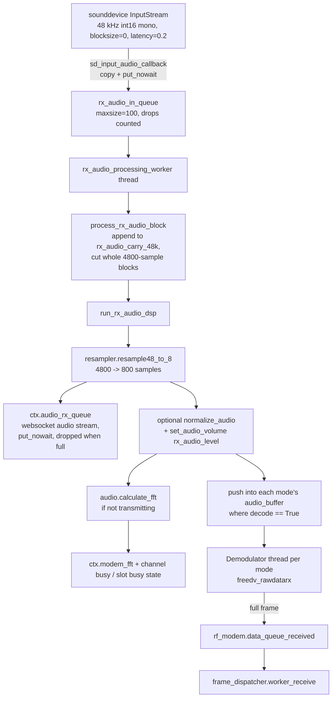
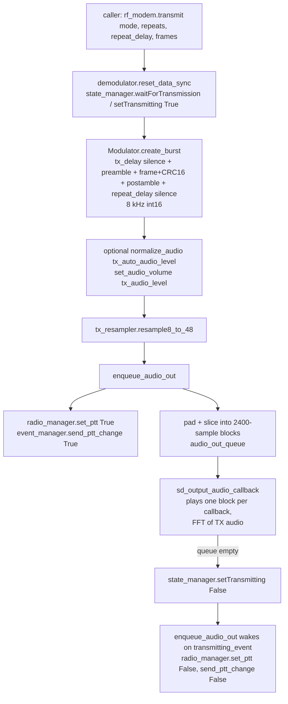

# Modem, Audio and Radio Control

This document covers the signal-processing core of `freedata_server`: audio capture and playback, the codec2 binding, the modulator and demodulators, CW identification, and the radio control backends.

Files covered:

| Area | Files |
|---|---|
| Modem orchestration | [modem.py](../modem.py) |
| TX / RX DSP | [modulator.py](../modulator.py), [demodulator.py](../demodulator.py) |
| codec2 binding | [codec2.py](../codec2.py), [codec2_filter_coeff.py](../codec2_filter_coeff.py), `lib/codec2/` |
| Audio | [audio.py](../audio.py), [audio_buffer.py](../audio_buffer.py) |
| CW / test tone | [cw.py](../cw.py), [command_transmit_sine.py](../command_transmit_sine.py) |
| Radio control | [radio_manager.py](../radio_manager.py), [rigctld.py](../rigctld.py), [flrig.py](../flrig.py), [serial_ptt.py](../serial_ptt.py), [rigdummy.py](../rigdummy.py) |

---

## 1. Overview and signal flow

`modem.RF` ([modem.py](../modem.py)) is the central object. `ServiceManager` creates it (`ctx.rf_modem = modem.RF(ctx)`), starts the frame dispatcher, then calls `start_modem()`. `RF` owns one `Demodulator` and one `Modulator`.

Fixed rates:

| Constant | Value | Where |
|---|---|---|
| `AUDIO_SAMPLE_RATE` | 48000 Hz (sound card side) | `modem.RF` |
| `modem_sample_rate` | `codec2.api.FREEDV_FS_8000` = 8000 Hz (codec2 side) | `modem.RF`, `Modulator` |
| `FDMDV_OS_48` | 6 (48k/8k ratio; asserted at `RF.__init__`) | [codec2.py](../codec2.py) |
| `RX_DSP_BLOCK_48K` | 4800 samples (100 ms, 800 samples at 8 kHz) | `modem.RF` |
| Output stream blocksize | 2400 samples (50 ms) | `RF.init_audio` |
| `AUDIO_STREAMING_CHUNK_SIZE` | 800 samples (one RX DSP block at 8 kHz, 100 ms) | `modem.RF` |

### RX path



### TX path



Other TX sources that go through `enqueue_audio_out` (already at 48 kHz, no resampling):

- `RF.transmit_sine()` - 30 s, 1500 Hz tone, normalized then scaled by `tx_audio_level`. Triggered by `TransmitSine` in [command_transmit_sine.py](../command_transmit_sine.py); `RF.stop_sine()` clears `audio_out_queue` and resets the transmitting state.
- `RF.transmit_morse()` - CW ID of `STATION.mycall` (see [section 6](#6-cw-identification)).

In test mode (`ctx.TESTMODE`), `transmit()` only puts `[mode, frames]` into `ctx.TESTMODE_TRANSMIT_QUEUE` and returns; `start_modem()` skips audio init, creates the `resampler` and `tx_resampler`, and starts the demodulator threads with no stream.

`RF` uses two `codec2.resampler` instances because a resampler keeps filter memory between calls: `resampler` for the RX worker (`resample48_to_8`), and `tx_resampler` for the TX path (`resample8_to_48` in `transmit()`, `resample48_to_8` for the TX FFT in `sd_output_audio_callback`).

---

## 2. codec2 ctypes binding ([codec2.py](../codec2.py))

### Library location and loading

The module loads the shared library at import time:

1. Base directory `script_dir`: `__compiled__.containing_dir` when compiled with Nuitka, otherwise the directory of `codec2.py`.
2. Recursive glob under `script_dir`, by `sys.platform`:

   | Platform | Glob |
   |---|---|
   | `linux` | `**/*libcodec2*` |
   | `darwin` | `**/*libcodec2*.dylib` |
   | `win32` / `win64` | `**/*libcodec2*.dll` |
   | other | none |

3. Each match is tried with `ctypes.CDLL()`; the first that loads wins (`OSError` is silently skipped).
4. If none loads, it logs critical and calls `sys.exit(1)`.

Bundled binaries in `lib/codec2/`:

| File | Notes |
|---|---|
| `libcodec2.dll` | Windows |
| `libcodec2.so` | Linux |
| `libcodec2.1.2.dylib` | macOS |
| `arm64_libcodec2.1.2.dylib` | macOS arm64 |

On macOS both `.dylib` files match the glob; whichever `CDLL` accepts first is used.

### FREEDV_MODE enum

| Member | Value | How it is opened | Use in this subsystem |
|---|---|---|---|
| `signalling` | 19 | `freedv_open(19)` | Signalling frames; always decoded. Same value as `datac13`. |
| `signalling_ack` | 20 | `freedv_open(20)` | Signalling ACKs. Same value as `datac14`. |
| `datac0` | 14 | `freedv_open` | TX instance opened; RX instance opened, not enabled by default |
| `datac1` | 10 | `freedv_open` | ARQ speed level 2 ([arq_session.py](../arq_session.py)) |
| `datac3` | 12 | `freedv_open` | Opened for TX/RX |
| `datac4` | 18 | `freedv_open` | Lowest speed level; decoded by default and always re-enabled by `set_decode_mode` |
| `datac13` | 19 | alias of `signalling` | |
| `datac14` | 20 | alias of `signalling_ack` | |
| `data_ofdm_200` | 21200 | `freedv_open_advanced(21, ofdm config)` | Custom OFDM |
| `data_ofdm_250` | 21250 | advanced, custom OFDM | |
| `data_ofdm_500` | 21500 | advanced, custom OFDM | ARQ speed level 1 |
| `data_ofdm_1700` | 211700 | advanced, custom OFDM | |
| `data_ofdm_2438` | 2124381 | advanced, custom OFDM | ARQ speed level 3 |
| `data_vhf_1` | 201 | `freedv_open_advanced(9, fsk config)` | 4-FSK; decoded when `EXP.enable_vhf` |

Because `datac13`/`datac14` share values with `signalling`/`signalling_ack`, Python's `Enum` makes them aliases: iterating `FREEDV_MODE` (and `len(FREEDV_MODE)`) yields 12 members, and `FREEDV_MODE.datac13 is FREEDV_MODE.signalling`.

Helpers: `freedv_get_mode_value_by_name(name)`, `freedv_get_mode_name_by_value(value)`, `open_instance(mode)`, `get_bytes_per_frame(mode)` (opens a new instance on every call; the code has a `TODO add close session`).

`FREEDV_MODE_USED_SLOTS` maps modes to a 5-element boolean list matching the 5 FFT slots in `audio.SLOT_RANGES`; used by ARQ speed levels.

### Custom mode configurations

`OFDM_CONFIG` mirrors codec2's `struct OFDM_CONFIG` (centre freqs, `fs`, `rs`, `ts`, `tcp`, `nc`, `ns`, `np`, `bps`, `nuwbits`, `tx_uw[64]`, LDPC `codename`, clipping, TX/RX BPF, `amp_scale`, `fmin`/`fmax`, etc.). `FREEDV_ADVANCED` holds FSK parameters plus a pointer to an `OFDM_CONFIG`.

`create_default_ofdm_config()` builds a 1500 Hz centred, 8 kHz, `streaming` data-mode config; each OFDM mode then overrides fields:

| Mode | nc | np | tcp | nuwbits | LDPC code | TX BPF | BPF bandwidth / taps |
|---|---|---|---|---|---|---|---|
| `data_ofdm_200` | 3 | 18 | 0.006 | 48 | `H_256_512_4` | off | 400 Hz / 101 |
| `data_ofdm_250` | 4 | 47 | 0.006 | 32 | `H_1024_2048_4f` | on | 400 Hz / 101 |
| `data_ofdm_500` | 8 | 32 | 0.006 | 56 | `H_1024_2048_4f` | on | 600 Hz / 100 |
| `data_ofdm_1700` | 27 | 38 | 0.006 | 16 | `H_4096_8192_3d` | off | 2000 Hz / 100 |
| `data_ofdm_2438` | 39 | 52 | 0.004 | 24 | `H_16200_9720` | on | 2700 Hz / 100 |

`data_vhf_1`: FSK with `M=4`, `Rs=200`, `tone_spacing=400`, `interleave_frames=1`, `H_256_512_4`, `first_tone` centred on 1500 Hz via `get_centered_first_tone`.

BPF prototypes come from `codec2_filter_coeff.generate_filter_coefficients(Fs, bandwidth, taps)` ([codec2_filter_coeff.py](../codec2_filter_coeff.py)): a sinc low-pass `B*sinc(n*B)` returned as a ctypes float array with all real parts followed by all imaginary parts (`np.hstack`), length `2*taps`. `testFilter` is a 3-tap placeholder used by the default config.

### Wrapped C functions

| C function | Used by |
|---|---|
| `freedv_open`, `freedv_open_advanced` | `open_instance` |
| `freedv_get_bits_per_modem_frame` | bytes per frame (TX and RX) |
| `freedv_get_n_tx_modem_samples`, `..._preamble_...`, `..._postamble_...` | modulator buffer sizing |
| `freedv_rawdatatx`, `freedv_rawdatapreambletx`, `freedv_rawdatapostambletx` | modulator |
| `freedv_gen_crc16` | modulator CRC (no `restype`/`argtypes` declared) |
| `freedv_nin`, `freedv_rawdatarx`, `freedv_get_rx_status` | demodulator loop |
| `freedv_set_frames_per_burst`, `freedv_set_sync` | demodulator setup / sync reset |
| `freedv_get_modem_stats` | SNR |
| `freedv_get_modem_extended_stats` (`MODEMSTATS` struct) | frequency offset (`foff`) and scatter (`rx_symbols`) |
| `fdmdv_48_to_8_short`, `fdmdv_8_to_48_short` | `resampler` |

All wrapped functions except `freedv_gen_crc16` declare `argtypes` (the `fdmdv_*` resampler functions declare no `restype`). Instance handles and data/sample buffers are declared as `c_void_p` (so NumPy `.ctypes` objects and `ctypes` string buffers can be passed). Functions returning `void` (`freedv_set_sync`, `freedv_rawdatatx`, `freedv_set_frames_per_burst`, `freedv_get_modem_stats`, `freedv_ofdm_print_info`) have `restype = None`. `freedv_rawdatapreambletx` / `freedv_rawdatapostambletx` take two arguments (`freedv`, output buffer). `freedv_open_advanced.argtypes = [c_int, POINTER(FREEDV_ADVANCED)]` is set after the `FREEDV_ADVANCED` struct is defined.

`api.rx_sync_flags_to_text` maps the 4-bit rx status (`E`rrors, `B`its, `S`ync, `T`rial) to text for logging.

### `codec2.resampler`

Keeps filter memory between calls (`filter_mem48` 48 taps, `filter_mem8` 8 taps).

- `resample48_to_8(in48)`: asserts `int16` and `len % 6 == 0`; returns `len/6` samples.
- `resample8_to_48(in8)`: returns `6*len` samples.

### `codec2.audio_buffer`

Linear, mutex-protected int16 buffer by David Rowe. `push()` asserts it does not overflow; `pop(n)` shifts the remaining samples to the start. Data always starts at index 0, which is what `freedv_rawdatarx(..., audiobuffer.buffer.ctypes)` relies on.

---

## 3. Modulator ([modulator.py](../modulator.py))

`init_codec2()` opens one TX instance per mode (`datac0/1/3/4/13/14`, `data_ofdm_200/250/500/1700/2438`, `data_vhf_1`).

`create_burst(mode, repeats, repeat_delay, frames)`:

1. Looks up the instance; `signalling_ack` -> DATAC14 instance, `signalling` -> DATAC13 instance. An unknown mode only prints `"wrong mode"` and then fails on the unbound `freedv`.
2. Prepends `MODEM.tx_delay` ms of silence (for PTT switching time).
3. For each repeat, for each frame (a single `bytearray` is wrapped in a list):
   - preamble (`freedv_rawdatapreambletx`) - skipped if `EXP.enable_vhf`
   - frame (`transmit_create_frame`): pads to `bytes_per_frame - 2`, appends big-endian CRC16 from `freedv_gen_crc16`, modulates with `freedv_rawdatatx`
   - postamble - skipped if `EXP.enable_vhf`
4. After each repeat appends `repeat_delay` ms of silence.

Returns raw bytes of 8 kHz int16 samples.

---

## 4. Demodulators ([demodulator.py](../demodulator.py))

### Per-mode state

`Demodulator.MODE_DICT` is a **class attribute** keyed by mode value (12 entries, see aliasing above). Each entry: `decode`, `bytes_per_frame`, `bytes_out`, `audio_buffer`, `nin`, `instance`, `state_buffer`, `name`, `decoding_thread`.

`init_codec2_mode(mode)` opens an instance, sets frames-per-burst to 1, reads `freedv_nin`, and allocates an RX buffer of `2 * AUDIO_FRAMES_PER_BUFFER_RX` = 9600 samples (1.2 s at 8 kHz):

| `EXP.enable_ring_buffer` | Buffer class |
|---|---|
| false (default path) | `codec2.audio_buffer` |
| true | `audio_buffer.CircularBuffer` ([audio_buffer.py](../audio_buffer.py)) - condition-variable ring buffer whose `push` blocks when full and `pop` blocks until `n` samples exist; after each pop it re-packs valid data to index 0 so codec2 can read from the start of the array |

### Threads

`start(stream)` starts one daemon thread per `MODE_DICT` entry (named after the mode) running `demodulate_audio(mode)`. **All modes get a thread**, but only modes with `decode == True` receive audio from `RF.run_rx_audio_dsp`, so the others idle.

Loop (every 10 ms, while the stream is active and `shutdown_flag` unset, or in TESTMODE):

1. When `audiobuffer.nbuffer >= nin`:
   - If not transmitting: `nbytes = freedv_rawdatarx(...)`, read `rx_status`. Any non-zero status sets `is_codec2_traffic_counter = 5` (shared across threads); the counter decrements per iteration and drives `state_manager.set_channel_busy_condition_codec2(True/False)`. Status 10 is appended to `state_buffer`.
   - If transmitting: `nbytes = 0` and `reset_data_sync()` (sets sync 0 on every instance).
   - `pop(nin)` and refresh `nin = freedv_nin()`.
2. If `nbytes == bytes_per_frame`: compute SNR and scatter, then put onto `ctx.rf_modem.data_queue_received`:

   ```python
   {"payload": bytes_out, "freedv": freedv, "bytes_per_frame": ..., "snr": ..., "frequency_offset": ..., "mode_name": ...}
   ```

   `frame_dispatcher.DISPATCHER.worker_receive` ([frame_dispatcher.py](../frame_dispatcher.py)) consumes this queue.

On an unexpected exception the loop logs and calls `audio.sd._terminate()`; PortAudio "not initialized" / "invalid stream pointer" errors are treated as normal shutdown.

### Signal reports

| Function | Source | Output |
|---|---|---|
| `calculate_snr` | `freedv_get_modem_stats` | SNR rounded to 0.1 dB, returned as `int` (0 on error) |
| `get_frequency_offset` | `MODEMSTATS.foff` | `-round(foff)` Hz |
| `get_scatter` | `MODEMSTATS.rx_symbols` | non-zero points (scaled `//1000`) sent via `event_manager.send_scatter_change`; all points if fewer than 150, else every 10th |

### Enabling / disabling modes

Initial state (constructor):

| `EXP.enable_vhf` | Decoded modes |
|---|---|
| false | `signalling`, `signalling_ack`, `datac4` |
| true | `data_vhf_1`, `signalling`, `signalling_ack` |

`set_decode_mode(modes_to_decode=None, is_arq_irs=False, is_p2p_connection=False)` resets all to false, then:

- `signalling` always on; `data_vhf_1` on if `enable_vhf`
- `signalling_ack` off only when `is_arq_irs and not is_p2p_connection`
- `datac4` always on
- applies the `{mode_value: bool}` overrides in `modes_to_decode`

Callers: [arq_session_irs.py](../arq_session_irs.py), [arq_session_iss.py](../arq_session_iss.py), [p2p_connection.py](../p2p_connection.py).

`shutdown()` sets `shutdown_flag` and joins each thread with a 3 s timeout.

---

## 5. Audio ([audio.py](../audio.py), [modem.py](../modem.py))

### Device enumeration and selection

- `get_audio_devices()` runs `fetch_audio_devices` in a separate `multiprocessing.Process` (comment: to avoid PortAudio crashes on Raspberry Pi), joined with a 3 s timeout, and returns `(inputs, outputs)` lists. Used by the devices API ([api/devices.py](../api/devices.py)).
- `fetch_audio_devices` iterates `sd.query_devices()`, skips names starting with `DAX RESERVED` or `DAX IQ` (Flex Radio), and emits `{"id", "name", "api", "native_index"}` for devices with input or output channels.
- `id` = `device_crc(device)`: hex CRC16 (`helpers.get_crc_16`) of `"<name>.<hostapi>"`. The config stores these IDs (`AUDIO.input_device`, `AUDIO.output_device`), not PortAudio indices.
- `get_device_index_from_crc(crc, isInput)` re-enumerates in-process and returns `(native_index, name)`; it returns `None` when no device matches or enumeration raises (logged as a warning).
- `test_audio_devices(input_id, output_id)` checks each with `sd.check_input_settings` / `check_output_settings` (1 ch, int16, 48 kHz) and returns `[in_ok, out_ok]`, then re-initializes PortAudio. `ServiceManager` runs this before starting the modem.

### Streams (`RF.init_audio`)

| | Input | Output |
|---|---|---|
| Class | `sd.InputStream` | `sd.OutputStream` |
| Format | 1 ch, int16, 48 kHz | 1 ch, int16, 48 kHz |
| blocksize | `0` (PortAudio chooses) | `2400` |
| latency | `0.2` | default |
| Callback | `sd_input_audio_callback` | `sd_output_audio_callback` |

Failure in `init_audio` calls `stop_modem()` and returns `False`; `start_modem()` then raises `RuntimeError("Unable to init audio devices")`.

### RX blocking and latency

The comments in [modem.py](../modem.py) explain the design:

- `blocksize=0` is deliberate: a fixed 4800 blocksize starved/overflowed on some virtual devices (measured on `snd-aloop`). `latency=0.2` makes the PortAudio ring deep.
- The input callback only copies the block into `rx_audio_in_queue` (`maxsize=100`). If the queue is full the block is dropped and `rx_audio_dropped_blocks` is incremented. If PortAudio reports a `status`, the block is logged and discarded.
- `rx_audio_processing_worker` (daemon thread) drains the queue; `None` is the shutdown sentinel posted by `stop_modem()`.
- `stop_modem()` closes `sd_input_stream` / `sd_output_stream` only if they exist, so it is safe in TESTMODE or after a failed audio init.
- `process_rx_audio_block` re-blocks: captured samples are appended to `rx_audio_carry_48k`, the DSP runs once per complete 4800-sample block, and any remainder is carried to the next call. This keeps the resampler input gapless and a multiple of 6 regardless of capture size (e.g. 512/1024-sample blocks).
- `RX_DSP_BLOCK_48K` stays at 4800 because the resampler assertion, the 800-sample FFT, the streaming chunk padding and per-block AGC all assume it.

### Levels

| Setting | Effect |
|---|---|
| `AUDIO.rx_audio_level` | dB gain via `set_audio_volume` on RX 8 kHz audio |
| `AUDIO.tx_audio_level` | dB gain on TX 8 kHz audio (data) or 48 kHz tone (sine) |
| `AUDIO.rx_auto_audio_level` | `normalize_audio` per 800-sample RX block before gain |
| `AUDIO.tx_auto_audio_level` | `normalize_audio` on the whole burst before gain |

Both levels are read once in `RF.__init__`.

- `set_audio_volume(data, dB)`: clips dB to **[-30, +20]**, scales by `10**(dB/20)`, clips to int16.
- `normalize_audio(data)`: scales so the peak reaches `int(32767*0.85)`.

### FFT, audio level and channel busy detection (`audio.calculate_fft`)

Called with RX audio (when not transmitting) and with each played TX block (resampled to 8 kHz in the output callback).

1. Pad/truncate to 800 samples, `rfft` -> 401 bins (10 Hz/bin), `dfft = 10*log10(|X|)`.
2. Threshold = mean(dfft) + 13 dB.
3. When not transmitting: bins above threshold are set to 100 for display, and `audio_dbfs` (RMS dBFS) is updated at most once per second.
4. Slot busy: 5 bin ranges `SLOT_RANGES` = (0-65), (65-120), (120-176), (176-231), (231-315), i.e. roughly 0-3150 Hz. A slot is busy when it has an above-threshold bin while neither transmitting nor receiving a codec2 signal; per-slot hold counters add 2 per busy block and decay by 1 (max 200). Result -> `state_manager.set_channel_slot_busy`.
5. Channel busy: a global `CHANNEL_BUSY_DELAY` with the same increment/decay drives `set_channel_busy_condition_traffic`.
6. The FFT queue (`ctx.modem_fft`) is emptied and the first 315 bins are put on it; the websocket manager streams it to clients.

Codec2-based busy detection (`set_channel_busy_condition_codec2`) comes from the demodulator rx status, see section 4.

### RX audio streaming

Each 800-sample 8 kHz block (before AGC/gain) is passed to `enqueue_streaming_audio_chunks`, which zero-pads it to a multiple of `AUDIO_STREAMING_CHUNK_SIZE` (800, so normally no padding) and puts each chunk on `ctx.audio_rx_queue` (`maxsize=10`) with `put_nowait()`. When the queue is full (no consumer draining it) the chunk is dropped rather than stalling the RX DSP. [websocket_manager.py](../websocket_manager.py) drains it to audio websocket clients.

### TX output

- `enqueue_audio_out(audio_48k)` sets `enqueuing_audio`, sets transmitting, keys PTT, sends a PTT event, pads/slices to the output blocksize (2400; also 2400 in TESTMODE), queues the blocks, then **blocks** on `state_manager.transmitting_event` before un-keying PTT.
- `sd_output_audio_callback` plays one queued block per callback (not while `enqueuing_audio` is true), computing a TX FFT from it (resampled with `tx_resampler`). When the queue is empty and nothing is being enqueued it calls `setTransmitting(False)` and outputs silence.

---

## 6. CW identification ([cw.py](../cw.py))

`MorseCodePlayer(wpm=25, f=1500, fs=48000)`:

- Timing: dot = `1.2/wpm` s, dash = 3 dots, element gap = 1 dot, word gap = 7 dots.
- `text_to_morse` handles letters, digits and common punctuation (case-insensitive); unknown characters are dropped.
- `morse_to_signal` produces a 48 kHz int16 signal (half-scale sine, element gap after every element; a space adds 7+1 dot gaps).

`RF.transmit_morse(repeats, repeat_delay, frames)` waits for any ongoing transmission, converts `STATION.mycall`, normalizes it and calls `enqueue_audio_out`. The three arguments are unused, and `tx_audio_level` is not applied. In the current tree the only callers are commented out ([command_beacon.py](../command_beacon.py), [command_transmit_sine.py](../command_transmit_sine.py)), although `MODEM.enable_morse_identifier` exists in the config schema.

---

## 7. Radio control

### RadioManager ([radio_manager.py](../radio_manager.py))

Created only by `ServiceManager.start_radio_manager()` (on `start` / `restart`), which first stops any running instance. Until then, and after a stop, `ctx.radio_manager` is `None` ([context.py](../context.py)); `RF` checks for `None` before keying PTT, and `POST /radio/` returns 503. Backend selection by `RADIO.control`:

| `RADIO.control` | Backend |
|---|---|
| `rigctld`, `rigctld_bundle` | `rigctld.radio(ctx)` |
| `serial_ptt` | `serial_ptt.radio(ctx)` |
| `flrig` | `flrig.radio(ctx)` |
| anything else | `rigdummy.radio()` |

The backend is constructed synchronously (for rigctld this includes the connection retry loop), then the `update_parameters` daemon thread starts.

Public API:

| Method | Behaviour |
|---|---|
| `set_ptt(state)` | `radio.set_ptt(state)`; on un-key it is called **twice** "for reducing chance of stuck PTT". Then, if `SOCKET_INTERFACE.enable`, notifies the socket command client via `ctx.socket_interface_manager...socket_respond_ptt(state)` (exceptions printed). |
| `set_frequency`, `set_mode`, `set_rf_level`, `set_tuner` | forwards to backend and mirrors into `state_manager.set_radio(...)` |
| `update_parameters()` | every `refresh_rate` = 1 s: `radio.get_parameters()` -> `radio_frequency`, `radio_mode`, `radio_bandwidth`, `radio_rf_level`, `radio_tuner`, `s_meter_strength`; while transmitting also `radio_swr` (ALC is stored only in `self.radio_alc`) |
| `stop()` | stops polling, `radio.disconnect()`, `radio.stop_service()` |

Common backend interface: `connect`, `disconnect`, `set_ptt`, `set_frequency`, `set_mode`, `set_rf_level`, `set_tuner`, `get_parameters` (dict with `frequency`, `mode`, `alc`, `strength`, `bandwidth`, `rf`, `ptt`, `tuner`, `swr`), `stop_service`.

### Capability matrix

| Operation | rigctld | flrig | serial_ptt | rigdummy |
|---|---|---|---|---|
| PTT | `T <mode>` | `rig.set_ptt(0/1)` | RTS + DTR lines | no-op |
| Set frequency | `F` | `main.set_frequency` | no-op | stored locally |
| Set mode | `M <mode> 0` | `rig.set_mode` | no-op | stored locally |
| Set bandwidth | `M <mode> <bw>` | `rig.set_bandwidth` | no-op (no arg) | no-op (no arg) |
| Set RF power | `L RFPOWER <rf/100>` | `rig.set_power(watts)` from `% * get_maxpwr` | no-op | stored locally (`parameters["rf"]`) |
| Tuner | `U TUNER 0/1`, read `u TUNER` | `rig.tune(state)` | no-op | no-op |
| Read freq / mode / bw | `f`, `m` | `rig.get_vfo`, `rig.get_mode` (bw not read) | - | - |
| Read S-meter / ALC / SWR / power | `l STRENGTH`, `l ALC`, `l SWR`, `l RFPOWER` | `rig.get_smeter`, -, `rig.get_swrmeter`, `get_power/get_maxpwr` | - | - |
| Polling | by RadioManager via `get_parameters()` | own 1 s thread; `get_parameters()` returns cache | - | - |

### rigctld ([rigctld.py](../rigctld.py))

- Config: `RIGCTLD.ip`, `RIGCTLD.port`, `RADIO.ptt_mode`; socket timeout 3 s.
- `rigctld_bundle`: on init, `stop_service()` + `start_service()`. `start_service` finds `rigctld` via `helpers.find_binary_paths(..., search_system_wide=True)` and launches it with `helpers.kill_and_execute(path, args)`. `format_rigctld_args()` builds args from `RADIO` config: `-m model_id`, `-r serial_port`, `-s serial_speed`, `-p ptt_port`, `-P ptt_type`, `-D serial_dcd`, `--set-conf dtr_state/rts_state/data_bits/stop_bits`, `--vfo` if `RIGCTLD.enable_vfo`, then `RIGCTLD.arguments` split on spaces. Values `"ignore"` or integer `0` are skipped (the string `"0"` is not).
- `connect()`: up to 60 attempts (1 s apart), 2 s warm-up after connecting, then `\chk_vfo` and `v`. In bundle mode, rigctld is restarted every 10 failed attempts (5 s pause). Sets `radio_status` in state. Does nothing after `disconnect()` (sets `shutdown`).
- `send_command()`: one command at a time (guarded by `await_response` Event, 1 s wait), sends `cmd\n`, one `recv(1024)`. Responses containing `RPRT` or `None` become `None`. Socket timeout/errors mark the backend disconnected; the next `get_parameters()` reconnects. When not connected it returns `""`.
- VFO: if `\chk_vfo` returned `1`, `insert_vfo()` inserts the current VFO after the command letter (e.g. `F VFOA 14074000`).
- PTT modes (`PTTMode`): `RX=0`, `TX=1`, `TX_MIC=2`, `TX_DATA=3`; `RADIO.ptt_mode` names the key mode, falling back to `TX` if invalid. Un-key always sends `T 0`.
- `get_parameters()` reads VFO, frequency, mode+bandwidth, ALC, strength, RF power (x100 as %), tuner, SWR. Failed reads set the field to `"err"`.

### flrig ([flrig.py](../flrig.py))

XML-RPC via `xmlrpc.client.ServerProxy("http://FLRIG.ip:FLRIG.port")`. Starts its own poll thread in `__init__` (1 s): connects if needed, then reads frequency, mode, RF, PTT, SWR, frequency and mode again, and S-meter. Any polling exception marks it disconnected and the next loop reconnects. `stop_service()` / `close_rig()` stops and joins the thread. Uses standard `logging` instead of `structlog`.

### Serial PTT ([serial_ptt.py](../serial_ptt.py))

Opens `serial.Serial(RADIO.ptt_port)` with pyserial defaults; `ptt_port == "ignore"` means no port. PTT drives **both** RTS and DTR: when `RADIO.serial_rts` / `RADIO.serial_dtr` is `"ON"` the line follows the PTT state, otherwise it is inverted. PTT is released on init. Frequency/mode/etc. are no-ops; `get_parameters()` returns placeholders. `radio_status` reflects whether the port opened.

### Dummy ([rigdummy.py](../rigdummy.py))

No hardware. Stores frequency, mode and RF level set by the caller, `set_ptt` returns the state, everything else is a no-op.

---

## 8. Known oddities in the code

Observations from reading the current source:

| Location | Observation |
|---|---|
| [demodulator.py](../demodulator.py) `set_frames_per_burst` | Clamps the value to 1..5 and then hard-codes it to 1 (`FIXME`). Not called in this subsystem; `init_codec2_mode` sets 1 directly. |
| [demodulator.py](../demodulator.py) | `MODE_DICT` is a class attribute, so it is shared by every `Demodulator` instance. |
| [codec2.py](../codec2.py) | `freedv_gen_crc16` has no `argtypes`/`restype` declaration. |
| [codec2.py](../codec2.py) | `datac13`/`datac14` are Enum aliases of `signalling`/`signalling_ack`; `FREEDV_MODE_USED_SLOTS` members with identical lists are aliases too. |
| [flrig.py](../flrig.py) | `connect()` only creates a `ServerProxy` (no network I/O), so it reports connected until a poll fails; the poll loop reads frequency and mode twice per cycle. |
| [rigctld.py](../rigctld.py) | Construction (and a reconnect from the poll thread) can block for the whole 60-attempt retry loop. |
| [modem.py](../modem.py) `transmit_morse` | Arguments unused, `tx_audio_level` not applied, and no active caller. |
