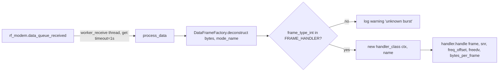

# Protocol frames, frame handlers and TX commands

This document describes the on-air frame formats used by the FreeDATA server, how received frames are
dispatched to handlers, and how transmit commands produce frames.

Scope:
[modem_frametypes.py](../modem_frametypes.py),
[data_frame_factory.py](../data_frame_factory.py),
[frame_dispatcher.py](../frame_dispatcher.py),
[frame_handler.py](../frame_handler.py) and `frame_handler_*.py`,
[command.py](../command.py) and `command_*.py`.

ARQ session, P2P connection and NORM state machines that consume these frames are covered in
[arq-sessions.md](arq-sessions.md).

---

## 1. Frame types

Defined in [modem_frametypes.py](../modem_frametypes.py) as `FRAME_TYPE(Enum)`. The numeric value is the
first byte of every frame (except `ARQ_BURST_ACK`, see [section 3.1](#31-the-headerless-arq_burst_ack)).

"TX mode" is the codec2 mode (`FREEDV_MODE` in [codec2.py](../codec2.py)) passed to `rf_modem.transmit()`
by the code that sends the frame. `signalling` has value 19 (alias `datac13`) and `signalling_ack` has value
20 (alias `datac14`).

| Name | Value | Purpose | Sent by | TX mode | Handler class |
|---|---:|---|---|---|---|
| `ARQ_STOP` | 10 | ISS asks IRS to stop the ARQ session | `ARQSessionISS.send_stop` (repeated by `transmit_stop_and_wait`) | `signalling` | `ARQFrameHandler` |
| `ARQ_STOP_ACK` | 11 | IRS confirms stop | `ARQSessionIRS.send_stop_ack` | `signalling_ack` | `ARQFrameHandler` |
| `ARQ_SESSION_OPEN` | 12 | ISS opens an ARQ session | `ARQSessionISS.start` | `signalling` | `ARQFrameHandler` |
| `ARQ_SESSION_OPEN_ACK` | 13 | IRS accepts/rejects the open | `ARQSessionIRS.send_open_ack` | `signalling` | `ARQFrameHandler` |
| `ARQ_SESSION_INFO` | 14 | ISS announces total length, CRC32 and data type | `ARQSessionISS.send_info` | `signalling` | `ARQFrameHandler` |
| `ARQ_SESSION_INFO_ACK` | 15 | IRS confirms info, returns resume offset and speed level | `ARQSessionIRS.send_info_ack` | `signalling` | `ARQFrameHandler` |
| `ARQ_BURST_FRAME` | 20 | ARQ payload chunk | `ARQSessionISS.send_data` | mode of current speed level (see [arq-sessions.md](arq-sessions.md#4-speed-level-and-bandwidth-adaptation)) | `ARQFrameHandler` |
| `ARQ_BURST_ACK` | 21 | IRS acknowledges a burst / final ACK | `ARQSessionIRS.receive_data` | `signalling_ack` | `ARQFrameHandler` |
| `P2P_CONNECTION_CONNECT` | 30 | Open a P2P connection | `P2PConnection.connect` | `signalling` | `P2PConnectionFrameHandler` |
| `P2P_CONNECTION_CONNECT_ACK` | 31 | Accept a P2P connection | `P2PConnection.connected_irs` | `signalling` | `P2PConnectionFrameHandler` |
| `P2P_CONNECTION_HEARTBEAT` | 32 | Keep-alive, carries HAS_DATA / ANNOUNCE_ARQ flags | `P2PConnection.transmit_heartbeat` | `signalling` | `P2PConnectionFrameHandler` |
| `P2P_CONNECTION_HEARTBEAT_ACK` | 33 | Keep-alive reply | `P2PConnection.transmit_heartbeat_ack` | `signalling` | `P2PConnectionFrameHandler` |
| `P2P_CONNECTION_PAYLOAD` | 34 | Small compressed payload inside a P2P connection | `P2PConnection.process_data_queue` | `signalling` (data <= 11 B) or `datac4` (12-32 B) | `P2PConnectionFrameHandler` |
| `P2P_CONNECTION_PAYLOAD_ACK` | 35 | ACK for a payload frame | `P2PConnection.received_data` | `signalling_ack` | `P2PConnectionFrameHandler` |
| `P2P_CONNECTION_DISCONNECT` | 36 | Close the P2P connection | `P2PConnection.disconnect` | `signalling` | `P2PConnectionFrameHandler` |
| `P2P_CONNECTION_DISCONNECT_ACK` | 37 | Confirm disconnect | `P2PConnection.received_disconnect` | `signalling` | `P2PConnectionFrameHandler` |
| `NORM_DATA` | 100 | Broadcast data burst | `NormTransmissionISS.transmit_bursts` | `datac4` | `NORMFrameHandler` |
| `NORM_NACK` | 101 | Request missing broadcast bursts | `NormTransmission.create_and_transmit_nack_burst` | `datac4` | `NORMFrameHandler` |
| `NORM_REPAIR` | 102 | Retransmitted broadcast burst | `NormTransmissionISS.transmit_bursts` (after `create_repair`) | `datac4` | `NORMFrameHandler` |
| `NORM_CMD` | 103 | Template only (`# FIXME`); `build_norm_cmd()` is `pass` | - | - | none (dispatcher logs "unknown burst") |
| `CQ` | 200 | General call | `CQCommand` | `TxCommand.get_tx_mode()` | `CQFrameHandler` |
| `QRV` | 201 | Answer to CQ | `CQFrameHandler.send_ack` | `signalling` | base `FrameHandler` |
| `PING` | 210 | Directed ping | `PingCommand` | `TxCommand.get_tx_mode()` | `PingFrameHandler` |
| `PING_ACK` | 211 | Ping reply | `PingFrameHandler.send_ack` | `signalling` | base `FrameHandler` |
| `BEACON` | 250 | Periodic station beacon | `BeaconCommand` | `TxCommand.get_tx_mode()` | `BeaconFrameHandler` |
| `IDENT` | 254 | Enum value only, no template, builder or handler | - | - | none |
| `TEST_FRAME` | 255 | Test transmission (type byte + zero fill) | `TestCommand` | `data_ofdm_500` (or `data_vhf_1`) | none (no template) |

`TxCommand.get_tx_mode()` returns `FREEDV_MODE.data_vhf_1` when `config["EXP"]["enable_vhf"]` is set,
otherwise `FREEDV_MODE.signalling`. Replies sent by frame handlers use `FrameHandler.get_tx_mode()`, which
always returns `signalling`.

Commented-out enum members: `MESH_BROADCAST` (100), `MESH_SIGNALLING_PING` (101),
`MESH_SIGNALLING_PING_ACK` (102), `IS_WRITING` (215), `FEC` (251), `FEC_WAKEUP` (252).

---

## 2. Frame construction (`DataFrameFactory`)

[data_frame_factory.py](../data_frame_factory.py) keeps one template per frame type in `self.template_list`
(an ordered `dict` of `field -> size in bytes`). `construct(frametype, content, frame_length)`:

1. If the template's `frame_length` is an `int`, the frame buffer has that size. Otherwise (dynamic frames)
   the buffer size is the `frame_length` argument minus 2. Burst and P2P payload builders pass
   `get_bytes_per_frame(mode)` (codec2 `bits_per_modem_frame / 8`), so the buffer is the mode's payload
   size without the CRC16.
2. Byte 0 is the frame type, except for `ARQ_BURST_ACK`, which starts at byte 0 with the first field.
3. Fields are copied in template order. A field whose size is not an `int` (`"dynamic"`) takes the length
   of the supplied content. Exceeding the buffer raises `OverflowError`.
4. Unused trailing bytes stay `0x00`.

The modulator ([modulator.py](../modulator.py)) then pads the frame to `bytes_per_frame - 2` and appends a
2-byte CRC16 from `codec2.api.freedv_gen_crc16`. This CRC is not part of the factory templates.

### 2.1 Field encodings

| Field (template key) | Size | Encoding when building | Decoding in `deconstruct()` |
|---|---:|---|---|
| frame type | 1 | `FRAME_TYPE.value` | `frame_type` (name) and `frame_type_int` |
| `origin`, `destination`, `domain` | 6 | `helpers.callsign_to_bytes()` (callsign + SSID packed into 6 bytes) | `helpers.bytes_to_callsign().decode()` -> `str` |
| `origin_crc`, `destination_crc` | 3 | `helpers.get_crc_24("CALL-SSID")` (CRC-24/OpenPGP) | `bytes.hex()` -> `str` |
| `total_crc` | 4 | `helpers.get_crc_32(data)` | `bytes.hex()` |
| `checksum` (NORM) | 3 | CRC-24 of the full broadcast payload | `bytes.hex()` |
| `gridsquare` | 4 | `helpers.encode_grid()` (6-char locator packed into 26 bits) | `helpers.decode_grid()` |
| `snr` | 1 | `helpers.snr_to_bytes()`: `int(clip(snr*10, -127, 127))`, signed | `helpers.snr_from_bytes()`: signed / 10 |
| `session_id`, `speed_level`, `frames_per_burst`, `version`, `protocol_version`, `type`, `burst_info`, `sequence_id` | 1 | `int.to_bytes(1, "big")` | `int` (big-endian), except `sequence_id` (stays `bytes`, it is not in the int list) |
| `maximum_bandwidth`, `payload_size` | 2 | big-endian int | `int` |
| `offset`, `total_length`, `timestamp` | 4 | big-endian int | `int` |
| `flag` | 1 | bit field (see 2.2) | `dict` of booleans for ARQ ACK, BEACON and P2P frames; raw `int` for NORM frames; empty `dict` for any other frame type (e.g. `ARQ_SESSION_INFO`) |
| `burst_numbers` | 8 | list of burst numbers zero-padded to 8 bytes | list with zeros removed |
| `data` | dynamic | raw bytes | `frame[pos:-2]` (everything up to the trailing CRC16) |
| `payload_data`, `id`, other | fixed | raw bytes | raw bytes |

### 2.2 Flag bits

`helpers.set_flag` / `helpers.get_flag` with these bit positions:

| Dict | Bit 0 | Bit 1 | Bit 2 | Used for |
|---|---|---|---|---|
| `ARQ_FLAGS` | `FINAL` | `ABORT` | `CHECKSUM` | `ARQ_SESSION_OPEN_ACK`, `ARQ_SESSION_INFO_ACK`, `ARQ_BURST_ACK` (decoded); `ARQ_SESSION_INFO` carries a flag byte that is always 0 and is not decoded |
| `BEACON_FLAGS` | `AWAY_FROM_KEY` | - | - | `BEACON` |
| `P2P_FLAGS` | `HAS_DATA` | `ANNOUNCE_ARQ` | - | `P2P_CONNECTION_HEARTBEAT`, `_HEARTBEAT_ACK`, `_PAYLOAD` |
| `NORM_FLAGS` | `LAST_DATA` | - | - | defined but unused. NORM frames use their own layout (see 2.3.5) |

### 2.3 Byte layouts

Offsets include the type byte at offset 0. The "Size" column is the buffer that `construct()` creates
(before modulator padding and CRC16).

`LENGTH_SIG0_FRAME = LENGTH_SIG1_FRAME = 14`, `LENGTH_ACK_FRAME = 3`, `LENGTH_NORM_FRAME = LENGTH_NORM_NACK_FRAME = 54`.

#### 2.3.1 Broadcast / ping frames (14-byte buffer)

| Frame | Layout (offset:size field) | Builder |
|---|---|---|
| `CQ` | 0:1 type, 1:6 origin, 7:4 gridsquare | `build_cq()` |
| `QRV` | 0:1 type, 1:6 origin, 7:4 gridsquare, 11:1 snr | `build_qrv(snr)` |
| `BEACON` | 0:1 type, 1:6 origin, 7:4 gridsquare, 11:1 flag | `build_beacon(flag_away_from_key)` |
| `PING` | 0:1 type, 1:3 destination_crc, 4:3 origin_crc, 7:6 origin | `build_ping(destination)` |
| `PING_ACK` | 0:1 type, 1:3 destination_crc, 4:3 origin_crc, 7:4 gridsquare, 11:1 snr | `build_ping_ack(destination, snr)` |

`origin` and `gridsquare` are always the local station (`STATION.mycall-myssid`, `STATION.mygrid`).

#### 2.3.2 ARQ frames

| Frame | Size | Layout | Builder |
|---|---:|---|---|
| `ARQ_SESSION_OPEN` | 14 | 0:1 type, 1:3 destination_crc, 4:6 origin, 10:1 session_id, 11:2 maximum_bandwidth, 13:1 protocol_version | `build_arq_session_open(destination, session_id, maximum_bandwidth, protocol_version)` |
| `ARQ_SESSION_OPEN_ACK` | 14 | 0:1 type, 1:1 session_id, 2:6 origin, 8:3 destination_crc, 11:1 version, 12:1 snr, 13:1 flag | `build_arq_session_open_ack(session_id, destination, version, snr, flag_abort)` |
| `ARQ_SESSION_INFO` | 14 | 0:1 type, 1:1 session_id, 2:4 total_length, 6:4 total_crc, 10:1 snr, 11:1 flag, 12:1 type (data type) | `build_arq_session_info(session_id, total_length, total_crc, snr, type)` |
| `ARQ_SESSION_INFO_ACK` | 14 | 0:1 type, 1:1 session_id, 2:4 offset, 6:1 snr, 7:1 speed_level, 8:1 frames_per_burst, 9:1 flag | `build_arq_session_info_ack(session_id, offset, snr, speed_level, frames_per_burst, flag_final, flag_abort)` |
| `ARQ_STOP` | 14 | 0:1 type, 1:1 session_id | `build_arq_stop(session_id)` |
| `ARQ_STOP_ACK` | 14 | 0:1 type, 1:1 session_id | `build_arq_stop_ack(session_id)` |
| `ARQ_BURST_FRAME` | `bytes_per_frame(mode) - 2` | 0:1 type, 1:1 session_id, 2:1 speed_level, 3:4 offset, 7:n data | `build_arq_burst_frame(freedv_mode, session_id, offset, data, speed_level)` |
| `ARQ_BURST_ACK` | 3 | 0:1 session_id, 1:1 speed_level, 2:1 flag (**no type byte**) | `build_arq_burst_ack(session_id, speed_level, flag_final, flag_checksum, flag_abort)` |

The available payload per burst is
`get_available_data_payload_for_mode(type, mode) = bytes_per_frame - 2 (CRC16) - 1 (type) - sum(fixed template fields)`,
which is `bytes_per_frame - 9` for `ARQ_BURST_FRAME`.

The `snr` parameter is ignored by `build_arq_session_open_ack`, `build_arq_session_info` and
`build_arq_session_info_ack`. All three encode the constant `helpers.snr_to_bytes(1)`, so the SNR byte on the
wire is always `0.1` dB.

#### 2.3.3 P2P connection frames

| Frame | Size | Layout | Builder |
|---|---:|---|---|
| `P2P_CONNECTION_CONNECT` | 14 | 0:1 type, 1:6 destination, 7:6 origin, 13:1 session_id | `build_p2p_connection_connect(destination, origin, session_id)` |
| `P2P_CONNECTION_CONNECT_ACK` | 14 | 0:1 type, 1:3 destination_crc, 4:6 origin, 10:1 session_id | `build_p2p_connection_connect_ack(destination, origin, session_id)` |
| `P2P_CONNECTION_HEARTBEAT` | 14 | 0:1 type, 1:1 session_id, 2:1 flag | `build_p2p_connection_heartbeat(session_id, flag_has_data, flag_announce_arq)` |
| `P2P_CONNECTION_HEARTBEAT_ACK` | 14 | 0:1 type, 1:1 session_id, 2:1 flag | `build_p2p_connection_heartbeat_ack(...)` |
| `P2P_CONNECTION_PAYLOAD` | `bytes_per_frame(mode) - 2` | 0:1 type, 1:1 session_id, 2:1 sequence_id, 3:1 flag, 4:n data | `build_p2p_connection_payload(freedv_mode, session_id, sequence_id, data, flag_has_data, flag_announce_arq)` |
| `P2P_CONNECTION_PAYLOAD_ACK` | 3 | 0:1 type, 1:1 session_id, 2:1 sequence_id | `build_p2p_connection_payload_ack(session_id, sequence_id)` |
| `P2P_CONNECTION_DISCONNECT` | 14 | 0:1 type, 1:1 session_id | `build_p2p_connection_disconnect(session_id)` |
| `P2P_CONNECTION_DISCONNECT_ACK` | 14 | 0:1 type, 1:1 session_id | `build_p2p_connection_disconnect_ack(session_id)` |

The `P2P_CONNECTION_PAYLOAD` template is assigned twice with identical content in
`_load_p2p_connection_templates()`.

#### 2.3.4 NORM frames

| Frame | Size | Layout | Builder |
|---|---:|---|---|
| `NORM_DATA` | 54 | 0:1 type, 1:6 origin, 7:6 domain, 13:4 gridsquare, 17:1 flag, 18:4 timestamp, 22:1 burst_info, 23:3 checksum, 26:2 payload_size, 28:26 payload_data | `build_norm_data(origin, domain, gridsquare, timestamp, burst_info, payload_size, payload_data, flag, checksum)` |
| `NORM_REPAIR` | 54 | same as `NORM_DATA` | `build_norm_repair(...)` |
| `NORM_NACK` | 54 | 0:1 type, 1:6 origin, 7:10 id (ASCII broadcast id), 17:8 burst_numbers | `build_norm_nack(origin, id, burst_numbers)` |
| `NORM_CMD` | 54 | 0:1 type, 1:6 origin, 7:4 domain, 11:1 flag | `build_norm_cmd()` is not implemented |

`domain` is 6 bytes in `NORM_DATA`/`NORM_REPAIR` but 4 bytes in the unused `NORM_CMD` template.

#### 2.3.5 NORM `flag` and `burst_info` bytes

Set in [norm/norm_transmission.py](../norm/norm_transmission.py), not in the factory:

| Byte | Bits | Meaning |
|---|---|---|
| `flag` | 7 | `is_last` (last burst) |
| | 6-3 | `NORMMsgType` (0 UNDEFINED, 1 MESSAGE, 2 POSITION, 3 SITREP, 4 METAR) |
| | 2-0 | priority (`NORMMsgPriority` 0 LOW ... 5 EMERGENCY) |
| `burst_info` | 7-4 | burst number (1-based) |
| | 3-0 | total bursts |

#### 2.3.6 Other builders

| Builder | Result |
|---|---|
| `build_test(mode)` | `bytes_per_frame(mode) - 2` buffer, byte 0 = `TEST_FRAME` (255), rest zero |
| `build_fec(mode, payload)` | references `FR_TYPE.FEC`, which is commented out in the enum (raises `AttributeError`) |
| `build_fec_wakeup(mode)` | references `FR_TYPE.FEC_WAKEUP` (commented out) |
| `build_fec_is_writing()` | references `FR_TYPE.IS_WRITING` (commented out) |

---

## 3. Frame reception and dispatch

[frame_dispatcher.py](../frame_dispatcher.py), class `DISPATCHER`.



* `start()` launches the daemon thread `"Receive Worker"` running `worker_receive()`. `stop()` sets
  `stop_event`.
* Each queue item is a dict with `payload`, `freedv`, `bytes_per_frame`, `snr`, `frequency_offset`,
  `mode_name`.
* Any exception in `worker_receive` (including from deconstruction or a handler) is caught and dropped
  silently (`except Exception: continue`).
* A **new handler instance** is created for every received frame.
* `FRAME_HANDLER` mapping:

| Handler class | Frame types |
|---|---|
| `ARQFrameHandler` ([frame_handler_arq_session.py](../frame_handler_arq_session.py)) | `ARQ_SESSION_OPEN`, `_OPEN_ACK`, `_INFO`, `_INFO_ACK`, `ARQ_BURST_FRAME`, `ARQ_BURST_ACK`, `ARQ_STOP`, `ARQ_STOP_ACK` |
| `P2PConnectionFrameHandler` ([frame_handler_p2p_connection.py](../frame_handler_p2p_connection.py)) | all `P2P_CONNECTION_*` (30-37) |
| `BeaconFrameHandler` ([frame_handler_beacon.py](../frame_handler_beacon.py)) | `BEACON` |
| `CQFrameHandler` ([frame_handler_cq.py](../frame_handler_cq.py)) | `CQ` |
| `PingFrameHandler` ([frame_handler_ping.py](../frame_handler_ping.py)) | `PING` |
| `NORMFrameHandler` ([frame_handler_norm.py](../frame_handler_norm.py)) | `NORM_DATA`, `NORM_NACK`, `NORM_REPAIR` |
| `FrameHandler` (base, no protocol action) | `PING_ACK`, `QRV` |

`get_id_from_frame()` is documented as unused.

### 3.1 The headerless `ARQ_BURST_ACK`

`deconstruct(frame, mode_name)` treats any frame received with `mode_name == "SIGNALLING_ACK"` as an
`ARQ_BURST_ACK` and prepends byte `21`, **unless** byte 0 equals `35` (`P2P_CONNECTION_PAYLOAD_ACK`). For
every other frame, byte 0 is read as the frame type.

Consequences:

* `ARQ_STOP_ACK` is sent in `signalling_ack` mode (`ARQSessionIRS.send_stop_ack`) with its type byte `11`.
  On reception it is parsed as an `ARQ_BURST_ACK` with `session_id = 11`.
* An `ARQ_BURST_ACK` whose `session_id` is `35` is parsed as a `P2P_CONNECTION_PAYLOAD_ACK`.

Other `deconstruct()` behaviour:

* A frame type that has no template (`IDENT`, `TEST_FRAME`) raises `AttributeError` (`None.items()`). A
  byte value not in `FRAME_TYPE` raises `ValueError`. Both exceptions are dropped by the worker, so the
  "unknown burst" warning only appears for `NORM_CMD`, the one type that has a template but no handler.
* It writes debug `print()` output for every frame and every int field.

---

## 4. Base `FrameHandler` lifecycle

[frame_handler.py](../frame_handler.py). `handle(frame, snr, frequency_offset, freedv_inst, bytes_per_frame)`
runs these steps in order:

| # | Step | Details |
|---|---|---|
| 1 | Store details | `self.details = {frame, snr, frequency_offset, freedv_inst, bytes_per_frame}` |
| 2 | Resolve origin from session | If the frame has no `origin` but has `session_id`, `state_manager.get_dxcall_by_session_id()` is used |
| 3 | Resolve origin from CRC | If there is still no `origin` but there is an `origin_crc`, `DatabaseManager.get_callsign_by_checksum()` is used |
| 4 | Location update | Calls `update_station_location` only if the frame has a `location` key with `gridsquare`. No frame template has a `location` field, so this branch never runs |
| 5 | Gridsquare fill-in | If `origin` is known, looks up the station in `DatabaseManagerStations`. If the frame has no `gridsquare`, it uses the stored one or `"------"` |
| 6 | Blacklist | If `STATION.enable_callsign_blacklist` is set: blocked when CRC-24 of origin equals CRC-24 of a list entry, or origin equals / starts with the entry. A blocked frame returns `False` and processing stops |
| 7 | `log()` | `"[Frame Handler] Handling frame <type>"` |
| 8 | `add_to_heard_stations()` | Only if `origin` is present. Computes distance to own grid via `maidenhead.distance_between_locators`, takes `away_from_key` from flags, calls `helpers.add_to_heard_stations(..., state_manager.heard_stations)` |
| 9 | `add_to_activity_list()` | `state_manager.add_activity({direction: "received", snr, frequency_offset, activity_type, origin?, destination?, gridsquare?, session_id?, away_from_key?})` |
| 10 | `emit_event()` | `event_manager.broadcast(make_event())`, see below |
| 11 | `follow_protocol()` | Subclass hook. The base implementation does nothing |

The base class does **not** de-duplicate frames. Repeated frames are handled again (ARQ/P2P sessions handle
repeats through their state tables and byte offsets).

The signal report comes from the demodulator's `snr` in the queue item. It is stored in `details["snr"]` and
used for heard stations, activity, the event, the `QRV` / `PING_ACK` replies and the auto-repeat check.
SNR values carried inside frames are only decoded into the frame dict.

`make_event()` produces:

```text
{type: "frame-handler", received: <frame_type name>, timestamp, mycallsign, myssid, snr: str(snr),
 dxcallsign?: origin, gridsquare?, distance_kilometers?, distance_miles?}
```

The `away_from_key` branch in `make_event()` checks `"flag" in self.details` rather than in the frame, so
`away_from_key` never appears in this event.

Helpers:

* `is_frame_for_me()` decides whether a frame is addressed to us:
  * `ARQ_SESSION_OPEN`, `ARQ_SESSION_OPEN_ACK`, `PING`, `PING_ACK`: `helpers.check_callsign(mycall-myssid, destination_crc, STATION.ssid_list)`.
  * `ARQ_SESSION_INFO`, `ARQ_BURST_FRAME`, `ARQ_STOP`: `session_id` in `state_manager.arq_irs_sessions`.
  * `ARQ_SESSION_INFO_ACK`, `ARQ_BURST_ACK`, `ARQ_STOP_ACK`: `session_id` in `state_manager.arq_iss_sessions`.
  * `NORM_DATA`: always true.
  * `P2P_CONNECTION_CONNECT`: computes CRC-24 of the frame's `destination`. If the socket interface has
    `socket_interface_callsigns` (set by `MYCALL`), it checks against each of them, otherwise against own
    `mycall-myssid`.
  * Other `P2P_CONNECTION_*`: `session_id` in `state_manager.p2p_connection_sessions`.
  * Anything else: false.
* `should_respond()` returns `is_frame_for_me()`.
* `transmit(frame)` calls `rf_modem.transmit(signalling, 1, 0, frame)`. If the module-level
  `TESTMODE = True`, it calls `event_manager.broadcast(frame)` instead.
* `check_for_queued_message()`: if `MESSAGES.enable_auto_repeat` is set and `snr >= -2`, it calls
  `DatabaseManagerMessages.set_message_to_queued_for_callsign(origin)`.

### 4.1 Handler subclasses (`follow_protocol`)

| Handler | Behaviour |
|---|---|
| `ARQFrameHandler` | Returns if `should_respond()` is false. For `ARQ_SESSION_OPEN`: if `session_id` is already an IRS session, it keeps the session in `NEW`/`OPEN_ACK_SENT`, resets `FAILED`/`ABORTED` to `NEW`, or calls `reset_session()` + `NEW` for `ENDED`. Otherwise it discards the open if `state_manager.check_if_running_arq_session()` (ISS sessions) is true, or creates `ARQSessionIRS(ctx, origin, session_id)` and registers it. INFO/BURST/STOP go to the IRS session (`get_arq_irs_session`). The ACK types go to the ISS session (`get_arq_iss_session`). If the lookup returns `None`, the frame is discarded with a warning. Then `session.set_details(snr, freq_offset)` and `session.on_frame_received(frame)` |
| `P2PConnectionFrameHandler` | Returns if `should_respond()` is false. For `P2P_CONNECTION_CONNECT`: if `session_id` is already in `state_manager.p2p_connection_sessions` (lost `CONNECT_ACK`, peer retries), that session is reused. Otherwise it creates `P2PConnection(ctx, origin, destination)`, overwrites `session_id` with the frame's, and registers it. Other P2P frames go to `get_p2p_connection_session(session_id)`. If that returns `None`, the frame is discarded with a warning. Then `set_details` + `on_frame_received` |
| `BeaconFrameHandler` | `DatabaseManagerBeacon.add_beacon(now, origin, snr, gridsquare)`, then `check_for_queued_message()` |
| `CQFrameHandler` | Returns if `state_manager.getARQ()` is set. Otherwise `send_ack()`: builds `QRV` with the received SNR, waits a random 0-5 s, waits up to 5 s on `channel_busy_condition_codec2`, then transmits. Then `check_for_queued_message()`. There is no `should_respond()` gate (the override is commented out) |
| `PingFrameHandler` | Requires `is_frame_for_me()` and not `getARQ()`. Sends `PING_ACK` via `build_ping_ack(frame["origin_crc"], snr)`, then `check_for_queued_message()` |
| `NORMFrameHandler` | Does not call `should_respond()`. `NORM_DATA` / `NORM_REPAIR` -> `NormTransmissionIRS(ctx, frame)`. `NORM_NACK` -> looks up the broadcast by `id`. If found, its `direction` is `"transmit"` (sent by this station) and `attempts < 30`, it increments attempts and transmits `create_repair(broadcast, burst_numbers)`. NACKs for broadcasts this station only received are logged and ignored. The NACK's sender is not checked |

`PingFrameHandler.send_ack()` passes the received `origin_crc` (a hex string) to `build_ping_ack`. That
builder runs `get_crc_24()` over its `destination` argument, so the `PING_ACK.destination_crc` on the wire
is a CRC of the hex string rather than of a callsign. `PING_ACK` is handled by the base `FrameHandler`,
which never calls `is_frame_for_me()`.

---

## 5. Transmit commands

### 5.1 Base `TxCommand` lifecycle

[command.py](../command.py). Commands are usually created and run by `enqueue_tx_command(ctx, cmd_class, params)`
in [api/command_helpers.py](../api/command_helpers.py). It instantiates `cmd_class(ctx, params)`, runs
`command.run` in `asyncio.to_thread`, and returns `True` if neither step raised (the return value of `run()`
is ignored). Exceptions are logged and return `False`, and the calling API endpoints then abort with 500.

| Stage | Method | Default behaviour |
|---|---|---|
| construct | `__init__(ctx, apiParams={})` | logger -> **`set_params_from_api(apiParams)`** -> `DataFrameFactory(ctx)` -> `ARQDataTypeHandler(ctx)` (the factory is created *after* params are parsed) |
| run | `run()` | `emit_event()` (no-op) -> `logger.info(log_message())` -> `transmit()` |
| transmit | `transmit()` | `frame = build_frame()` -> `rf_modem.transmit(get_tx_mode(), 1, 0, frame)` |
| frame | `build_frame()` | returns `None` (override) |
| mode | `get_tx_mode()` | `data_vhf_1` if `EXP.enable_vhf`, else `signalling` |
| test | `test(event_queue)` | emits, logs, returns `build_frame()` without transmitting |
| helpers | `make_modem_queue_item(mode, repeat, repeat_delay, frame)`, `log()`, `get_name()` | |

### 5.2 Commands

| Command (file) | Invoked from | API params read | Frames / action |
|---|---|---|---|
| `ARQRawCommand` ([command_arq_raw.py](../command_arq_raw.py)) | `POST /send_arq_raw` ([api/modem.py](../api/modem.py)) | `dxcall` (`-0` appended if not a valid FreeDATA callsign), `type` (`ARQ_SESSION_TYPES` name, `KeyError` -> `raw`; the endpoint only allows `raw`, `raw_lzma`, `raw_gzip`), `data` (base64) | Overrides `run()`: random 0-5 s wait, waits up to 5 s on `channel_busy_condition_codec2`, `arq_data_type_handler.prepare(data, type)`, creates `ARQSessionISS`, registers it and calls `start()` (sends `ARQ_SESSION_OPEN`...). Returns the ISS or `False` |
| `BeaconCommand` ([command_beacon.py](../command_beacon.py)) | `POST /beacon`, `ScheduleManager` (every 600 s) | none (uses `state_manager.is_away_from_key`) | `BEACON` |
| `CQCommand` ([command_cq.py](../command_cq.py)) | `POST /cqcqcq` | none | `CQ` |
| `SendMessageCommand` ([command_message_send.py](../command_message_send.py)) | `POST /messages` ([api/freedata.py](../api/freedata.py)), `ScheduleManager.check_for_queued_messages` (every 15 s, passes a DB message dict and calls `transmit()` directly) | `MessageP2P.from_api_params` fields: `destination`, `body`, optional `attachments`, `id` | `set_params_from_api` stores the message in the DB with `status="queued"`. `transmit()`: returns if `getARQ()` or no modem; loads the **first queued message** from the DB; random 0-9 s wait; waits while a codec2 signal is received; listens for 10 s and returns if a signal appears; sets status `transmitting`; JSON -> `prepare(..., p2pmsg_zlib)` -> `ARQSessionISS(ctx, message.destination, ...)`. Destination and payload both come from the same (first queued) message |
| `Norm` ([command_norm.py](../command_norm.py)) | `POST /broadcasts` | `origin`, `domain` (`-0` appended if invalid), `data` (base64, truncated to 15 x 26 = 390 bytes), `priority` (default 1), `type` (`NORMMsgType` name), `gridsquare` | Returns `False` unless `EXP.enable_groupchat`. Starts a thread running `NormTransmissionISS.prepare_and_transmit_data(...)` (`NORM_DATA` bursts). Always returns `False` |
| `P2PConnectionCommand` ([command_p2p_connection.py](../command_p2p_connection.py)) | socket interface `CONNECT` | `origin`, `destination` (`-0` appended if invalid) | `run()`: `P2PConnection(ctx, origin, destination)`, registers it, `connect()` (sends `P2P_CONNECTION_CONNECT`). Returns the session or `False`. `connect()` on the command is an empty placeholder |
| `PingCommand` ([command_ping.py](../command_ping.py)) | `POST /ping_ping` | `dxcall` (`-0` appended if invalid). Also calls `DatabaseManager.get_or_create_station(dxcall)` | `PING` |
| `TestCommand` ([command_test.py](../command_test.py)) | `POST /send_test_frame` | none | `TEST_FRAME` in `data_ofdm_500` (or `data_vhf_1`) |
| `TransmitSine` ([command_transmit_sine.py](../command_transmit_sine.py)) | `/tune` in [api/radio.py](../api/radio.py) | none | Overrides `transmit()` with `rf_modem.transmit_sine()`. No frame |

`rf_modem.transmit(mode, repeats, repeat_delay, frames)` is the common sink. ARQ and P2P sessions call it
with `(mode, 1, 1, frame)`, NORM calls it with `(datac4, 1, 200, burst)`, and commands and handlers call it
with `(mode, 1, 0, frame)`.
